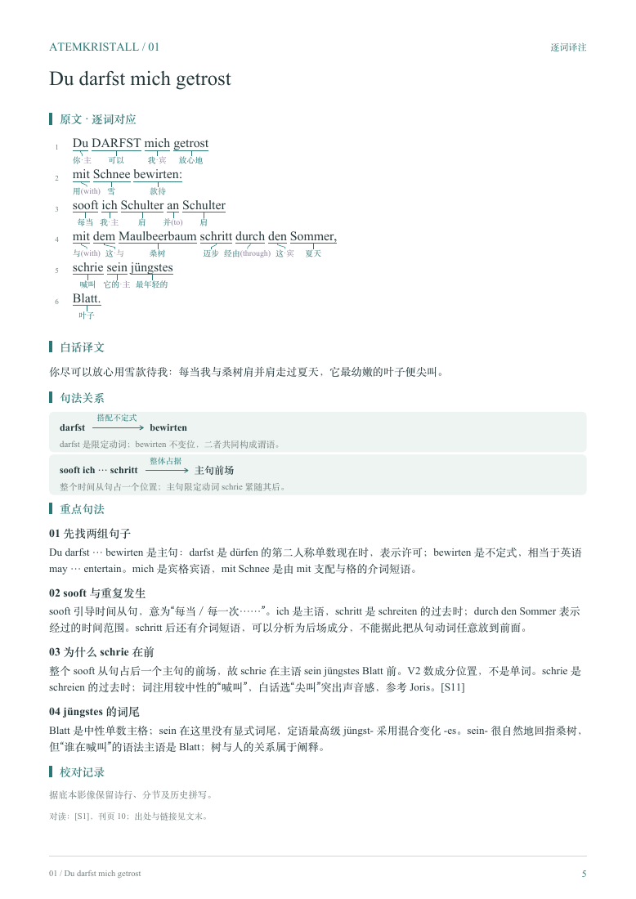

# 逐词读本编纂指南

编纂方法整理：Letter Lai 与 Codex  
独立指南版本：v1.0 · 2026-10-13  
形制依据：《策兰〈呼吸结晶〉21首逐词译注读本》v2.0 的最终成稿。

本指南可以单独用于一本新读本。**同一语言的新作者、新诗集，默认复用已有语法手册，不把重编手册列为读本的交付条件。** 例如编写里尔克、特拉克尔或布莱希特读本时，可引用现有德语手册的适用章节；少量未覆盖问题在本读本说明即可。只有明确决定新编或系统修订手册时，才另启动语法手册项目。

这份方法首先记录读本的形制经验：读者应能从原文迅速找到词义与语法提示，再转向连贯的中文理解；页面应安静、清楚，并保有诗行和诗节的节奏。下列规格来自当前成稿，可作为试排起点，不能不经检查地套用到所有语言与纸张。

## 1. 五个阅读层次，各有自己的任务

| 层次 | 读者在这里得到什么 | 编辑边界 |
|---|---|---|
| 原文 | 诗行、节奏、标点、分节与词语的排列 | 保留采用底本，不为词注的长度拉大原文词间距 |
| 逐词中文 | 这个词在此处的基本意义，以及必要的形态提示 | 简短、贴词，不提前替整句完成翻译 |
| 白话译文 | 连贯的意义与句子、从句、插入语的展开 | 允许句内疏通，保留句间次序，不把所有语法标记搬入译文 |
| 句法关系与重点说明 | 支配、修饰、回指、动词配对，以及歧义的证据 | 解释词注难以承载的关系，不在词下堆成长注 |
| 校对记录与出处 | 原文采用何种读法、译义怎样选择 | 区分底本事实、编辑改动与解释，供需要时回查 |

逐词层与白话层不是长短不同的同一份译文。例如 jüngstes 在词注中用“最年轻的”，白话可用“最幼嫩的”；Silberglanz 词注为“银色光泽”，白话可用“银光”。读者能据词注检查原文，又能据白话读通句意。两层有侧重，但不能互相矛盾。

## 2. 颜色编码：让词义与语法辅助信息一眼可分

| 信息 | 当前颜色 | 使用方式 |
|---|---|---|
| 原文、白话与主要正文 | 深墨色 `#24383B` | 主阅读层，保持清晰对比 |
| 中文基本词义、词下引线、栏目标题 | 低饱和青绿 `#2A7775` | 引导视线，不盖过原文 |
| 词注中的格标记、括号英文、方括号及构词分隔符 | 淡紫 `#8B7D99` | 标为辅助信息，与词义主体区分 |
| 白话中必要的“（指……）” | 灰紫 `#7B7087` | 显示编者补充，不伪装成原文的一部分 |
| 页下注明、行号及次要说明 | 灰色 `#6F7C7B` | 退居次层，仍须能读清 |
| 句法关系卡片底色／页脚细线 | `#EDF4F1`／`#CCDAD5` | 轻微分区，不形成沉重表格边框 |

淡紫表示“语法及结构辅助层”，并非每一种语法意义都另分一种颜色：主、属、与、宾仍用文字区分。`[掀` 和 `起]` 中，仅方括号用淡紫，词义用青绿；“生命|山”也只把分隔符染为淡紫。英文括注整体使用辅助色。

重要区别要同时有文字或符号，不能只靠颜色。黑白阅读时仍应辨认 `·主`、`(with)`、`[`、`]` 和 `|`。换用新字体、屏幕或纸张后，应重新检查浅色小字的可读性；不把未经实物打样的屏幕效果称为已验证的印刷效果。

## 3. 逐词对应：短引线、自然词距、稳定行距

原文按正常词间距排。下方中文按自身宽度紧凑安排；较宽词注可小幅横向错开，通过引线找回对应词，不要把原文单词推得很远。

本次词下引线去掉箭头，仅用细线连接词与注释。词下短横线提供对应范围，接近两端的短竖线使落点清楚；尽量避免长斜线、相交与难以判断归属的落点。中文向引线靠近，使原词与词注形成一组。

句法关系卡片中的方向箭头承担“谁指向谁”的任务，可以保留；它与逐词对应线的功能不同。卡片端点、箭头及线上标签应紧凑，完整解释另放下方。

全书原文采用稳定的行距。遇到长注释，依次考虑：删去冗词、把解释移到重点说明、调整中文横向位置；仍无法容纳，再试排受控的注释换行或续页。不要用越来越长的引线、越来越小的字或忽大忽小的原文行距解决局部问题。当前成稿的词注为单行，不能把未来可选的换行方案误记为既有设计。

## 4. 诗节、栏目与分页：让空白表达结构

诗节间留出明显空白，不能只靠一行末尾的标点提示分节。“原文 · 逐词对应”标题与首行间也需要呼吸空间；缩短词与注之间的距离，不等于压缩标题与正文的距离。

一首诗的页面顺序通常是：原文与词注 → 白话译文 → 句法关系 → 重点句法 → 校对记录。较长说明可以移到续页，保留题目和诗号，避免强塞到第一面。本次每首控制在一至两页，是这一组选诗的结果；未来长诗不必硬套页数上限。

目录、页码、附录跳转和书签属于阅读形制。附录也应在目录可达。英文对照采用双栏、每首尽量完整；诗间留白明显，标题及译者信息不必每页重复。不要为了减少空白而改变原诗断行。

### 成稿样页

图为读本 v2.0 的 PDF 第 5 页（第 1 首），用于保存实际的页面层次和空白关系。网页缩放显示仅供形制参照，小字与颜色应在原 PDF 中放大核对。

## 5. 当前成稿的排版参数

以下从最终排版设置核对，单位为 pt（1 pt = 25.4/72 毫米）。参数是样章的起点，重点在比例和功能。

| 项目 | 当前参数 |
|---|---|
| 纸张／左右页边距 | A4；各 46 pt，约 16.2 mm |
| 原文拉丁字 | Times New Roman，12.1 pt |
| 中文字形 | Songti，标题／强调使用相应粗体 |
| 中文词注 | 7.6 pt，注释行框 9 pt |
| 每组原文与词注的重复间距 | 29 pt，约 10.2 mm |
| 诗节间额外留白 | 21 pt，约 7.4 mm，加在正常行组间距之外 |
| 相邻中文注释最小水平间隔 | 4 pt，约 1.4 mm |
| 词下引线 | 0.42 pt，无箭头；词下注释在既有位置上向引线靠近约 1 mm |
| “原文 · 逐词对应”标题后的额外留白 | 在栏目常规间距之外增加 10.25 pt，约 3.6 mm；不是标题至正文的总距离 |
| 白话与主要说明 | 10.1 pt，行距 15.3 pt |
| 句法关系 | 两端词组 9.3 pt，关系标签 7.5 pt，下方说明 8.3 pt；箭头与两端词组各留 6 pt |

字号、纸张和字体共同决定密度。未来可选择具备相近阅读气质的字体，不自动把版式替换为无衬线；字体能否嵌入以及具体字符是否齐全需要单独检查。英文附录的 Minion 字体属于附录样式，不与主读本的 Times New Roman 混为一项规范。

## 6. 复用已有语法手册

先记录所用手册的名称、版本和链接，按新读本实际问题列一张“语法问题 → 手册章节”的索引。明确复用哪些规则，不因已有手册以策兰命名便假设所有新诗例已经讲过。

| 新读本遇到的情况 | 处理方法 |
|---|---|
| 已有手册覆盖 | 引用该版本的章节，在本诗说明具体怎样应用 |
| 只有少量未覆盖构式 | 在本诗或读本末尾补充短说明，不必新增整本手册 |
| 发现已有手册明确错误 | 记录勘误，按需要另作手册修订；新读本给出正确分析和所引版本 |
| 需要另一种语言或系统补充大量规则 | 另立手册项目，使用独立的语法手册编纂指南 |

新读本可单向引用已有手册，无须为了加入新诗例而重新发布旧手册。只有实际修订旧手册时，才补其反向索引并更新版本。新读本定稿不以旧手册同步重编为条件。

## 7. 开始之前先确定六件事

| 项目 | 应明确的内容 |
|---|---|
| 读者 | 面向中文母语者；需要哪些语言基础；是否使用英语辅助提示 |
| 作品范围 | 一个诗集、一个组诗或明确的选篇清单；篇序依据 |
| 底本 | 作者、书名、编者／译者、出版社、年月、版次、页码；取得何种影像或文本 |
| 对读资料 | 异版本、词典、语法书、已有译本，各自承担什么核查用途 |
| 成果 | 读本的 Markdown、PDF，以及可选的对照译本附录；记录复用手册，不默认新编手册 |
| 编辑约定 | 历史拼写、大小写、诗行、标点、符号、歧义、版本号如何处理 |

先选 2—3 首有代表性的诗做样章：一首较清晰，一首含复杂句法，一首含造词或省略。用样章确定信息密度和版式后，再扩展全书。选篇较多时，以批次校对，避免未解决的标注问题复制到整部书。

## 8. 先建立可靠的文本，再做解释

### 8.1 记录来源的作用

为每个来源分配固定编号，写清书目、页码、链接及实际查阅范围。例如：底本照片用于转录和断行；另一刊本用于对读；词典用于词义；语法资料用于规则；译本用于检验理解。不要把没有读过的版本写成已经核校的依据。

OCR 和文本抽取只能作为初稿。易混字母、变音符号、连字、长短横线、词末标点，以及跨页处，都应回到影像核查。区分原诗、页上引诗、注释和编辑说明，防止把旁引的诗句并入正文。

### 8.2 分开保存三个层次

1. **底本转录**：忠实记录看到的字形、标点、诗行和分节。
2. **读本采用文本**：经过校勘决定后实际排入读本的文本。
3. **校勘记录**：列出两者有意义的差异、采用理由和证据。

拼写差异、作者异文、印刷错误、OCR 错误、编辑改译，应分别记录。“看起来不像一个词”只是核查线索，不能单独作为改字依据；不确定时保留疑点。

本次策兰项目采用 Himmelsmünze，并把正文和各译注层统一为“天币”；旧读 Himmelssäure 保留在说明中。此类改动必须能追溯到校勘决定，不能仅凭中文更顺而更换原文。

### 8.3 诗行与词法单位分别记录

诗行不是句子，印面上的一个片段也未必是一个完整词。原作跨行拆词应保留断行，同时在分析中恢复完整词。可分动词的分离、复合词的组成、单纯的排字断词，是三个不同问题。

底本的字形差异若保留，应说明其性质，不赋予未经证实的诗学意义。历史拼写是否现代化须全书统一约定，不可边读边随意更改。

## 9. 每首诗建立一份可追踪的编辑记录

不必一开始就建立复杂数据库，但至少把下列信息分开保存：

| 字段 | 用途 |
|---|---|
| 作品标识、诗号、题目／首行 | 稳定定位，不因分页改变 |
| 底本及页码 | 回查原文 |
| 诗节、诗行、原文词项 | 保留空间组织与对应关系 |
| 词典形式、当前词义、形态说明 | 防止把词面、基本形式和上下文意义混为一谈 |
| 跨行合词／可分动词配对 | 把分开的部分连接起来 |
| 句法关系 | 谁支配谁、谁指向谁、哪些成分处于同一层级 |
| 中文白话译文 | 独立于逐词注释的连续阅读层 |
| 来源、异文、争议和决定 | 区分事实、推断与编辑选择 |
| 校对状态 | 已核原文／已核语法／已校译文／已验版面 |

以后若自动排版，建议由同一份结构化内容生成 Markdown 与 PDF，颜色、引线和字体由排版层处理。不要把颜色代码当作词义数据，也不要只修改生成的 PDF。

**当前策兰两册的仓库版本是已校定成果快照。** 当前读本的 Markdown 由编排程序生成，手册的 Markdown 则参与生成 PDF；仓库初次入库不包含这套本地排版程序。未来恢复自动生成时，应先明确每册的唯一内容来源，再迁移为统一流程，避免 PDF 与 Markdown 各改各的。

## 10. 逐词注释：贴近本义，同时对这一句负责

### 10.1 基本词义和白话表达分层

逐词注释尽量短、直接，不替相邻词提前完成整句翻译，也不把诗意解释塞入一个词下。白话层可以更自然，但两层应能相互追溯。

| 本次采用的区分 | 编辑目的 |
|---|---|
| jüngstes：词注“最年轻的”；白话“最幼嫩的” | 基本义与语境表达分开 |
| schrie：词注“喊叫”；白话“尖叫” | 词注保留较中性的范围 |
| Mund：词注“口” | 不把位置关系预先揉进名词 |
| Silberglanz：词注“银色光泽”；白话“银光” | 词注保留构成意义，译文允许凝练 |
| heranwachen：词注“靠近\|醒来”；白话“向着你逐渐醒来” | 构词提示与诗句的解释性译法并列保留 |

这些是本项目的决定，不是要求未来每首诗都使用同一个中文对译。尤其 heranwachen 的“逐渐”属于本项目采用的译法，不能据此把 heran- 普遍释为时间上的渐进。

### 10.2 介词、冠词和其他功能词

先判断它在句中的功能，再选择中文提示。避免把所有介词都译成“走向、穿过、依靠”等带完整动作的表达，以免读者误认原文多出一个动词。

保留中文意义，必要时括注英文近似词，例如“用(with)”“向(to)”。英文只作当前构式的提示，不宣称两种语言存在固定一一对应。冠词的“这”也只是辨识用的简注，不要求白话译文逐个译出。

一个词若承担多种语法功能，应在词表分项。如介词 zu、不定式标记 zu、动词粒子 zu，不能合并成一个“去”。功能词表以查读需求为准，兼顾构式、支配与例句。

### 10.3 形态标记要准确而节制

德语版使用“主、属、与、宾”等简写；冠词、人称代词和物主限定词在有助于辨认关系时标格。物主词的词干表示所属者，词尾随所在名词短语变化，不能因为汉语译为“……的”便判为属格。

形式同形时先看句法；句法仍不能确定，才标“主/宾”等可能项。不要把自己的不确定直接变成文本的固有歧义，也不要为整齐强行排除真实歧义。

词下仅放最有帮助的标记，完整分析放在句法注释或手册中。词义、形态、回指提示用不同的视觉层次，但不能只靠颜色传达重要区别。

### 10.4 复合词和可分动词

原文不额外加入拆分符号。中文注释仅在构词确有阅读价值时使用半角 `|`；常规词直接给整体词义，如“桑树”“颧骨”。造词的组成宜使用完整中文词，例如“天空|钱币”。连接成分不必人为分配独立词义。

可分动词的分离部分可用配对方括号显示，如 wirft `[掀`、auf `起]`。仅因跨行拆开的普通词不用这种括号。方括号、分隔符、英文提示和格标记作为辅助信息统一配色，词义保持主注释色。

## 11. 白话译文：读得通，也看得出原句怎样展开

保留句子、从句和插入语之间的次序。句内语序、可分动词和中文不自然的搭配可作必要疏通，但不要提前交代原诗后置的信息，也不要把从句全部拆成失去关系的陈述句。

保留代词及其结构作用。只有中文确实会产生额外歧义、且原文所指有依据时，才补“（指‘词’）”之类提示。显而易见的指代不逐个加括号；原作有意开放的所指不替作者决定。

逐句反查四个问题：

1. 中文是否多出原文没有的主体、动作、因果或时间顺序？
2. 是否漏掉否定、语气、数量、比较、重复或从属关系？
3. 插入语仍修饰原来的对象吗？关系从句还连着原来的先行词吗？
4. 为了通顺补出的内容，是否需要说明为编辑补充？

名词片段和省略不必全部补成完整句。若保留冒号或片段结构，语法说明也必须如实描述，不能沿用旧稿“译文补出了‘是’”之类已经失效的说明。

## 12. 句法说明：把关系写具体

每条先说具体关系，再提供词形证据和必要限度。例如说明某代词是某动词的宾语、某介词支配某名词短语，而不只写“这里很复杂”“构成张力”。

关系图中的两个端点、连接线和说明应形成紧凑的阅读单位；过长标签移入下面的短句。遇到名词片段、同位结构或多种复原方案，分别标出“词形能确定什么”和“解释尚可怎样选择”。

注释宜分成词形、句法、词义、版本四类问题来审读，但页面不必机械设四个栏目。说明中引用的原词必须与本页采用文本一致。

## 13. 扩展到其他语言时，重设哪些部分

下表是后续立项的核查重点，具体规则与例句仍须查阅该语言的可靠资料；不能把德语格标记整套复制过去。

| 方向 | 优先核查和设计的标注内容 | 可沿用的部分 |
|---|---|---|
| 布莱希特、特拉克尔、里尔克等德语诗人 | 作品各自的版本、语域、缩略和句法；哪些现有规则适用，哪些需新增诗例 | 德语基本术语、格和句框的辨认方法、索引框架 |
| 英语诗歌 | 代词形式、时态与体、情态、助动词、省略、倒装及短语动词；是否仍需要英文括注 | 词义与白话分层、诗行保留、关系图、校勘记录 |
| 夏尔、博纳富瓦等法语诗歌 | 省音与缩合、性数配合、代词及其位置、时态语气、分词、否定、省略和指代 | 底本与译本分开、逐词对应和构式说明、歧义处理 |
| 洛尔迦等西班牙语诗歌 | 动词人称、主语省略、时态语气、代词位置与功能、性数配合、介词构式 | 逐诗读本与专题手册配套、普通例句与诗例对照 |

“逐词”允许一个印面词对应多个语法成分，也允许几个词共同构成一个需要整体提示的表达。记录原文边界与分析边界；不要为了表格齐整删去省音符、拆坏缩合词，或把构式意义硬塞给其中一个词。

对作者风格的判断也应来自选定作品和资料，不在开工前就把“晦涩”“口语化”等印象变成整套译法。

## 14. 已有译本怎样参与编纂

先独立分析原文，再用已有译本核查句法理解和词义选择。遇到差异，列出各译本实际怎样处理，返回原词与语境判断；译本之间意见相同，也不能代替原文证据。

重排译本附录时，记录译者、来源、页码及编辑改动。区分单纯改错字和主动改译。本次英译附录把 heavenacid 改为 heaven-coin，是与所采用德语异文相配的编辑改译；life-mountain 的连字符和 flag 的排字校正也单独列明。

附录说明置于译文之后，可以先让读者连续读诗，再了解使用方法和改动。没有明确编辑决定的措辞、标点和诗行，依来源保留。

## 15. 校对按层次进行，最后再通读

| 轮次 | 核查内容 | 完成依据 |
|---|---|---|
| 原文校对 | 逐字、逐行、分节、标点、篇序和版本差异 | 与底本影像核对，疑点有记录 |
| 词注校对 | 漏词、多译、复合词、功能词、形态和符号 | 每个原词均可追踪到注释或处理说明 |
| 语法校对 | 支配、一致、回指、从句层级、可分动词、语气 | 结论有词形或句法依据，规则有出处 |
| 译文校对 | 语义、关系、次序、中文歧义、过度补足 | 可逐句反查原文，解释选择已说明 |
| 全书一致性 | 同一词项、术语、来源、索引、版本与署名 | 多层内容同步，交叉引用落点正确 |
| 版面校对 | 引线、行距、表格、页边距、字体、附录、导航 | 渲染后目视检查，不能只读抽取文本 |
| 定稿通读 | 旧注释是否仍描述新译文，是否出现修订回退 | 明确错误修正，合理译法分歧不反复重写 |

自动检查适合发现漏词、无效链接、缺字、未嵌入字体和边界溢出；它不能判断一首诗是否译得恰当。缩略总览用于发现异常分页，详细页面用于查文字和线条。修订后重点复查受影响页面及其前后页；若改变全局版式，则重新检查全书。

每次定稿写清本轮究竟做了什么。不要把检查脚本通过写成“绝无错误”，也不要把一次局部修正表述为完成了新的权威校勘。

## 16. GitHub、版本和交接

按语言、作者、作品建立目录；方法指南和模板放在共用目录。收录 Markdown、PDF 及 Markdown 实际引用的图片，使用仓库内相对路径。原始照片、字体、参考文献全文和临时渲染图不因本地存在就全部上传。

每册独立标版本；仓库可以有一个包含多册版本的快照标签。大范围结构或编辑原则改变再提升主版本，小范围增补及纠错记入修订记录。已发布的旧标签保持可追溯，下一轮在新提交中修改。

明确每种内容的署名和来源，不给包含原诗、已有译文及外来图片的整个仓库直接套用统一开放许可。当前仓库为私有资料库；以后若公开，应逐项核对收录范围与授权状态。

交接时至少留下：当前正式版本、目录结构、未决问题、构建方式是否可用、已完成的校对范围，以及不得被后续修改误删的编辑决定。

## 17. 新读本起始任务

> 为［作者／作品范围］编写中文辅助的［语言］逐词译注读本，复用［已有语法手册名称、版本和链接；暂无则说明］，本次不默认新编语法手册。依本指南先核定底本、篇序及编辑约定，用 2—3 首制作样章。重点沿用原文、词注、白话和句法说明的功能分层，以及辅助色、短引线、稳定行距和清晰分节。词注贴近本义，白话疏通句内表达并保留从句与插入语的次序。按目标语言调整标注。完成文字校对和 PDF 目视校对后，提交读本 Markdown、PDF、必要图片、来源、语法查阅索引与修订记录。

底本缺失或篇序未定时，先记录缺口，不能凭记忆补诗。每轮新决定写回项目编辑记录，使后续工作不依赖聊天历史。
