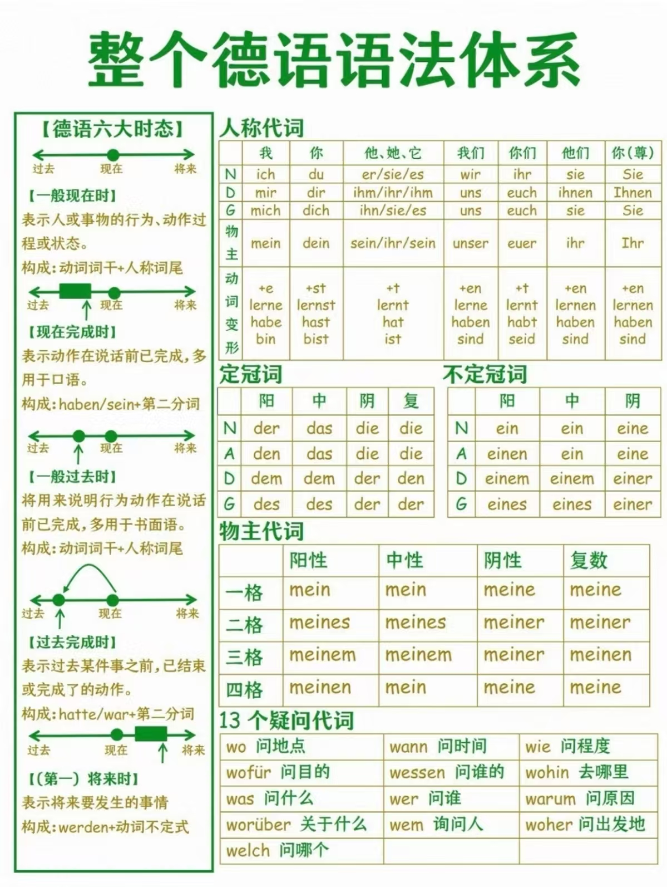
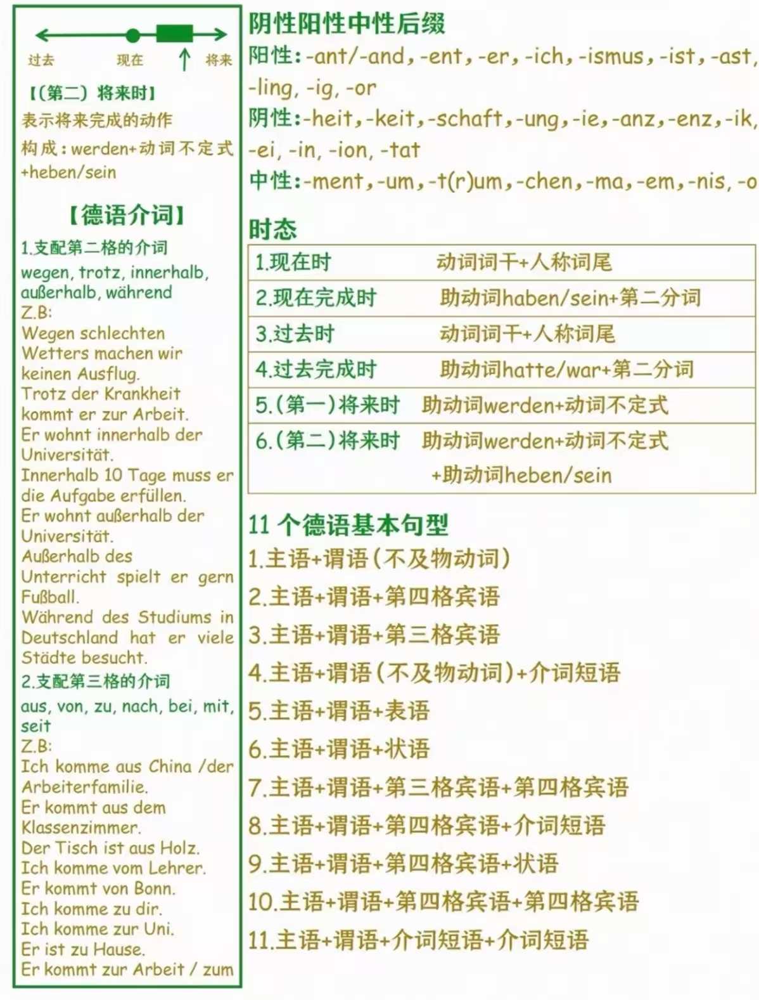

# 策兰《呼吸结晶》德语语法阅读手册

**从词形到句法：中文解释 · 德语例句 · 英语对照**

编写日期：2026年10月12日；版本：v2.1；修订日期：2026年10月14日。

本手册以德语语法为组织主线，结合策兰《呼吸结晶》的诗句与日常例句，说明词形、格与句法结构。诗例用于展示规则在文学语言中的运用；日常例句为教学例句，中文译文侧重呈现语法关系。逐首译注可参阅配套《21首逐词译注读本》v2.0；附录 D.2 标出常用诗例的诗号，读本的语法索引则指向本手册章节。

## 编写与版本说明

### 署名

编写与校订：Letter Lai (laiyutao2004@gmail.com)  
德语诗例：Paul Celan（保罗·策兰）；补充诗例：Rainer Maria Rilke（赖内·马利亚·里尔克）

### 诗例底本

汉斯-格奥尔格·伽达默尔著，陈早译：《谁是我，谁是你？：伽达默尔谈策兰〈呼吸结晶〉》，上海：上海文艺出版社，2022 年 11 月第 1 版、第 1 次印刷。ISBN 978-7-5321-8434-7。  
本手册所引《呼吸结晶》诗句以该书德语文本为基础，并参照配套读本的校对记录。陈早为上述底本书籍的译者；本手册的中文语法说明与教学例句另行编写。补充诗例《天鹅》取自里尔克《新诗集》（1907），出处见附录 E。

### 编写范围

本手册按德语语法主题组织，以诗句与日常例句说明词形和句法。规则核查主要依据 IDS grammis、Duden 等资料，完整出处见附录 E。逐首原文、词注、白话译文及 Pierre Joris 英译见配套读本。

### 使用与版权

© 2026 Letter Lai。本项目原创译注、语法讲解及编排供个人非商业学习使用。未经书面许可，不得商用、转载、重新发布或另行分发；依法允许的使用及平台条款另有规定的除外。原诗、既有译文、录音等第三方内容的权利归各自权利人，本说明不授予其使用许可。

### 版本与配套

版本：v2.1  
初编日期：2026-10-12  
修订日期：2026-10-14  
配套书：《策兰〈呼吸结晶〉21首逐词译注读本》v2.0。

## 使用说明与目录

**查词尾，先找所属短语；查语序，先找限定动词；查代词，分别找先行词和格的来源。** 这三项操作贯穿全书。

正文使用传统教学术语，同时在必要处说明其他分析方式。四格统一按第一格、第二格、第三格、第四格排列；少数词典采用主格、宾格、与格、属格的顺序，查表时应看名称，不要只记行号。

| 标记 | 本书用法 |
|---|---|
| Nom. / Gen. / Dat. / Akk. | 主格 / 属格 / 与格 / 宾格 |
| m. / f. / n. / Pl. | 阳性 / 阴性 / 中性 / 复数 |
| `[……]` | 分析者划出的成分边界，或明确标出的补足 |
| `…` | 为讨论而略去的原文，不代表诗人原有省略号 |
| `*` 置于例句开头 | 在所讨论的标准结构中不成立 |
| 语法事实 | 词形、支配、基本句法关系能够支持的判断 |
| 分析选择 | 在多个可行句法描述之间作出的选择 |
| 诗学提示 | 语法没有单独证明的意义联想或解释 |

本书尽量用熟悉的英语语法术语帮助定位概念；重要术语在正文首次讲解时对照，附录D.3另按英文字母排序，便于从英语术语反查。英文对照用于搭桥，不表示两种语言逐词等价。例如英语 *me* 可以对应德语 *mich* 或 *mir*；英语 *to* 可以对应介词，也可以是不定式标记。

### 正文章节

1. [词类、短语与句子成分](#ch01)（含1.5-1.8：词类、功能与词形的集中对照；1.9：大小写规则）
2. [性、数、格：名词短语的基本坐标](#ch02)
3. [冠词、限定词与指示形式](#ch03)
4. [人称、物主、反身代词](#ch04)
5. [配价与格支配：动词怎样组织参与者](#ch05)
6. [动词变位、限定与非限定形式](#ch06)
7. [主句、从句与 V2、V1、动词末位](#ch07)
8. [拓扑场与句子框架](#ch08)
9. [可分动词、情态动词与不定式结构](#ch09)
10. [关系从句与关系代词](#ch10)
11. [被动语态与状态表达](#ch11)
12. [虚拟式、命令式与语气](#ch12)
13. [否定、范围与常见小词](#ch13)
14. [分词：动词性质与形容词性质](#ch14)
15. [形容词强、弱、混合变化](#ch15)
16. [名词化与省略名词](#ch16)
17. [介词、双格介词与代词副词](#ch17)
18. [复合词、派生与词形缩略](#ch18)
19. [省略、插入语、跨行与标点](#ch19)
20. [句法拆解流程与综合示范](#ch20)

附录：[A 速查表](#appendix-a) · [B 易错点校正](#appendix-b) · [C 自检练习与答案](#appendix-c) · [D 索引](#appendix-d) · [E 原文与参考资料](#appendix-e) · [F 虚词分类速查表](#appendix-f) · [G 两页语法总览](#appendix-g) · [H 原图与勘误](#appendix-h)

<a id="ch01"></a>
## 01 词类、短语与句子成分

### 1.1 和词有关的三种层次

**词类**问“这是什么词”；**句子成分**问“它在这里做什么”；**词形**问“它现在以什么形式出现”。

例如 *Ich sehe den alten Baum.*（我看见那棵老树）：*alt* 属于形容词，*alten* 是变格后的形式，在名词短语内部作定语；整个 *den alten Baum* 才是动词 *sehe* 的宾语。一个词在句中修饰动作，说明的是它在这里的句法功能，并不意味着它一定属于副词词类。

| 词类 | 德语 / 英语术语 | 基本功能与例子 |
|---|---|---|
| 名词 | Nomen / noun | 指称人、物、事件、抽象概念：Baum、Hoffnung |
| 冠词、限定词 | Artikelwort / determiner | 限定名词短语：der、ein、mein、dieser |
| 代词 | Pronomen / pronoun | 可独立构成名词性成分：ich、ihm、jemand |
| 形容词 | Adjektiv / adjective | 描写性质：alt、hell；可作定语、表语或状语 |
| 动词 | Verb / verb | 构成谓语核心：lesen、sein、können |
| 副词 | Adverb / adverb | 常表达时间、处所等：heute、dort |
| 介词 | Präposition / preposition | 与名词性成分组合并支配格：mit、durch |
| 并列连词 | Konjunktion / coordinator | 连接同级单位：und、aber、oder |
| 从属连词 | Subjunktion / subordinator | 引入从句：dass、weil、sooft |
| 小品词 | Partikel / particle | 表达语气、焦点等：ja、doch、nur（依用法） |

词类划分并非所有语法书完全一致。本书把 *neu* 在“重新揉塑”中的用法称为“形容词的副词性用法”，也会简写为“作状语”，避免把词类和句法功能混成一件事。

### 1.2 什么是短语，什么是中心词

短语是围绕中心词组织起来的语法单位。中心词也称核心词，它决定短语的基本类别，并影响其他成分与它的组合方式。例如，名词短语以名词为中心，形容词短语以形容词为中心；其他成分可以对中心词加以限定、修饰，或补足它所表达的内容。

- 名词短语：*das alte Haus*，核心是 *Haus*。
- 介词短语：*mit dem Kind*，中心词是介词 *mit*，它要求后面的名词短语 *dem Kind* 用与格。
- 形容词短语：*sehr müde*，核心是 *müde*。
- 分词短语：*von der Sonne erwärmt*，核心是 *erwärmt*。

在 *ein deinem gleichendes Aug* 中，整个短语以 *Aug* 为核心；*deinem gleichendes* 是修饰它的分词结构；*deinem* 又是分词 *gleichend* 的与格补足语。**层层嵌套不等于所有相邻词都与同一个名词保持一致。**

### 1.3 主语、宾语、表语、状语、定语

| 成分 | 简明判断 | 例子 |
|---|---|---|
| 主语 Subjekt / subject | 通常为主格，与限定动词在人称和数上配合 | **Das Kind** schläft. 孩子睡觉。 |
| 宾语 Objekt / object | 由动词选择的某类补足语 | Ich sehe **das Kind**. |
| 表语 Prädikativ / predicative complement | 经 sein、werden、bleiben 等述说性质或身份 | Das Kind ist **müde**. |
| 状语 Adverbial / adverbial | 表示时间、地点、方式、原因等；部分也受配价约束 | Das Kind schläft **hier**. |
| 定语 Attribut / noun modifier | 在名词性结构内部修饰核心 | das **müde** Kind；das Buch **des Kindes** |

英语教学中的 *subject complement*（主语补语）可帮助理解表中 *ist müde* 的表语；*complement* 的广义“补足语”还包括动词等选择的其他成分，见第5.3节。德语 *Attribut* 在这里指名词的修饰成分，英语常用 *modifier*；*attributive* 则常表示“作定语的”。

主语不等于“主动做事的人”。*Das Kind wird geweckt.*（孩子被叫醒）中，孩子仍是主语，但承受动作。宾格也不只表示宾语：*Ich schlafe den ganzen Tag.*（我睡一整天）里的宾格短语表达持续时间。

### 1.4 从词到句的阅读单位

*Die Frau mit dem roten Mantel liest.*（穿红外套的女人在读书。）

句首并非 *Die*、*Frau*、*mit* 三个独立句法位置，而是一个包含介词定语的主语短语：`[Die Frau [mit dem roten Mantel]]`。它整体可以换成 *Sie*。这种“替换成一个代词”的方法有助于识别成分，但并非适用于所有结构的机械测试。

**英语对应：** *the woman in the red coat* 也能整体作主语。德语额外通过 *dem roten Mantel* 标出介词要求的与格。

### 1.5 词类、功能与词形：交叉对照

**同一种词或短语可以承担不同功能，同一种功能也可以由不同形式承担。** “定语”不是“形容词”的另一个名称，“状语”也不等于“副词”。以下把词类与短语形式放在一列，是为了比较它们的用途，并不是把短语当成一种词类。

| 词类或短语形式 | 在结构中的功能与例句 | 词形怎样处理 |
|---|---|---|
| 形容词 | 定语：ein **schneller** Zug（快车）；表语：Der Zug ist **schnell**（火车很快）；状语：Der Zug fährt **schnell**（火车开得快） | 名词前的普通定语加性数格词尾；表语、状语通常不加这套词尾 |
| 分词及其短语 | 定语：das **lachende** Kind（笑着的孩子）；伴随成分：Das Kind kam **lachend**（孩子笑着来了） | 定语加词尾；独立伴随用法不加定语词尾；分词内部仍可能带宾语等成分 |
| 名词短语 | 主语：**Der Mann** kommt；宾语：Ich sehe **den Mann**；定语：das Buch **des Mannes** | 按当前结构取主、宾、属等格；是否看得出变化，取决于词本身及冠词等形式 |
| 时间名词短语 | 状语：Ich warte **den ganzen Tag**（我等一整天） | 这里用宾格表达时长；有宾格形式不等于作宾语 |
| 介词短语 | 状语：Er schläft **im Garten**（他在花园里睡觉）；定语：der Baum **im Garten**（花园里的树） | 两处都是介词短语；内部都用与格，不因对外功能改变而换词尾 |
| 副词 | 状语：Er wartet **dort**（他在那里等）；定语：der Mann **dort**（那里的男人） | dort 均不变格；作定语不使它变成带词尾的形容词 |

反过来看，同是修饰 *Haus* 的定语，可以说 *das alte Haus*（旧房子）、*das Haus meines Vaters*（我父亲的房子）、*das Haus am Fluss*（河边的房子），也可以用关系从句 *das Haus, das am Fluss steht*（坐落在河边的房子）。它们承担相近的修饰功能，却保留各自的内部规则。

**定语通常是句子成分内部的一部分。** 在 *[Das Haus am Fluss] ist alt* 中，整个括号部分作主语，*am Fluss* 在这个主语内部作定语。不要把主语内部的定语和整个主语当成同一层级的两个独立成分。

### 1.6 同一个分词短语：定语、伴随与谓语组成部分

以 *von der Sonne erwärmt*（被太阳晒暖）为例。核心是第二分词 *erwärmt*，不是随意放置的限定动词；*von der Sonne* 是分词内部的介词短语。

**独立分词结构：** *[Von der Sonne erwärmt], lag der Stein im Gras.*（石头被太阳晒暖，躺在草中。）整组补充说明主句主语 *der Stein* 的状态或情境，*erwärmt* 不加定语词尾。这里可以作伴随状态理解；其他语境也可能容许原因、时间等读法，分词形式本身不唯一指定这些逻辑关系。

**前置定语：** *Der [von der Sonne erwärmte] Stein lag im Gras.*（被太阳晒暖的石头躺在草中。）整组嵌在 *der … Stein* 内部，修饰 *Stein*；第二分词加上弱变化词尾 *-e*，成为 *erwärmte*。换作宾语，则是 *Ich berühre den [von der Sonne erwärmten] Stein*（我触摸被太阳晒暖的石头），用 *-en*。

**被动谓语的一部分：** *Der Stein wurde [von der Sonne erwärmt].*（石头被太阳晒暖了。）限定动词是 *wurde*，*erwärmt* 与它共同构成被动谓语，不加名词定语词尾。不能因为同样没有词尾，就把它与上一种独立分词结构混为一谈。

三处 *von der Sonne* 都保留 *von* 要求的与格。发生变化的是整个分词结构的外部作用，以及定语用法中分词的词尾；并不是内部每个词都一起改成中心名词的格。

**“在句首”不是“作前置定语”。** 第一例的分词结构位于句首；第二例的定语位于名词前、名词短语内部。判断时先找它附着于哪个结构，再看它在纸面上的前后位置。策兰 *Von Ungeträumtem geätzt …* 的具体分析见第14.5节。

### 1.7 功能变化、屈折变化与词类转换

**功能变化：** *im Garten* 从状语变为定语，仍是同一个介词短语；*schnell* 作状语时，本书仍称其为形容词的副词性用法，不要求先把它改判为副词。语法体系有时命名不同，应先看具体结构。

**屈折变化（Flexion / inflection）：** *schnell → schneller* 在 *ein schneller Zug* 中是添加定语词尾；*der Mann → den Mann* 是选择宾格形式。它们没有因此产生新的词类。形容词、冠词等的变格与动词的变位也不同：*ich lese / er liest* 的变化由人称、数等决定，不能把形容词的词尾表套给限定动词。

**词类转换或名词化：** *lesen → das Lesen*（阅读这件事），不定式名词化后按中性名词使用，例如 *beim Lesen*（阅读时）。*alt → der Alte / ein Alter*（那位老人／一位老人）则说明，形容词名词化后虽然大写并可独立指人，仍保留形容词式变格，不能一概换成普通名词的变化规则。详见第16章。

| 所见形式 | 应当区分的变化 | 对照例子 |
|---|---|---|
| schnell / schneller | 定语变格与比较级可能同形 | ein **schneller** Zug：快车，-er 是定语词尾；Der Zug fährt **schneller**：火车开得更快，-er 表比较级 |
| lesend / lesende | 分词构成与定语词尾是两层 | lesen → lesend：形成第一分词；lesend → lesende：再加定语词尾 |
| Mann / Mannes | 名词本身的变格 | das Buch des **Mannes**：属格 -es；不是把 Mann 变成形容词 |
| lesen / Lesen | 动词用法与名词化 | Ich möchte **lesen**；Das **Lesen** macht Freude |

**不要只凭一个词尾判功能。** 相同外形可以来自不同规则；反过来，功能或格不同，词形也可能相同。需要同时核对中心词、冠词、支配关系与句子结构。

### 1.8 怎样判断，以及这种灵活性的边界

阅读时按四步走：**划范围 → 找核心 → 判外部功能 → 核对内部词形。**

例如 *Ich sehe [den [ein Buch lesenden] Mann]*（我看见那个读着一本书的男人）：外层 *den … Mann* 是 *sehe* 的宾格宾语；中层 *ein Buch lesenden* 是修饰 *Mann* 的前置定语，所以分词用 *-en*；内层 *ein Buch* 是 *lesen* 的宾格宾语。两个宾格各有来源，不能说内层只是在复制外层的格。

同一种词类能有多种用法，不表示每个词都能进入所有位置。*der ehemalige Präsident*（前总统）成立，却不能照搬为 *Der Präsident ist ehemalig* 来表达同一意思；*das lesende Kind* 成立，也不能照搬英语进行时说 *Das Kind ist lesend* 来表达普通的“孩子正在读书”。应说 *Das Kind liest gerade*。

介词、冠词、连词等通常参与组成或连接结构，不能因为整个短语作定语或状语，就说其中每个词都独立承担了这个功能。表中的例子展示常见可能性，不是所有词类都可任意互换的许可表。

**进一步查阅：** 格与变格见[第2-4章](#ch02)，动词变位与非限定形式见[第6章](#ch06)，分词内部语序见[第14章](#ch14)，形容词定语词尾见[第15章](#ch15)，名词化见[第16章](#ch16)。本组说明依据附录 E 的 S16、S17，并参见 [IDS：形容词的不同功能](https://grammis.ids-mannheim.de/terminologie/6)与[定语的不同构成形式](https://grammis.ids-mannheim.de/vggf/2267?termini=both)。


### 1.9 德语的大小写规则

德语的大写不仅标记句子的开头，也与词的类别和用法有关。**普通名词同样大写，无论它在句中作主语、宾语还是其他成分。** 这里的“大写”通常指首字母大写，例如 *Tag*，并不是把整个词写成 *TAG*。

| 常见情况 | 例子 | 说明 |
|---|---|---|
| 句首 | **Heute** lese ich.（今天我读书。） | Heute 因位于句首而大写；换到句中是 Ich lese **heute** |
| 普通名词 | das **Haus**（房子）；die **Liebe**（爱）；der **Tag**（一天） | 具体事物、抽象概念的名词都适用；名词前没有冠词时也大写，如 Ich brauche **Zeit**（我需要时间） |
| 名词化形式 | das **Lesen**（阅读这件事）；das **Gute**（善／好的事物）；etwas **Neues**（某种新事物） | 其他词类以名词性方式使用时大写，未必带冠词；具体变格及省略的区别见第16章 |
| 专有名称 | **Berlin**；**Rilke** | 地名、人名等大写；由名称派生的形容词有各自规则，如 ein **deutsches** Gedicht（一首德语诗）中的 deutsches 小写 |
| 尊称代词及物主形式 | **Sie、Ihnen、Ihr**；Ist das **Ihr** Buch?（这是您的书吗？） | 尊称“您／您们”的相关形式大写，与通常小写的 sie、ihnen、ihr 相区别 |

**Den ganzen Tag warte ich.**（我一整天都在等。）这句话中，*Den* 因位于句首大写，*Tag* 因是名词大写；*ganzen* 是形容词，*warte* 是动词，*ich* 是人称代词，在这里都小写。改成 *Ich warte den ganzen Tag*，*den* 不再大写，*Tag* 仍然大写。整个 *den ganzen Tag* 是表示时长的宾格状语，名词的大小写不随这个功能改变。

**大小写有时对应不同的词义或语法用法。** *Ich komme morgen*（我明天来）中的 *morgen* 是副词；*Ich komme am Morgen*（我早晨来）中的 *Morgen* 是名词。*Ich möchte lesen*（我想读书）中的 *lesen* 是动词不定式；*beim Lesen*（阅读时）中的 *Lesen* 是名词化的不定式，*beim* 相当于 *bei dem*。

**人称代词与英语的习惯不同。** 德语 *ich* 通常小写，只有在句首等需要大写的位置才写成 *Ich*；英语 *I* 则始终大写。*du、ihr* 及对应物主形式通常小写，但在书信中称呼收信人时也允许写成 *Du、Ihr、Dein、Euer* 等。句首的 *Sie* 还可能表示“她”或“他们”，具体所指仍由语境确定。

**诗歌的换行与排印另有作用。** 换行本身不要求下一行首词大写；个别诗作保留每行首字母大写、全小写或全大写等写法。标题的第一个词通常大写，其余词按相应规则书写，并非所有实词都自动大写。大写因此是辨认名词和名词化的线索，也可能来自句首、专名或版式，不能单独决定词类。诗例中的具体情况见第16.6节。

以上概述常见规则；固定搭配及特殊形式另有细则。依据[官方正字法：大小写](https://grammis.ids-mannheim.de/rechtschreibung/6161)与 [Duden：大小写规则](https://www.duden.de/sprachwissen/rechtschreibregeln/Gro%C3%9F-%20und%20Kleinschreibung)，并参见附录 E 的 S7。


<a id="ch02"></a>
## 02 性、数、格：名词短语的基本坐标

### 2.1 性是词汇分类，不是物的自然性别

语法性别（Genus / grammatical gender）分阳性 *masculine*、阴性 *feminine*、中性 *neuter*。

德语名词有阳性、阴性、中性：*der Baum*、*die Hand*、*das Auge*。性通常是名词本身的词汇属性，不由它在句中作主语还是宾语决定。某些后缀提供线索：*-ung、-heit、-keit* 构成的相应名词通常为阴性；指小后缀 *-chen、-lein* 构成的名词为中性。

*das Mädchen* 指女孩，却为语法中性。这并不意味着人没有自然性别。实际语篇中的人称指代还可能考虑自然性别，因此不能把一张一致关系表当成所有代词回指的唯一规则。

性有实在的语法作用：它参与冠词、形容词和代词的形式选择。它通常不自动提供诗歌象征意义。

**名词的性通常固定，复数的搭配形式则不再区分三种性。** *Baum* 不因变成 *Bäume* 就改属另一种性；变化的是数。冠词和形容词在复数中共用一套形式，因此变格表通常分为“阳性单数、阴性单数、中性单数、复数”四列。

| 名词的性 | 单数主格 | 复数主格 |
|---|---|---|
| 阳性 | der alte Baum | die alten Bäume |
| 阴性 | die alte Frau | die alten Frauen |
| 中性 | das alte Haus | die alten Häuser |

这比“只有单数名词才有性”更准确：这里说的是性别区别在复数搭配形式中不再显现。只用复数、没有对应单数的词，通常也无从按单数的冠词搭配确定三性，见2.2节。

### 2.2 数：单数和复数

数（Numerus / number）区分单数 *singular* 与复数 *plural*。

复数形式需要随词学习：*das Blatt → die Blätter*，*das Auge → die Augen*，*der Finger → die Finger*。最后一个的名词词形不变，冠词或上下文帮助辨认数。复数冠词与形容词变化不再区分三种性。

词典建议记录：**冠词 + 单数 + 复数 + 必要的特殊属格**，如 *der Name, des Namens, die Namen*。不要只背中文“名字”。

**复数形式，也可以按整体理解**

语法上的数与意义上的组织方式并不完全对应。有些名词形式上是复数，所指却可以作为一段时期、一项总额或一种整体概念来理解，并不要求把它拆成若干可数个体。

| 复数形式 | 含义 | 整体理解 |
|---|---|---|
| die Ferien | 假期 | 可以指一次连续的假期，并非一定是几次假期 |
| die Kosten | 费用 | 可以指某件事的总费用，不必逐笔区分 |
| die Masern | 麻疹 | 表示一种疾病，并非几种疾病或多个病例 |

这些词在上述常用意义中只有复数形式，称为**只用复数的名词（Pluraletantum；复数 Pluraliatantum）**。词典中的 *nur im Plural* 就是“仅用复数”。“作为整体理解”不等于语法上变成单数，也不等于所有复数都可以忽略数量区别。[Duden：Ferien](https://www.duden.de/rechtschreibung/Ferien)、[Kosten](https://www.duden.de/rechtschreibung/Kosten)、[Masern](https://www.duden.de/rechtschreibung/Masern)

句法配合仍按复数：*Die Ferien sind vorbei.*（假期结束了。）用 *sind*，不用 *ist*；*Die Kosten sind hoch.*（费用很高。）也是如此。应分别判断两个问题：这个名词在语法上是什么数，以及它所指的事物在意义上怎样构成一个整体。

### 2.3 什么是格、四格是什么，以及怎样辨认格

**格（Kasus / case）是名词性成分在具体结构中的语法属性，用来标明它与句子中其他成分的关系。** 例如，同样是“孩子”，在“孩子睡觉”“看见孩子”“给孩子一本书”中参与的关系不同，德语会通过格来组织这些关系。格不是词义，也不能简单等同于一个词尾。

德语有四个格。先认识它们的名字和常见用途，再讨论哪些词显示格、哪些词要求格。

**四格名称与典型用途**

| 格 | 德语 | 英语 | 典型用途 | 提问形式 |
|---|---|---|---|---|
| 第一格：主格 | Nominativ | nominative | 主语、某些表语 | wer? / was? |
| 第二格：属格 | Genitiv | genitive | 属格定语；部分动词、形容词或介词的补足语 | wessen? |
| 第三格：与格 | Dativ | dative | 与格宾语、某些介词补足语 | wem? |
| 第四格：宾格 | Akkusativ | accusative | 宾格宾语、某些介词补足语、时量等 | wen? / was? |

这些是典型用途，不是逐一等价的定义。*helfen* 的对象用与格，不能因为中文说“帮助他”就改用宾格。提问法适合检验已经大致读懂的结构，不能代替词典中的格支配信息。

**先用同一个名词看四格。**

| 格 | 简单例句 | 在这里表示什么 |
|---|---|---|
| 主格：第一格 | **Das Kind** schläft. 孩子在睡觉。 | “孩子”是主语：谁在睡觉？ |
| 属格：第二格 | Das Buch **des Kindes** ist hier. 孩子的书在这里。 | 修饰 *Buch*：谁的书？ |
| 与格：第三格 | Ich helfe **dem Kind**. 我帮助孩子。 | *helfen* 要求其帮助对象用与格 |
| 宾格：第四格 | Ich sehe **das Kind**. 我看见孩子。 | *sehen* 的这个宾语用宾格 |

主格和宾格在这个例子里都写作 *das Kind*，却不是同一个格：要结合句法关系判断。与格也不一定能译成“给……”；*helfen* 就是一个应连同格要求一起学习的动词。

**再看四格怎样出现在同一句话里。**

*Der Mann gibt dem Kind das Buch seines Vaters.*

那个男人把他父亲的书给孩子。

`[der Mann]Nom. + gibt + [dem Kind]Dat. + [das Buch [seines Vaters]Gen.]Akk.`

*seines Vaters* 是嵌在宾语名词短语中的属格定语；它不因整个 *das Buch …* 是宾格而变成宾格。

**认识四格之后，再区分下面四个层次。**

名词的性通常随词记忆；一个名词短语采用什么格，则要到句子或搭配中判断。不能脱离结构，给 *Kind* 永久贴上“主格名词”或“宾格名词”的标签。**变格是相关词语按格等语法属性选择形式的变化系统；处于某格与显现某种词形，不是同一层面的说法。**

| 概念 | 它回答什么问题 | 例子 |
|---|---|---|
| 处于某个格 | 这个成分在当前结构中是什么格？ | *mir* 在 *mit mir* 中为与格 |
| 变格及其词形 | 一个词有哪些相应形式？这里选择哪一种？ | “我”的形式有 *ich / meiner / mir / mich* |
| 格支配 Rektion | 哪个词要求另一个成分使用某格？ | *mit* 要求与格；*helfen* 也要求与格对象 |
| 一致关系 Kongruenz | 短语内部哪些形式需要相互配合？ | *mit dem kleinen Kind* 中，冠词和定语随名词短语采用与格形式 |

**mir 和 mit：一个呈现格，一个要求格。**

*mit mir*（和我一起）中，*mit* 是介词，要求后面的代词用与格；*mir* 是“我”的与格形式，满足这一要求。不是两个词都“属于第三格”，也不是 *mit* 自己发生了与格变化。

`mit（支配与格） → mir（采用与格形式）`

可以把它想成“要求与满足要求”，但这不是说造句时一定先写下 *ich*，再做一次把它改成 *mir* 的动作。分析时我们是在说明：这个位置为什么应当选用 *mir*。

**“这个代词能变格”和“mir 已经是一个与格形式”不矛盾。**

前者说的是这个代词整套可用形式，后者说的是其中某个具体词形。比较：*Ich komme.*（我来）；*Du siehst mich.*（你看见我）；*Du hilfst mir.*（你帮助我）。主格位置选择 *ich*，宾格位置选择 *mich*，与格位置选择 *mir*。不是再给 *mir* 添加一个词尾，就得到宾格。

因此，变格不一定只是“原形＋词尾”：有的形式变化很明显，如 *ich / mir*；有的只改词尾；有的在若干格中完全相同。

**有格，不保证词形会发生可见变化。**

代词 *etwas*（某物、某事）通常不变形，却仍可处在不同的格中：

| 例句 | etwas 的格 | 判断依据 |
|---|---|---|
| *Etwas fehlt.* 有东西缺失。 | 主格 | 作主语 |
| *Ich sehe etwas.* 我看见某物。 | 宾格 | 作 *sehen* 的宾语 |
| *Ich spiele mit etwas.* 我拿某样东西玩。 | 与格 | 受介词 *mit* 支配 |

*mit mir* 与 *mit etwas* 都要求后项用与格；只是 *mir* 明显显示格的区别，*etwas* 不通过外形显示它。不能因为 *etwas* 没有变化，就说它在结构中“没有格”。

另外要区分“通常不变形”和“若干格恰好同形”：*Kind* 在现代常用形式中，单数主格、宾格、与格都可写作 *Kind*，属格却有 *Kindes*。它与通常不变形的 *etwas* 不是完全相同的情况。不同格同形的现象见第2.4节。

**哪些词自己带格，哪些词可以支配格？**

| 词类或用法 | 自身是否带格或变格 | 需要注意的区别 |
|---|---|---|
| 名词、代词 | 在结构中处于某个格；词形可能显现，也可能不显现 | 先判断结构，再核对形式 |
| 冠词、物主限定词等 | 按所在名词短语的性、数、格选择形式 | *dem Kind / das Kind* |
| 作定语的形容词、分词 | 通常随名词短语变格 | *dem kleinen Kind / das kleine Kind* |
| 限定动词 | 自身不变格，但可以支配对象的格 | *ich helfe / du hilfst* 是动词变位；*helfen + Dat* 是格支配 |
| 介词 | 自身不变格，但要求所带成分采用相应格 | *mit mir / mit dir* 中 *mit* 始终不变 |
| 副词、连词、语气小词 | 通常没有格变化 | 不能把所有词的语法变化都称为“变格” |

例如 *Du hilfst mir* 中，*hilfst* 随主语 *du* 变位，*mir* 则因 *helfen* 的要求采用与格。**动词变位（Konjugation）与名词性成分的变格（Deklination）是不同的形态系统。**

**同一个格也不要求短语内部所有词具有相同词尾。**

在 *mit dem kleinen Kind* 中，*mit* 支配整个名词短语的与格；内部的 *dem*、*kleinen* 和 *Kind* 按各自的变化规则配合。它们同处与格结构，但不是都加 *-em*。换成 *für das kleine Kind*，介词 *für* 要求宾格，于是选择 *das* 和 *kleine*，而 *Kind* 的表面形式仍不变。

最后，“自己变格”和“支配别的成分的格”也不是互斥的能力。某些形容词以及保留动词性质的分词可以一边作定语变格，一边支配自己的补足语。诗例 *ein deinem gleichendes Aug* 正是如此：*gleichendes* 随外层名词短语变格，同时保留 *gleichen* 对 *deinem* 的与格要求。详细层次见第14.5、15.6节。

### 2.4 定冠词四格总表

| 格 | 阳性 m. | 阴性 f. | 中性 n. | 复数 Pl. |
|---|---|---|---|---|
| Nom. | der | die | das | die |
| Gen. | des | der | des | der |
| Dat. | dem | der | dem | den |
| Akk. | den | die | das | die |

一个词形可能对应多个格，即**同形合流（Synkretismus）**。*die* 可为阴性单数主格或宾格，也可为复数主格或宾格；*der* 不一定是阳性。必须结合名词、支配者和句法功能判断。

### 2.5 名词的数、格与词形：有区别，不一定有不同词尾

**普通名词的性通常是词汇属性，数和格则是当前用法中的语法条件。** 名词可以有单复数和格的变化，但并非每个条件都对应一个独立词尾。复数主要通过词尾、变元音或两者共同体现，也可能与单数同形：*Kind → Kinder*、*Mutter → Mütter*、*Blatt → Blätter*、*Fenster → Fenster*。

| 格 | 阳性：Mann | 阴性：Frau | 中性：Kind | 复数：Kinder |
|---|---|---|---|---|
| Nom. | der Mann | die Frau | das Kind | die Kinder |
| Gen. | des Mannes | der Frau | des Kindes | der Kinder |
| Dat. | dem Mann | der Frau | dem Kind | den Kindern |
| Akk. | den Mann | die Frau | das Kind | die Kinder |

阳性、中性名词的单数属格常加 *-(e)s*。复数与格常加 *-n*；已有 *-n* 或以复数 *-s* 结尾等情况下通常不再加：*mit den Frauen*、*mit den Autos*。阴性单数名词通常不因格改变词尾，但限定词照样变化。

**数和格同时存在，并不是“变了一种，另一种就不用变”。** *Kinder* 的 *-er* 表示复数；与格 *Kindern* 又加 *-n*，形成 *Kind-er-n*。属格 *der Kinder* 中，名词没有额外的属格词尾，属格主要由冠词和句法关系体现。形式相同，不表示没有格；形式改变，也不一定只表达一种语法信息。

| 比较项目 | 普通名词 | 名词前的形容词定语 |
|---|---|---|
| 性 | 通常是固有的词汇属性 | 在单数中与中心名词的性配合 |
| 数、格 | 按当前用法采用相应词形，许多形式同形 | 在所修饰的名词短语内保持一致；复数词尾不再分性 |
| 强、弱、混合类别 | 通常随词记录，不因更换冠词而切换 | 主要随限定词环境选择词尾范式 |
| 变化的外形 | 词尾、变元音或同形 | 主要通过变格词尾体现；词干也有少数调整 |

“一致”说的是语法条件的配合，不是相邻词必须有相同结尾。形容词词尾如何选择，见15.1-15.2节。[IDS：名词变格](https://grammis.ids-mannheim.de/kontrastive-grammatik/3605)

**弱变化名词**另记：*der Mensch → des Menschen / dem Menschen / den Menschen*。这是名词的变化类别，不能与第15章形容词的“弱变化”混为一谈。

**名词自身的强、弱、混合变化，通常是这个词的词汇属性，不由前面的冠词决定。** 学习时连同性、属格形式和复数形式一起记；句法决定当前的格，再按该名词所属的范式取词形。“词本身决定”不是说名词可以自行选择格，也不是只看词的拼写就总能判断变格类别。

例如，同为单数宾格，弱变化名词 *Mensch* 在 *den Menschen / einen Menschen / meinen Menschen* 中都保留 *-en*；强变化名词 *Mann* 在 *den Mann / einen Mann / meinen Mann* 中都不加这个词尾。换冠词或物主限定词不会让名词切换强弱类别。相比之下，形容词在 *der alte Mann / ein alter Mann* 中会随限定词环境改变词尾。名词化的形容词、分词通常仍按形容词规则变化，如 *der Kranke / ein Kranker*，详见第16章。[IDS：名词的变格类别](https://grammis.ids-mannheim.de/kontrastive-grammatik/3482)

*Name* 属于常被归入混合变化的一组：*der Name, des Namens, dem Namen, den Namen*。诗中 *unsre Namen* 是复数宾格；不能仅凭 *Namen* 的 *-n* 判为复数，因为单数宾格也有这个形式。

### 2.6 格从哪里来

阅读时在词旁标出原因，通常比只写“第三格”更有用：

- 主语位置：*du* 在 *du knetest* 中为主格。
- 动词支配：*gleichen + Dat.*，所以 *deinem* 为与格。
- 形容词支配：*deiner würdig*（配得上你）中，*würdig* 要求人称代词用属格；作表语的形容词自身不加性数格词尾，不妨碍它支配补足语的格。
- 介词支配：*aus + Dat.*，所以 *aus seiner Krume* 为与格。
- 名词内部关系：*der Finger* 在 *jedem der Finger* 中为部分属格。
- 一致关系：*alten* 在 *mit dem alten Mann* 中随名词短语变格。

### 2.7 嵌套短语：外层的格不会传遍内部每个词

**一个名词短语整体处于某格，不表示它里面所有嵌套成分也都处于这个格。** 要区分“直接与中心名词配合的词”和“内部另一个短语”。

**名词用属格，通常放在另一个名词后面作定语。** 更完整地说，是以该属格名词为中心的整个短语作后置定语，称为属格定语（Genitivattribut）。例如 *die Farbe [der Blume]*（花的颜色）：中心名词是 *Farbe*，后面的 *der Blume* 为阴性单数属格，修饰 *Farbe*。这里没有介词；*der* 是属格冠词，不是表示“的”的介词。

特拉克尔《Klage》中的 *Schwester [stürmischer Schwermut]* 也是这个构造：*Schwermut*（忧郁）是后置属格短语的中心名词；*stürmischer* 修饰 *Schwermut*，因无冠词而用阴性单数属格的强变化词尾 *-er*，不是直接修饰 *Schwester*。属格定语可以表示所属、特征或其他关联，不限于所有权。

**属格名词也可以前置作定语。** 专名属格前置很常见，如 *Peters Buch*（彼得的书）；普通名词的属格前置则更常见于文学或较庄重的书面语。“通常后置”不是“只能后置”。

| 位置与形式 | 例子 | 所修饰的中心名词 |
|---|---|---|
| 普通名词属格后置 | die Farbe [der Blume]：花的颜色 | Farbe |
| 专名属格前置 | [Peters] Buch：彼得的书 | Buch |
| 普通名词属格前置 | [Des Menschen] goldnes Bildnis：人的金色肖像 | Bildnis |

最后一例也出自特拉克尔《Klage》：*des Menschen* 整体为阳性单数属格，放在 *Bildnis* 前作定语；*goldnes* 是 *goldenes* 的省音形式，修饰 *Bildnis*。通常的后置排列可写作 *das goldene Bildnis [des Menschen]*。德语 *Peters Buch* 不像英语 *Peter’s book* 那样在 *s* 前加撇号。无论前置还是后置，都要先看属格短语修饰哪个名词；它的属格并不传给外层中心名词。[IDS：名词短语中的前置与后置定语](https://grammis.ids-mannheim.de/kontrastive-grammatik/5745)


*Ich lese das Buch meines Freundes mit dem Hund.*

按“我在读那个带着狗的朋友的书”这一读法，结构是：

`Ich lese [das Buch [meines Freundes [mit dem Hund]]].`

| 层次 | 中心与相关词形 | 格从哪里来 |
|---|---|---|
| 整个宾语名词短语 | das Buch …：中性单数宾格 | *lesen* 在这里带宾格宾语 |
| 内嵌的属格定语 | meines Freundes …：阳性单数属格 | 修饰 *Buch*，说明是谁的书 |
| 再内嵌的介词定语 | mit + dem Hund：*Hund* 为阳性单数与格 | *mit* 要求它所带的名词短语用与格 |

这里把 *mit dem Hund* 理解为修饰 *Freund*；实际阅读还应结合语境判断介词短语修饰谁。无论它附着在哪一层，*mit* 对 *dem Hund* 的与格要求都不因此变成属格。介词 *mit* 自己也不带与格词尾。

**同一层的一致，不等于跨层传递格。** 在 *das Buch [meiner alten Mutter]* 中，*meiner、alten、Mutter* 直接配合，处于阴性单数属格结构；*meiner* 有限定词词尾，*alten* 有形容词词尾，*Mutter* 本身却没有显性的属格词尾。同格不等于同尾，也不等于每个词都必须出现可见变化。

物主限定词要同时看两条关系：*mein-* 表示所属者是“我”；*meiner* 的 *-er* 在这里配合 *Mutter* 的阴性、单数、属格。不能把词干里的“我”另当作句中一个待判格的人称代词。具体辨认见第4.2、4.6节。

如果内外恰好都是属格，也要分别说明理由：*das Buch [des Freundes [meiner Mutter]]*（我母亲的朋友的书）中，*des Freundes …* 修饰 *Buch*，*meiner Mutter* 修饰 *Freund*。两层分别构成属格定语，不是外层的属格自动复制到内层。

操作顺序是：**划出短语边界 → 找每层中心词 → 判断该层的格 → 核对该层的一致形式 → 单独检查内部的介词短语、属格定语或分词补足语。**

<a id="ch03"></a>
## 03 冠词、限定词与指示形式

### 3.1 限定词与冠词：类别、性数格和词形

**限定词（determiner）是大类，冠词（article）是其中一类。** 限定词帮助确定名词所指的范围、归属、指示或数量等。英语的 *the, a, this, my, no* 都可作限定词，其中 *the, a/an* 是冠词；德语也可以按这个关系理解。

| 类别 | 德语例子 | 英语近似 |
|---|---|---|
| 定冠词 definite article | **das** Buch | **the** book |
| 不定冠词 indefinite article | **ein** Buch | **a** book |
| 指示限定词 demonstrative determiner | **dieses** Buch | **this** book |
| 物主限定词 possessive determiner | **mein** Buch | **my** book |
| 否定限定词 negative determiner | **kein** Buch | **no** book / **not a** book，依句子而定 |

所以，*kein* 是限定词，也常被教学语法称为“否定冠词”（Negativartikel）。本书用“冠词”主要指 *der*、*ein* 两类，把 *kein* 明称为否定限定词。不同德语语法书也会把 *Artikel* 用作广义名称，连 *dieser, mein, kein* 等一起纳入；查资料时先看它采用哪一种术语范围。参见资料 S18。

**不是所有放在名词前的词都是限定词。** *mein gutes Buch* 中，*mein* 限定归属，*gutes* 是描写性质的形容词定语。这里不能仅凭词的位置或是否变格来判定词类。

**德语的这些限定词要按性、数、格选择形式。** 这包括本章的 *der, ein, kein, dieser* 以及第4章的 *mein* 等。通常统称为它们的“变格”（declension），但选词形时不能只看格，还要看单复数以及单数名词的性。

| 先固定其他条件 | 例子 | 观察重点 |
|---|---|---|
| 都是单数主格，改变名词的性 | **kein** Mann / **keine** Frau / **kein** Kind | 阳性／阴性／中性影响形式，部分形式同形 |
| 都是主格，比较单复数 | **kein** Kind / **keine** Kinder | *kein* 有复数；复数范式不再区分三种性 |
| 都是阳性单数，改变格 | **kein** Mann / **keines** Mannes / **keinem** Mann / **keinen** Mann | 依次为主格／属格／与格／宾格 |

名词的性通常是它固有的词汇属性，*kein* 的形式是随它配合，不是把同一个名词任意“变成另一种性”。英语 *my/no* 不显示这套性数格变化，*this/these* 主要显示数的区别；德语的配合要求更丰富。也不要反过来断定所有限定词在每一个格都必须有不同外形：是否变形、哪些位置同形，要看具体范式。

**再看狭义的两类冠词。** 定冠词（bestimmter Artikel / definite article）可对照英语 *the*；不定冠词（unbestimmter Artikel / indefinite article）可对照 *a/an*。

*der/die/das* 常用于可识别的对象，*ein/eine* 常引入一个尚未特定识别的对象。英语 *the / a* 是良好起点，但德英冠词分布并不完全相同：*Er ist Lehrer.*（他是教师）常不用冠词，英语通常说 *He is a teacher.*

定冠词并不必然等于中文“这个”。*die Namen* 可以按语境译成“那些名字”“这些名字”或直接“名字”。指示意义更明确的“这一个”常用 *dieser*。

| 格 | 阳性 | 阴性 | 中性 |
|---|---|---|---|
| Nom. | ein | eine | ein |
| Gen. | eines | einer | eines |
| Dat. | einem | einer | einem |
| Akk. | einen | eine | ein |

*ein* 作为普通不定冠词没有复数。*ein Buch → Bücher*；否定则是 *kein Buch → keine Bücher*。

**kein 的完整形式表：单数按 ein 类变化，但另有复数。**

| 格 | 阳性单数 | 阴性单数 | 中性单数 | 复数 |
|---|---|---|---|---|
| Nom. 主格 | kein | keine | kein | keine |
| Gen. 属格 | keines | keiner | keines | keiner |
| Dat. 与格 | keinem | keiner | keinem | keinen |
| Akk. 宾格 | keinen | keine | kein | keine |

*Ich sehe keinen Mann*（我没看见任何男人）中，*sehen* 的这个宾语用宾格，因此选阳性单数宾格 *keinen*；*mit keinen Kindern* 中，*mit* 要求与格，限定词选复数与格 *keinen*，名词也用 *Kindern*。相同的 *keinen* 不等于相同的性数格组合。*kein* 与 *nicht* 的选择详见第13章；*nicht* 不属于这里这套随性数格变化的限定词。

### 3.2 der 类与 ein 类限定词

“der 类”“ein 类”是描述变格行为的教学分组，不是说它们意思相同。

| 类别 | 常见成员 | 对后续形容词的典型影响 |
|---|---|---|
| der 类 | der、dieser、jener、jeder、welcher | 形容词通常弱变化 |
| ein 类 | ein、kein、mein、dein、sein、ihr、unser、euer、Ihr | 形容词用混合变化模式 |
| 无限定词 | kaltes Wasser、frische Blumen | 形容词通常强变化 |

*dieser* 的表：

| 格 | 阳性 | 阴性 | 中性 | 复数 |
|---|---|---|---|---|
| Nom. | dieser | diese | dieses | diese |
| Gen. | dieses | dieser | dieses | dieser |
| Dat. | diesem | dieser | diesem | diesen |
| Akk. | diesen | diese | dieses | diese |

*jeder* 表示分配性的“每一个”，普通用法为单数：*jedes Kind*。复数“所有孩子”通常用 *alle Kinder*，不套成普通的 *jede Kinder*。

### 3.3 零冠词不是“没有语法”

*Ich trinke Wasser.*（我喝水。）

*Ich trinke kaltes Wasser.*（我喝冷水。）

无冠词的物质名词仍有性、数、格；只是形式线索可能更少。诗中 *mit Schnee*：*Schnee* 为阳性单数与格，依据是 *mit*，不是名词表面有一个明显的与格词尾。

专名、抽象名词、复数泛指、固定表达都可能不用冠词。不能把诗中每一个无冠词名词都解释为诗人“删掉了一个本应存在的冠词”。

### 3.4 同一个 der，可以做不同的事

*Der Mann kommt.*：*der* 为定冠词，限定 *Mann*。

*Der kommt.*：*der* 可为指示代词，约为“那个人来了”，具体语气依上下文。

*Der Mann, der kommt, …*：第二个 *der* 引入关系从句，同时在从句中作主语。

判断要看**整个结构**，不能只看后面紧邻的词。冠词与名词之间可以隔着很长的定语：*der gestern aus Berlin zurückgekehrte Mann*（昨天从柏林回来的男人）。关系代词也可能后接名词：*dessen Bruder* 中的 *dessen* 是属格关系形式，不能因此误判为冠词。

<a id="ch04"></a>
## 04 人称、物主、反身代词

### 4.1 人称代词完整表

人称代词（Personalpronomen / personal pronoun）可先对照英语 *I, you, he, she, we, they* 及其宾格形式。

| 人称 | Nom. | Gen. | Dat. | Akk. |
|---|---|---|---|---|
| 我 | ich | meiner | mir | mich |
| 你 | du | deiner | dir | dich |
| 他 / 阳性它 | er | seiner | ihm | ihn |
| 她 / 阴性它 | sie | ihrer | ihr | sie |
| 中性它 | es | seiner | ihm | es |
| 我们 | wir | unser | uns | uns |
| 你们 | ihr | euer | euch | euch |
| 他们 / 它们 | sie | ihrer | ihnen | sie |
| 您 / 您们 | Sie | Ihrer | Ihnen | Sie |

属格人称代词较少见，常出现在文学性或固定搭配中：*Wir gedenken ihrer.*（我们缅怀她／他们，所指由上下文确定。）日常“我的书”用 *mein Buch*，不是把人称属格 *meiner* 直接放到 *Buch* 前面。

表中 *meiner、deiner、seiner、unser* 等也可能与物主形式同形，不能只凭外观判断词类。人称代词属格与物主形式的区别见第4.6节；*unser aller* 这一属格定语结构见第4.7节。

**英语对应：** *I / me* 对应德语 *ich / mich或mir*；英语不能靠 *me* 区分德语与格和宾格。*mine* 属于独立物主形式，不宜直接当成 *ich* 的属格对译。

### 4.2 物主限定词：词干看拥有者，词尾看被限定对象

物主限定词（Possessivartikel / possessive determiner）对应 *my, your, his* 等名词前形式；有些英语教材称其为 *possessive adjective*。独立物主代词（possessive pronoun）则对应 *mine, yours*，见第4.4节。

| 拥有者 | 物主词干 |
|---|---|
| ich / du | mein- / dein- |
| er / es | sein- |
| sie 单数 | ihr- |
| wir / ihr | unser- / euer- |
| sie 复数 / Sie 尊称 | ihr- / Ihr- |

*sein Buch* 可以是“他的书”或“它的书”；*seine Hand* 仍然可以属于同一个男性或中性指称对象。*sein-* 选择拥有者，*-e* 在这里随阴性单数的 *Hand*。

以 *dein-* 为例：

| 格 | 阳性 | 阴性 | 中性 | 复数 |
|---|---|---|---|---|
| Nom. | dein | deine | dein | deine |
| Gen. | deines | deiner | deines | deiner |
| Dat. | deinem | deiner | deinem | deinen |
| Akk. | deinen | deine | dein | deine |

*euer-* 常有省音：*eure Hand, eurem Kind*；*unser-* 可见 *unsre, unsrem* 等变体。诗中 *unsre Namen* 即 *unsere Namen*，是复数宾格，并非一个与 *uns* 相同的独立人称代词。

**“物主”不等于“属格”：物主限定词本身也有四格形式。** *mein Buch* 可以是主格或宾格，*mit meinem Buch* 用与格，*der Titel meines Buches*（我的书的标题）中的 *meines Buches* 用属格。归属意义一直存在，格则随结构而定。

在 *das Buch [meiner Mutter]*（我母亲的书）中，*meiner* 是**物主限定词，阴性单数属格**：词干 *mein-* 表示“我的”，词尾配合 *Mutter*。说话者是男性还是女性，不改变这里的 *meiner*。对比 *Ich helfe meiner Mutter*（我帮助我的母亲），同样的 *meiner* 却是阴性单数与格，因为 *helfen* 要求与格。词类与格是两种标签，可以同时标注，不能二选一。

### 4.3 seiner 为什么不能替我们锁定先行词

诗例：*Aus seiner Krume knetest du neu unsre Namen.*

*aus* 要求与格；*Krume* 是阴性单数；所以物主限定词用 *seiner*。这里的 *-er* 与 *Krume* 配合，**不是在宣布拥有者为阴性，更不是在宣布拥有者为阳性**。

前文 *Lebensberg* 为阳性，*Brotland* 为中性，两者都可用 *sein-* 回指。就近、词义和篇章组织可以支持某个解释，但性别形式不能单独排除另一个。译文用“它的”时，最好意识到这种指代尚需上下文判断。

### 4.4 独立物主代词：your 与 yours 的区别

*Das ist dein Buch.*：这是你的书，*dein* 限定一个明说的名词。

*Das ist deins.*：这是你的，*deins* 独立使用。

| 格 | 阳性 | 阴性 | 中性 | 复数 |
|---|---|---|---|---|
| Nom. | deiner | deine | deines / deins | deine |
| Gen. | deines | deiner | deines | deiner |
| Dat. | deinem | deiner | deinem | deinen |
| Akk. | deinen | deine | deines / deins | deine |

独立物主代词的属格在实际使用中少见；此表供识别词形，日常表达不必刻意使用。带定冠词的形式另有一套配合：*der deine, das deine* 等。

在 *ein deinem gleichendes Aug* 中，*deinem* 独立指“你的那只眼睛”，约等于 *deinem Auge*；*gleichen* 要求与格。英语可帮助理解：*an eye resembling yours*。这里恢复 *Auge* 是解释指代内容，不必主张句法上真的删除了一个可见名词。

### 4.5 反身形式与普通人称宾语

反身代词（Reflexivpronomen / reflexive pronoun）可对照 *myself, yourself, himself*；但德语某些固定反身搭配的英语对应不用反身代词，例如 *sich erinnern → remember*。

| 主语 | 宾格反身 | 与格反身 |
|---|---|---|
| ich | mich | mir |
| du | dich | dir |
| er / sie / es | sich | sich |
| wir | uns | uns |
| ihr | euch | euch |
| sie / Sie | sich | sich |

第一、二人称借用普通人称代词形式；第三人称有专门的 *sich*。因此 *mich* 并不一出现就是反身。

*Du siehst mich.*（你看见我）：主语与宾语不共指，*mich* 为普通人称宾语。

*Ich sehe mich.*（我看见自己）：*mich* 回指主语，具有反身用法。

*Ich wasche mir die Hände.*（我洗手）：*die Hände* 为宾格，*mir* 为与格，表示相关的身体归属。不能由此推广成“只要另有宾格，反身代词就一定是与格”；具体结构仍须查动词配价。

反身代词与 *selbst* 不同。*Ich mache es selbst.* 是“我亲自做”，*selbst* 不替代宾语。*Wir helfen einander.* 强调彼此帮助；*Wir helfen uns.* 可以有相互的解释，视上下文而定。

代词的形式与类别核验见[参考资料 S3、S4](#appendix-e)。

### 4.6 人称代词属格与物主形式：同形不等于同类

**属格描述语法形式，物主描述所属关系及相应词类；不能把二者当成同义词。** 本书区分带名词的物主限定词与独立物主代词；有些教材把两者合称“物主代词”。

| 例句 | 目标形式的身份 | 指什么、为什么用这个形式 |
|---|---|---|
| Wir gedenken seiner. 我们纪念他。 | *seiner*：人称代词 *er* 的属格 | 直接指“他”；动词 *gedenken* 要求属格 |
| Sein Buch liegt hier. 他的书在这里。 | *sein*：物主限定词，中性单数主格 | 表示书属于“他”；随主语 *Buch* 取主格形式 |
| Ich helfe seiner Mutter. 我帮助他的母亲。 | *seiner*：物主限定词，阴性单数与格 | 表示母亲与“他”的关系；*helfen* 要求 *seiner Mutter* 用与格 |
| Das Buch ist seines. 这本书是他的。 | *seines*：独立物主代词，中性单数主格 | 独立表示“他的那一本”，这里作表语 |

前两句可对照英语 *We commemorate him* 与 *His book is here*；末句对应 *The book is his*。英语 *him* 不逐格对应德语 *seiner*，英语 *his* 又可以兼作名词前的物主形式和独立物主形式，不能靠英语译词反推德语的格。

**人称代词属格的常见支配来源，不限于动词。**

| 要求属格的词 | 例子与含义 | 分析 |
|---|---|---|
| 动词 *gedenken* | Wir gedenken seiner. 我们纪念他。 | *seiner* 是纪念对象，不表示“他的某物” |
| 形容词 *würdig* | Er ist deiner nicht würdig. 他配不上你。 | *deiner* 受 *würdig* 支配；不是系动词 *ist* 要求属格 |
| 介词 *statt* | Statt meiner fuhr Paul nach Berlin. 保罗代替我去了柏林。 | *statt* 带属格人称代词 *meiner* |

这些用法多偏正式或书面。*würdig* 在上述句中作表语，不按性数格变格，却仍然能支配 *deiner*；这再次说明“自身变格”和“支配另一个成分的格”是两个问题。例式核验见资料 S19。

不要据此机械拼接所有“属格介词＋人称代词”。例如“因为我／为了我”常用固定副词 *meinetwegen*；它在现代句法中是一个完整词，不能当作句中独立出现的属格 *meiner*。

诗中的 *ein deinem gleichendes Aug* 则属于另一格：*deinem* 是独立物主代词，指“你的那只眼睛”，受 *gleichen* 支配而用与格。**表示所属关系，不意味着处于属格；处于属格，也不一定表示所属关系。**

### 4.7 unser aller：人称代词属格也能作属格定语

不能把“人称代词属格常受动词、形容词或介词支配”改成“只能这样使用”。现代德语中还有 *unser aller、unser beider* 等结构。先看“我们所有人”的完整变化：

| 格 | 形式 |
|---|---|
| 主格 | wir alle |
| 属格 | unser aller |
| 与格 | uns allen |
| 宾格 | uns alle |

*unser aller Zukunft* 表示“我们所有人的未来”：`[unser aller] Zukunft`。*unser* 在这里是人称代词 *wir* 的属格；整个 *unser aller* 是属格代词短语，作 *Zukunft* 的定语。它不是一个修饰 *Zukunft* 的物主限定词。参见资料 S20。

**同形的 unser 要按结构分辨。** *unser Hund*（我们的狗）中，*unser* 是物主限定词；*unser aller Hund*（我们所有人的狗）中，*unser* 则属于 *wir alle* 的属格形式。把中心名词换成阴性名词，区别更明显：

| 结构 | 为什么这样写 |
|---|---|
| unsere Zukunft | 物主限定词与阴性单数主／宾格的 *Zukunft* 配合，取 *unsere* |
| unser aller Zukunft | *unser aller* 自成属格短语，不随 *Zukunft* 改成 *unsere aller* |

还可比较：*Unsere Zukunft ist offen*（我们的未来尚未确定）与 *Wir sprechen über unsere Zukunft*（我们谈论我们的未来）都用 *unsere*；*Wir beschäftigen uns mit unserer Zukunft*（我们思考自己的未来）中物主形式随与格变为 *unserer*。如果改成 *unser aller Zukunft*，内部的 *unser aller* 在这些外层结构中仍保持属格：*mit [unser aller Zukunft]* 中，*Zukunft* 属于 *mit* 要求的与格名词短语，*unser aller* 仍是其中的属格定语。

**“名词性”不等于“词类必须是名词”。** 人称代词及其短语也能直接指称人，承担名词性功能。这里的 *unser* 虽与物主词干同形，不能因此取消它作为人称代词属格的身份；独立物主代词本身也可具有名词性功能。

本书将“受动词、形容词、介词支配的补足语”和“名词内部的属格定语”分开说明。有些理论也把后一关系纳入广义支配；若采用这种定义，不能把 *unser aller* 称作“完全不受支配”的例子。它准确说明的是：**人称代词属格不仅能作前三类词的补足语，也能在特定结构中作名词的属格定语。** 普通“我的书”仍用 *mein Buch*，不要把此结构推广成任意的 *meiner Buch*。

<a id="ch05"></a>
## 05 配价与格支配：动词怎样组织参与者

### 5.1 配价不只是“接一个宾语”

**配价（Valenz / valency）**描述一个动词在某种意义下允许或要求哪些参与成分，以及它们采用什么形式。**支配（Rektion / government）**特别关注形式要求，如动词要求与格、介词要求宾格。

*geben* 的典型结构是：给予者主格 + 接受者与格 + 被给予物宾格。

*Ich gebe dem Mann ein Buch.*（我给那个男人一本书。）

词序可因信息安排改变：*Dem Mann gebe ich ein Buch.* 接受者仍是与格；中文译成“把书给男人”或“给男人一本书”，都不改变德语格的分工。

*Ich gebe den Mann einem Buch.* 如果硬按结构理解，会把男人设为被交付者，把一本书设为接受者。它不再是原来的意思。语义角色、句法关系和格有联系，但不是任何语言中都必然一一对应。

### 5.2 高频配价格式

| 格式 | 自造例句 | 说明 |
|---|---|---|
| sehen + Akk. | Ich sehe den Hund. 我看见狗。 | 人或物都可为宾格 |
| helfen + Dat. | Ich helfe dem Nachbarn. 我帮助邻居。 | 英语 help 的直接宾语不能机械迁移 |
| geben + Dat. + Akk. | Sie gibt mir den Schlüssel. 她给我钥匙。 | 接受者与给出物分开 |
| fragen + Akk. | Ich frage den Lehrer. 我询问老师。 | “人”不自动用与格 |
| antworten + Dat. | Ich antworte dem Lehrer. 我回答老师。 | 同样是交谈，格可不同 |
| gehören + Dat. | Das Rad gehört ihr. 自行车属于她。 | 所有关系未必用属格 |
| gleichen + Dat. | Das Bild gleicht dem Original. 图像像原作。 | 相似对象用与格 |
| gedenken + Gen. | Wir gedenken der Toten. 我们缅怀逝者。 | 文体较庄重 |
| warten auf + Akk. | Ich warte auf den Bus. 我等公交车。 | 介词补足语 |
| denken an + Akk. | Ich denke an dich. 我想到你。 | 不按空间方向解释 an |

一个词可以有多个配价框架和词义。查词典时应同时记格式、格和例句；不要把某一个格式当成该词所有用法的全集。

### 5.3 补足语与附加语

补足语（Komplement / complement）与附加语（Supplement / adjunct）的区别在于它与中心词的结合关系，不能只按词序或能否省略判断。这里 *complement* 是广义术语，不仅指英语教学中的主语补语或宾语补语。

*Ich lese heute im Garten ein Buch.* 中，*ein Buch* 是 *lesen* 的宾格补足语；*heute* 和 *im Garten* 通常是可自由加入的时间、地点说明。

但“能删去”不等于“一定不是补足语”。*Ich lese.* 可以不明说读什么，*lesen* 仍然允许一个阅读对象。反过来，*wohnen* 常需要处所说明，其形式虽像状语，却与动词关系紧密。不同语法体系对边界项目可能处理不同。参见[参考资料 S5](#appendix-e)。

### 5.4 三种反身结构

**普通反身关系：** *Ich wasche mich.* 与 *Ich wasche das Kind.* 可比较，动作对象恰好与主语共指。

**词汇性的反身用法：** *Ich erinnere mich an den Tag.*（我记得那一天。）这里不宜逐词译成“我使我自己回忆”。*sich erinnern* 整体表达记忆，反身形式属于该用法的结构。

**搭配与构式扩展：** *Ich arbeite mich durch den Text.*（我正在费力地逐步研读这篇文本。）先把 *sich durch etwas arbeiten* 当作一个固定搭配来记：通过努力逐步穿过或处理某物。“固定”的是搭配模式；动词和反身代词随主语变化，*durch* 后的内容可以替换。这里 *mich* 是宾格反身形式，*den Text* 的宾格则由 *durch* 支配。

英语 *I am working my way through the text* 很适合帮助理解：把阅读想象成沿着文本一步步向前推进。英语用 *my way*，德语这里用反身形式加路径表达，不能逐词对译。所谓“构式”，就是这种具有整体意义的表达模式；不能只靠 *arbeiten* 最常见的释义“工作”理解整句。原句并不表示已经读完。

策兰的 *sich zu dir heranwachen* 可与第三类联系，并与 *sich herantasten*（摸索着靠近）比较。*mich* 的宾格和反身指向是明确的；“通过清醒逐步接近”是对整个创新结构的解释；“使自己”不应被当成 *mich* 本身必有的使役意义。

### 5.5 属格宾语与介词宾语的对照

*Ich erinnere mich des Tages.*

`ich` 主格；`erinnere` 限定动词；`mich` 宾格反身形式；`des Tages` 属格宾语。

更常见的日常形式是 *Ich erinnere mich an den Tag.*，其中 *an* 支配宾格。不要把 *des Tages* 译成悬空的“那一天的”，它在这里表达回忆对象。

诗例 *die ich … abtaste nach einer Stelle* 中，*die* 是 *abtasten* 的宾格对象，*nach einer Stelle* 表示探寻的目标。两个成分处于不同结构位置；*nach* 要求与格，不是 *Stelle* 因为“间接被触摸”才用与格。

<a id="ch06"></a>
## 06 动词变位、限定与非限定形式

**变位（Konjugation / conjugation）不只指人称变化，也涉及数、时态、语气等；“人称变位”只是其中一部分。** 例如 *ich komme → du kommst* 是人称变化（我来 → 你来），*er kommt → sie kommen* 是数的变化（他来 → 他们来），*er kommt → er kam* 是现在时变为过去时，*er kommt → er käme* 则是直陈式变为第二虚拟式。一个形式可以同时体现多个维度：*du kamst* 中的 *kamst* 就是第二人称单数、过去时、直陈式。

还要区分**单个动词的形式变化**与**多个动词组成的复合结构**：*kommt → kam* 改变词形；*kommt → ist gekommen* 用助动词和过去分词组成完成时。广义的变位表通常也收录这种复合形式，但其中与主语配合的是限定动词：*ich bin gekommen / du bist gekommen / er ist gekommen* 中，*bin / bist / ist* 随人称变化，*gekommen* 保持不变。下面先辨认限定与非限定形式，再看人称变位表和时态结构。

### 6.1 先找限定动词

限定动词（finites Verb）承担人称、数、时态和语气等语法信息，并参与主句的 V2／V1 排列。非限定形式（infinite Verbformen）包括不定式和分词，不能单凭自身充当普通陈述句的完整限定谓语。英语的 *finite / non-finite verb* 是相近概念。

*Du liest das Buch.* 中 *liest* 是限定形式；*Du kannst das Buch lesen.* 中 *kannst* 限定，*lesen* 非限定。德语限定动词通常与主语在人称和数上一致，**不随主语的阴、阳、中性改变**：*Er liest. Sie liest. Das Kind liest.*

同一拼写可以承担不同功能：*Wir lesen.* 的 *lesen* 是第一人称复数限定形式；*Wir wollen lesen.* 中的 *lesen* 则是不定式。不要只凭词尾 *-en* 判断。

### 6.2 现在时基本变位

动词变位（Konjugation / conjugation）与变格（Deklination / declension）同属屈折变化（Flexion / inflection），但适用的词类与语法属性不同。

| 主语 | machen 做 | lesen 读 | sein 是／处于 | haben 有 | werden 成为 |
|---|---|---|---|---|---|
| ich | mache | lese | bin | habe | werde |
| du | machst | liest | bist | hast | wirst |
| er / sie / es | macht | liest | ist | hat | wird |
| wir | machen | lesen | sind | haben | werden |
| ihr | macht | lest | seid | habt | werdet |
| sie / Sie | machen | lesen | sind | haben | werden |

规则动词常见词尾为 *-e, -st, -t, -en, -t, -en*。但要留意：*arbeiten → du arbeitest, er arbeitet* 插入 *e*；*heißen → du heißt* 不再添加完整 *-st*；部分强动词第二、第三人称单数发生元音变化，如 *fahren → fährst / fährt*、*geben → gibst / gibt*。不能把一个强动词的变化类推到所有动词。

查词时建议记三种基本形式：*lesen - las - gelesen*；*schreiten - schritt - geschritten*；*werfen - warf - geworfen*。过去时词干与第二分词常常不能从不定式直接猜出。

### 6.3 六种常见时态：先会识别结构

| 名称 | 例句 | 阅读提示 |
|---|---|---|
| Präsens 现在时 | Ich lese. | 现在、习惯，也可表示将来 |
| Präteritum 过去时 | Ich las. | 常见于叙述；单一限定形式 |
| Perfekt 完成时 | Ich habe gelesen. | *haben/sein* 现在时＋第二分词 |
| Plusquamperfekt 过去完成时 | Ich hatte gelesen. | *haben/sein* 过去时＋第二分词 |
| Futur I 将来时 | Ich werde lesen. | *werden*＋不定式；也可表推测 |
| Futur II 将来完成时 | Ich werde gelesen haben. | *werden*＋完成不定式；也可推测已发生之事 |

这些名称不能直接等同英语时态的全部用法。德语 *Ich habe ihn gestern gesehen.* 可以自然地陈述“我昨天见过他”，英语通常用 *I saw him yesterday*，不宜机械套成英语现在完成时。

**完成时怎样组成：先选助动词，再变位。**

普通主动句的完成时基本框架是 **haben 或 sein 的现在时限定形式＋原动词的过去分词**。例如 *Ich lese ein Buch*（我读一本书）变成 *Ich habe ein Buch gelesen*；*Er kommt*（他来）变成 *Er ist gekommen*。限定助动词与主语在人称、数上一致，过去分词不随主语变位。*habe / hat / ist* 本身是现在时形式，但与后面的过去分词合起来，整个谓语是完成时。

选择哪一个助动词，主要看原动词的具体用法，不能只看主语或中文译义：

| 常见用法 | 通常选择 | 例句与理解 |
|---|---|---|
| 带宾格宾语的普通及物动词 | haben | Ich habe das Buch gelesen. 我读过这本书。 |
| 许多活动、持续状态动词 | haben | Er hat gearbeitet. 他工作过。Er hat geschlafen. 他睡过觉。 |
| 普通反身动词用法 | haben | Er hat sich gewaschen. 他洗过身子。 |
| 不及物用法中，主语发生位移或状态变化 | 常用 sein | Er ist gekommen. 他来了。Er ist eingeschlafen. 他睡着了。 |
| sein、bleiben、werden 的系词用法 | sein | Er ist müde gewesen. 他曾很累。Er ist ruhig geblieben. 他保持了平静。Er ist müde geworden. 他变得疲倦了。 |

这是选择的起点，不是没有例外的机械公式。*schlafen*（睡觉）与 *einschlafen*（入睡）分别用 *haben / sein*，说明“持续状态”与“进入状态”可能有区别；但 *sein* 本身并不表示变化，仍用 *sein* 作完成时助动词。具体词义、及物性及地区用法也会影响选择，例如 *sitzen*（坐着）的完成时存在 *haben / sein* 的地区差异。查词时把助动词与过去分词一起记，如 *kommen - kam - ist gekommen*；选择原则见 S22。

**sein 自己也有完成时：sein＋gewesen。**

| 原句（现在时） | 完成时 | 说明 |
|---|---|---|
| Er ist hier. 他在这里。 | Er ist hier gewesen. 他曾在这里。 | 原来的 sein 变成 ist … gewesen |
| Ich bin hier. 我在这里。 | Ich bin hier gewesen. 我曾在这里。 | 换主语后，助动词变为 bin，gewesen 不变 |

*sein - war - gewesen* 分别是不定式、过去时和过去分词。不能仿照英语 *He has been here* 写成 *Er hat hier gewesen*：英语选 *have*，德语的 *sein* 选 *sein*，二者只在“助动词＋过去分词”这一层结构相似。也不能写 *Er habe hier sein*：直陈式现在时是 *ich habe / er hat*，不只是“单数都用 habe”；完成时这里需要过去分词 *gewesen*，而不是不定式 *sein*。*er habe* 另可用于第一虚拟式，见12.2节。

**完成时与被动语态是两个维度，可以组合。** 普通 *sein* 句子和状态被动都把原来的 *sein* 变成 *ist … gewesen*：*Er ist hier → Er ist hier gewesen*；*Die Tür ist geschlossen → Die Tür ist geschlossen gewesen*。这里共同的是完成时的构造方法，不是说所有主动句都用 *sein*，也不是说 *sein* 这个动词自身被改造成了被动语态。动作被动则把原来的 *werden* 变成 *ist … worden*：*Die Tür wird geschlossen → Die Tür ist geschlossen worden*。完整时态表与辨析见11.1、11.2节。

### 6.4 非限定不等于“没有任何时态或语态结构”

| 形式 | 例子 | 说明 |
|---|---|---|
| 简单不定式 | lesen | 不显示人称、数 |
| 带 zu 不定式 | zu lesen | 常见于不定式结构 |
| 完成不定式 | gelesen haben | 表达相对先行的完成关系 |
| 被动不定式 | gelesen werden | 表达被动关系 |
| 第一分词（现在分词） | lesend | 可保留动词的补足语；作定语时加形容词词尾 |
| 第二分词（过去分词） | gelesen | 用于完成时、被动和定语等 |

准确说法是：非限定形式不承担句中限定动词的那套人称、数与语气标记；它们仍可组成有时间关系和语态区别的结构。

**第一分词就是通常所说的现在分词（Partizip I / present participle）。** *lesen → lesend*，意思可理解为“读着的／在读的”。“现在”是名称，不表示动作必定发生在说话的此刻：*Das lesende Kind saß am Fenster.*（那个在读书的孩子当时坐在窗边。）读和坐都处于过去的叙述中。

**第二分词就是通常所说的过去分词（Partizip II / past participle），不是过去时（past tense）。** 比较 *nehmen - nahm - genommen* 与英语 *take - took - taken*：*nahm / took* 是过去时形式，*genommen / taken* 是过去分词。德语 *Ich habe das Buch genommen* 和英语 *I have taken the book* 都可借“助动词＋过去分词”识别结构；两种语言的完成时实际用法仍需分别学习。

**“有动词性”与“作定语”不是二选一。** 比较 *das lesende Kind*（读书的孩子）和 *das ein Buch lesende Kind*（读着一本书的孩子）：后者内部，*ein Buch* 是阅读的宾格对象，说明分词保留了 *lesen* 带宾语的能力；对外，整个 *ein Buch lesende* 修饰 *Kind*，因此 *lesend* 加定语词尾成为 *lesende*。英语近似为 *the child reading a book*。同一个结构可以内部保留动词性质、对外作定语。分词的词类归属在不同语法体系中有不同分析，本书沿用传统教学分类，具体性质见第14章及资料 S16；分词定语的内外层语序与错误排列对照见第14.4节。

### 6.5 诗句里的动词识别

*Du darfst mich … bewirten*：*darfst* 是 *dürfen* 的现在时、直陈式、第二人称单数；*bewirten* 是受情态动词支配的裸不定式。*wirft* 是 *werfen* 的第三人称单数现在时；*ich schritt* 中的 *schritt* 是 *schreiten* 的第一人称单数过去时，与第三人称单数同形；*schrie* 是 *schreien* 的第三人称单数过去时。

*geätzt* 和 *durchwanderte* 在所引诗句中不是独立的限定谓语。前者是第二分词；后者是第二分词 *durchwandert* 加定语词尾 *-e*。句法位置比单个词形更有判别力。

### 6.6 sein 与 werden：时态、被动和系词用法的总览

**同一个词可以承担不同的语法功能。** *sein* 不总表示被动，*werden* 也不总表示将来；要看它和哪些成分结合。先用下表建立整体认识，再到第11章查看被动的详细说明。系词（copular / linking verb）把主语与说明其身份、性质或状态的表语连接起来。

| 动词与功能 | 常见结构 | 例句与判断 |
|---|---|---|
| sein：系词 | sein＋名词／形容词等表语 | Er ist müde. 他很累。müde 是普通形容词，这里没有被动或完成时。 |
| sein：完成时助动词之一 | sein＋过去分词 | Er ist angekommen. 他已经到了。ankommen（到达）的主动完成时用 sein。 |
| sein：状态被动助动词 | sein＋过去分词 | Die Tür ist geschlossen. 门关着。描述门处于关闭状态。 |
| werden：系词 | werden＋名词／形容词等表语 | Er wird müde. 他变得疲倦。这里表示“变得”，不是将来时或被动。 |
| werden：将来时助动词 | werden＋不定式 | Er wird kommen. 他将来。kommen 是不定式；这种结构也可依语境表达推测。 |
| werden：动作被动助动词 | werden＋过去分词 | Die Tür wird geöffnet. 门被打开。geöffnet 是 öffnen（打开）的过去分词。 |

**sein 的两种结构外形相同，不能只数词形。** *ist angekommen* 与 *ist geschlossen* 都是“sein＋过去分词”，但前者表达主语已经到达，后者表达门的关闭状态。需要结合原动词及它在句中的关系判断。对 *werden*，简单结构通常可以先看后面是不定式还是过去分词；遇到多个动词时，则要把整个组合读完。

**时态与语态可以分层组合，每个助动词各有任务。**

| 整个结构 | 各部分的任务 | 整体判断 |
|---|---|---|
| Die Tür **ist** geschlossen **worden**. 门已经被关上了。 | ist 构成完成时；geschlossen worden 保留动作被动关系 | 动作被动的完成时 |
| Die Tür **ist** geschlossen **gewesen**. 门曾关着。 | ist 构成完成时；gewesen 对应原状态结构中的 sein | 状态被动的完成时 |
| Die Tür **wird** geöffnet **werden**. 门将被打开。 | 前面的 wird 构成将来时；后面的 geöffnet werden 是被动不定式 | 动作被动的将来时 |
| Er **wird** angekommen **sein**. 他将已到达／他想必已经到了。 | wird 表示将来或推测；angekommen sein 是完成不定式，保留 ankommen 选用的 sein | 主动句的将来完成时；具体时间读法依语境判断 |

最后一例加上 *Bis morgen*（到明天）可明确建立将来的参照点：*Bis morgen wird er angekommen sein.* 英语 *will have arrived* 有结构参考意义，但不能把英语 *have* 逐词换成德语 *haben*：*ankommen* 的完成结构选择 *sein*。同理，*wird geöffnet werden* 可对应 *will be opened*，其中两个 *werden* 分别承担将来时与被动的作用。

阅读时先找限定形式，再检查其余动词：**ist / war / gewesen** 属于 *sein*；**wird / wurde / geworden / worden** 属于 *werden*，其中 *worden* 用于这里的被动完成结构，系词“变得”的过去分词用 *geworden*。不能仅凭词源相同就给它们判定相同功能。完成时助动词的选择见6.3节，动作与状态被动见11.1、11.2节。

<a id="ch07"></a>
## 07 主句、从句与 V2、V1、动词末位

### 7.1 V2：第二个句法位置

主句（Hauptsatz / main clause）、从句（Nebensatz / subordinate clause）与短语（Phrase / phrase）要先区分。英语也常称从句为 *dependent clause*；这里的 V2 是分句层次的词序规则。

德语普通陈述主句的限定动词通常位于第二个句法位置（Verbzweitstellung）。这里数的是**成分／位置**，不是单词。

| 前场：一个成分 | 限定动词 | 后续部分 |
|---|---|---|
| Ich | lese | heute das Buch. |
| Heute | lese | ich das Buch. |
| Das alte Buch | lese | ich heute. |
| Nach einem langen Tag | lese | ich noch ein Gedicht. |

前三个词组成的 *Das alte Buch* 仍然是一个名词短语。主语可以在限定动词之后，因而“动词前的名词就是主语”并不可靠。英语 *Today I read …* 通常保留主语在动词前，不能照搬这种次序来分析德语。

并列连词 *und, aber, oder, denn* 通常不占普通前场位置：*Und heute lese ich.* 的 *heute* 仍在前场。*deshalb*、*trotzdem* 等连接副词却可以占前场：*Deshalb lese ich weiter.*

### 7.2 V1：限定动词在句首

| 用法 | 例句 | 中文 |
|---|---|---|
| 一般疑问句 | Liest du das Buch? | 你读这本书吗？ |
| 命令句 | Lies das Buch! | 读这本书！ |
| 无连词条件句 | Hast du Zeit, komm vorbei. | 如果有时间，就过来。 |

**特殊疑问句**，也叫疑问词问句（德语 *W-Frage*，英语 *wh-question*），通常是 V2：*Was liest du?*（你在读什么？）中 *was* 占第一个位置。整个疑问短语也可以占这个位置：*Welches Buch liest du?*（你在读哪本书？）中 *welches Buch* 虽有两个词，仍只占一个成分位置。与之相对，一般疑问句（*yes/no question*）如 *Liest du ein Buch?* 采用 V1。祈使句的主语是否出现、动词形态如何，另见第12章。

### 7.3 典型从句：动词群在右侧

*Ich weiß, dass du das Buch liest.*

*Ich weiß, dass du das Buch gelesen hast.*

*Ich weiß, dass du das Buch lesen kannst.*

*weil, dass, obwohl, wenn, als, während, damit* 等从属连词引导的典型从句，限定动词处在右句框中；简单动词群里常见顺序是“其他非限定成分＋限定动词”。但“所有从句无例外都以限定动词作为最后一个纸面词”是错误概括：右句框之后还可以有后场，复杂动词群也有特殊排列。

德语还允许某些没有从属连词的 V2 补语从句，如 *Ich glaube, er kommt morgen.*；口语中也有特殊连接结构。入门时先掌握典型规则，阅读时再检查实际构造。

### 7.4 从句在主句前：整个从句占一个位置

*Wenn du Zeit hast, lesen wir zusammen.*

条件从句整体位于主句前场；主句的 *lesen* 紧随其后，仍符合 V2。逗号是书写边界，不是额外的句法位置。

诗句 *sooft ich … schritt durch den Sommer, schrie sein jüngstes Blatt* 中，*sooft* 引出表示“每当”的反复时间从句；整个从句放在 *schrie* 所在主句的前场。主句主语是 *sein jüngstes Blatt*，并非最近的 *Sommer*。

### 7.5 一句话里可以有多个分句

“句号之间是一句”属于书写层面；“主句、从句、并列分句”属于句法层面。不能用“有逗号所以是从句”作判断。德语可以用逗号连接独立分句，冒号也不自动赋予后面某种固定句法地位。

分析次序宜为：找每个限定动词 → 确认连词或关系词 → 划出各分句 → 再判断分句之间的依存、并列或解释关系。

<a id="ch08"></a>
## 08 拓扑场与句子框架

**每个主句、每个从句都单独分析一套框架。** 一个从句嵌在另一个分句里，不会因此失去自己的内部结构。“左、右”指本层分句中的位置，不是整段文字的最左端、最右端。

### 8.1 五个位置，描述词序而非语义角色

拓扑场模型（topologisches Feldermodell）把德语分句分成前场、左句框、中场、右句框和后场。英语可以近似称为 *prefield, left bracket, middle field, right bracket, postfield*。它是一张词序地图，不会直接告诉我们谁是动作发出者。参见资料 S6。

先用 *Ich habe gestern erfahren, dass du kommst*（我昨天得知你要来）认识五个位置；这里先分析外层主句：

| 位置 | 意义与常见内容 | 本例 |
|---|---|---|
| 前场 | 左句框之前；V2 陈述句通常放一个完整成分，不一定是主语 | Ich |
| 左句框 | V1／V2 句放限定动词；典型连词从句放从属连词，如 *weil* | habe |
| 中场 | 两个句框之间；可容纳主语、宾语、状语等，具体顺序另受规则约束 | gestern |
| 右句框 | 主句可放分词、不定式或可分前缀；典型动词末位从句在这里放动词群 | erfahren |
| 后场 | 右句框之后；可放某些短语或从句，不是任意词语都能放 | dass du kommst |

**这些位置不必全部填满，也不是五个各放一个词的空格。** 前场可以是一整个长短语，中场可以有多个成分，句框也可以为空。后场里的 *dass du kommst* 另有自己的结构：*dass* 在它的左句框，*du* 在中场，*kommst* 在右句框。

| 前场 | 左句框 | 中场 | 右句框 | 后场 |
|---|---|---|---|---|
| Ich | habe | das Buch gestern | gelesen. | - |
| Heute | kann | ich das Buch | lesen. | - |
| Er | ruft | mich morgen | an. | - |
| - | Hast | du das Buch | gelesen? | - |
| - | weil | ich das Buch | gelesen habe | - |
| die | - | ich … | abtaste | nach einer Stelle … |

前四行左句框由限定动词占据；*weil* 从句的左句框由从属连词占据。**本手册统一把关系词或关系短语放在前场，关系从句的左句框留空**，如末行的 *die*，以及 *durch die ich … heranwachen kann* 中的 *durch die*。关系词与从属连词不同：它还在从句内部承担成分作用，例如诗中 *die* 是宾语。另有模型将关系词归入左句框；这里采用 IDS 所介绍的前场分析，后文保持一致，见 S6。

**左句框为空，不代表可以把限定动词随意填进去。** 普通关系从句仍采用动词末位结构：*die ich … abtaste*，不能改成 *die abtaste ich …*。句型规则决定哪些位置能由什么成分占据。

### 8.2 什么叫 Satzklammer：句子框架／句框

*Ich **habe** das Buch **gelesen**.*

*Du **darfst** mich getrost mit Schnee **bewirten**.*

前后两部分形成框架，中间可以容纳宾语和状语。右框可能是不定式、分词、可分前缀或整个动词群；不必每句话都把两个框都填满。*Ich lese das Buch.* 只有左框的限定动词，右框为空。

*getrost* 是副词性使用的词，意为“放心地、尽管”；*mit Schnee* 是 *mit* 加与格的介词短语。它们处在中场并不意味着与宾语 *mich* 属于同一种句子成分。

### 8.3 后场：动词框闭合后仍可有内容

*Ich habe lange gewartet auf eine Antwort.*

这里 *auf eine Antwort* 出现在右框 *gewartet* 之后。更中性的排列可以是 *Ich habe lange auf eine Antwort gewartet.*。后一种适合初学时造句；前一种说明德语并不绝对禁止框外成分。

所引诗句有两个直接相关的例子：

| 前场 | 左句框 | 中场 | 右句框 | 后场 |
|---|---|---|---|---|
| - | sooft | ich Schulter an Schulter mit dem Maulbeerbaum | schritt | durch den Sommer |
| die | - | ich … | abtaste | nach einer Stelle, durch die ich mich zu dir heranwachen kann |

*nach* 是介词，*nach einer Stelle* 是介词短语，不是第二个谓语，因而没有省略 *und*。可比较 *die ich … nach einer Stelle abtaste* 与诗中的 *die ich … abtaste nach einer Stelle*：前者把介词短语放在中场，后者放在后场；两者的 *abtaste* 都占本层关系从句的右句框。这不是把动词任意提前，也不是所有成分都能同样后置。

嵌在 *Stelle* 后面的 *durch die ich mich zu dir heranwachen kann* 再单独分析：前场是 *durch die*，左句框空，中场是 *ich mich zu dir*，右句框是 *heranwachen kann*。**外层的后场，可以包含一个拥有自己框架的内层从句。**

因此，*schritt* 或 *abtaste* 后面还跟着词，并不自动推翻从句分析。后场常容纳较长或较重的短语、比较结构和从句；诗歌还能利用这种安排形成延迟和跨行效果。后者属于表达效果，不能反过来取消句法边界。

### 8.4 中场不是任意词袋

中场次序受代词、已知信息、重音、语义和结构共同影响。入门可比较：

*Ich gebe dem Kind das Buch.*（两个名词短语，常见与格在宾格前。）

*Ich gebe es dem Kind.*（非重读代词常靠前。）

*Ich gebe es ihm.*（两个非重读人称代词，常见宾格在与格前。）

这些是常见中性模式，不是脱离语境的绝对排列公式。时间-原因-方式-地点等口诀也只能帮助初步造句，不能替代实际句法分析。

<a id="ch09"></a>
## 09 可分动词、情态动词与不定式结构

### 9.1 可分动词：词典里的一个动词，句子里可以分开

| 结构 | aufstehen 起床 | anrufen 打电话 |
|---|---|---|
| 主句现在时 | Ich stehe früh auf. | Ich rufe dich an. |
| 典型从句 | … weil ich früh aufstehe. | … weil ich dich anrufe. |
| 完成时 | Ich bin früh aufgestanden. | Ich habe dich angerufen. |
| 情态结构 | Ich muss früh aufstehen. | Ich will dich anrufen. |
| 带 zu 不定式 | früh aufzustehen | dich anzurufen |

只有限定部分移到主句左句框时，可分粒子留在右句框；非限定形式或典型从句中的完整形式通常连写。*zu* 插在可分粒子和词干之间：*auf-zu-stehen*。不能把诗歌里隔开的 *wirft … auf* 看作作者临时拆坏了一个词。

### 9.2 可分与不可分：结合重音和词典判断

常见可分成分有 *ab-, an-, auf-, aus-, ein-, mit-, nach-, vor-, weg-, zu-, zurück-*。常见不可分前缀有 *be-, emp-, ent-, er-, ge-, miss-, ver-, zer-*。不可分前缀动词的第二分词通常不再加 *ge-*：*besuchen → besucht*、*erzählen → erzählt*。

*über-, unter-, um-, durch-* 等不能只按字面决定；重音和词义可能改变可分性。例如 *übersetzen* 可有“翻译”的不可分用法，也有“渡到另一边”的可分用法。查词时同时看重音、完成时形式和例句。

诗中的 *durchwandern* 在“走遍、穿行某地”的及物用法中不可分，第二分词为 *durchwandert*；*das … durchwanderte Brotland* 里的 *-e* 是定语变化词尾。

### 9.3 aufwerfen 的诗句结构

*wirft das … Brotland den Lebensberg auf*

恢复词典形式为 *aufwerfen*，可以有“堆起、扬起、提出”等不同词义。*das Brotland* 是主语，*den Lebensberg* 是宾格宾语，*auf* 是可分粒子。前置的 *Von Ungeträumtem geätzt* 占前场，所以紧接着就是限定动词 *wirft*，主语排在其后。

“面包之地掀起生命之山”等中文可以体现一种语义理解，但格的判定不依赖该隐喻是否得到最终解释。

### 9.4 情态动词及其基本含义

情态动词（Modalverb / modal verb）可对照英语 *can, must, may* 等；*haben, sein, werden* 则常作助动词（Hilfsverb / auxiliary verb）。

| 不定式 | ich / er 现在时 | du 现在时 | 核心用法与英语近似 |
|---|---|---|---|
| können | kann | kannst | 能力／可能：can, be able to |
| müssen | muss | musst | 必要：must, have to |
| dürfen | darf | darfst | 许可：may, be allowed to |
| sollen | soll | sollst | 要求／转述的应当：be supposed to |
| wollen | will | willst | 意愿：want to；不是英语 will 的简单等价物 |
| mögen | mag | magst | 喜欢；部分情态或推测用法 |

复数一般为 *wir/sie können, ihr könnt* 等。*möchte* 从形态来源说是 *mögen* 的第二虚拟式，在日常用法中表达较委婉的愿望：*Ich möchte einen Tee.*。

情态动词后通常接**不带 zu 的不定式**：*Ich kann lesen.*。原句 *Du darfst … bewirten* 的 *darfst* 不是祈使式。它在语境中可以听起来像邀请或允许，但这是语用效果。

### 9.5 三种 zu 不要混淆

| 例子 | zu 的身份 | 判断依据 |
|---|---|---|
| zu dir | 介词 | 后接与格代词 |
| zu lesen | 不定式标记 | 与动词不定式构成结构 |
| Ich mache die Tür zu. | 可分动词粒子 | 属于 *zumachen* |

*… mich zu dir heranwachen kann* 中，*zu dir* 是方向性的介词短语；*heranwachen* 是 *kann* 支配的裸不定式。不能把前面的 *zu* 从 *dir* 身边抽出来，认为它标记后面的不定式。

### 9.6 不定式结构与复杂动词群

*Ich versuche, den Text zu verstehen.*（我试着理解文本。）

*Um den Text zu verstehen, lese ich langsam.*（为了理解文本，我慢慢读。）

*ohne … zu* 表示没有做某事，*statt … zu* 表示代替做某事。它们通常没有明说的主格主语，隐含执行者要从上层结构和语境确定；不能一律说任何不定式结构都自动与主句主语相同。

进阶阅读会遇到替代不定式（Ersatzinfinitiv）：*Ich habe arbeiten müssen.*，而非在这个结构里通常使用 *gemusst*。相应从句可为 *… weil ich habe arbeiten müssen.*，限定助动词进入动词群的上位区域（Oberfeld）。这是特定复杂动词群的规则，不能据此把简单的 *… heranwachen kann* 随意改为 *… kann heranwachen*。参见资料 S8。

<a id="ch10"></a>
## 10 关系从句与关系代词

### 10.1 先行词给性、数，从句内部决定格

关系从句（Relativsatz / relative clause）可对照英语定语从句；关系代词是 *relative pronoun*，被回指的先行词是 *antecedent*。

*Ich sehe den Mann, der dort steht.*

*den Mann* 在主句里是宾格；关系代词 *der* 在从句里作 *steht* 的主语，所以是主格。它沿用先行词的阳性、单数，**不沿用先行词的宾格**。

反过来：*Der Mann, den ich sehe, kommt.* 中 *Der Mann* 是主句主语，*den* 却是关系从句中 *sehe* 的宾格对象。英语可近似比较 *the man who stands there / the man whom I see*，但英语日常 *who* 与 *whom* 的使用并不完全对应德语的格系统。

### 10.2 der / die / das 关系代词完整表

| 格 | 阳性单数 | 阴性单数 | 中性单数 | 复数 |
|---|---|---|---|---|
| 主格 Nom | der | die | das | die |
| 属格 Gen | dessen | deren | dessen | deren |
| 与格 Dat | dem | der | dem | denen |
| 宾格 Akk | den | die | das | die |

重点区分定冠词表：关系代词属格用 *dessen / deren*；复数与格用 *denen*，而定冠词是 *den*。*mit den Kindern* 中 *den* 是冠词，*die Kinder, mit denen …* 中 *denen* 是关系代词。参见资料 S10。

### 10.3 原句两个 die：相同拼写，不同坐标

*unsre Namen, die ich … abtaste*

先行词 *Namen* 是复数；从句里 *ich* 已是主语，*abtasten* 的触摸对象由 *die* 表达，所以 *die* 是**复数宾格**。判断不靠“die 常常是阴性”这种单词对照。

*nach einer Stelle, durch die ich mich zu dir heranwachen kann*

先行词 *Stelle* 是阴性单数。外部的 *nach* 使 *einer Stelle* 用与格；关系从句内部的 *durch* 支配宾格，因此 *die* 是**阴性单数宾格**。结构可写成：

`nach [einer Stelle]Dat, [durch die]Akk ich … kann`

英语近似为 *a place through which …*。性、数的衔接和格的独立决定，在同一个短句里同时可见。

### 10.4 关系代词不是人称代词的任意替换

*Ich lese die Namen. Ich taste sie ab.* 是两个独立分句，第二句用人称代词 *sie*。

*Ich lese die Namen, die ich abtaste.* 是主句内嵌一个修饰 *Namen* 的关系从句，使用 *die*，并呈现相应从句词序。不能只把 *sie* 换成 *die* 而保留所有句法关系不变。

英语某些限定性关系从句可省略作宾语的关系词：*the book I read*。标准德语相应结构通常必须有关系词：*das Buch, das ich lese*。德语关系从句书写时要用逗号分隔，并不以是否有逗号直接复制英语的限定／非限定二分。

### 10.5 关系代词属格：dessen / deren

*Das ist der Mann, dessen neues Buch ich lese.*

*dessen* 与阳性单数先行词 *Mann* 对应，在从句中表示所属关系，近似英语 *whose*。*Buch* 作为 *lese* 的宾语用宾格，*neues* 按这里的强变化取中性宾格词尾。*dessen* 的属格并不迫使后面的 *Buch* 也变成属格；它也不像 *das* 那样直接触发 *neue*。

*Die Frau, deren Sohn hier wohnt, …* 中 *deren* 对应阴性先行词；*Sohn* 在从句中作主语。

### 10.6 先行词有时需要语境确定

*Der Bruder des Mannes, den ich kenne, …* 中两个名词都是阳性单数，*den* 的形式本身不能排除其中任何一个先行词。邻近性可能帮助理解，却不是没有例外的硬规则。

*wer* 可引出自由关系结构：*Wer liest, lernt.*（读书的人有所学习。）*was* 常见于 *alles, nichts, etwas* 或整句内容之后：*Alles, was ich weiß, …*。这些模式不能随意替换所有 *der/die/das* 关系从句。

<a id="ch11"></a>
## 11 被动语态与状态表达

先分清两个问题：**“对象承受了什么动作？”与“对象处于什么状态？”** 德语通常分别用 *werden + 过去分词* 和 *sein + 过去分词* 表达。两种结构放在一起比较，才能理解为什么英语被动里的 *be* 不能直接换成德语 *sein*。

### 11.1 werden＋过去分词：表达动作的被动

主动语态／被动语态（Aktiv / Passiv；active voice / passive voice）描述参与者怎样组织为主语等成分。先看同一个关门动作：

*Jemand schließt die Tür.*（有人关门。）

*Die Tür wird geschlossen.*（门被关上。）

这里 *jemand* 是“有人”，*Tür* 是“门”；*schließt* 与 *geschlossen* 都来自 *schließen*（关闭），前者是第三人称单数现在时，后者是第二分词／过去分词（Partizip II / past participle）。主动句以动作执行者为主语；改成被动后，以承受动作的门为主语。**仍在表达关门这个事件，只是改变了句子的组织方式。**

为什么用 *wird*？因为德语表达这种事件被动，通常采用 **werden + 过去分词**；*wird* 是 *werden* 的第三人称单数现在时。这时 *werden* 是被动助动词，不按实义动词“成为”逐词翻译。若换成 *Die Tür ist geschlossen*，通常就转为“门是关着的”这一状态描述，详见紧接着的11.2节。

**英语参照应放在整个结构上。** 英语事件被动常用 *be + past participle*，德语对应的常是 *werden + Partizip II*：例如 *wird gelesen* 对应 *is read*，而不是先把英语 *is* 换成德语 *ist*。*lesen* 是“读”，*gelesen* 是其过去分词。德英被动表达相似关系，但选择的助动词不同。

**主动句中的宾格对象，可以成为这种被动句的主语。**

*Der Lehrer liest den Text.* → *Der Text wird vom Lehrer gelesen.*

教师读文本。→ 文本由教师阅读。*Lehrer* 是“教师”，*Text* 是“文本”；主动句中的 *den Text* 为宾格，被动句中的 *der Text* 为主格。施事“教师”可以省略，也可以用 *von + 与格* 表达；*vom = von dem*。不是所有宾语都这样变换，与格的情况见11.3节。

**时态改变的是动词结构，不改变这一被动关系。**

| 时态／结构 | 以“文本被阅读”为例 | 英语结构参照 |
|---|---|---|
| 现在时 | Der Text wird gelesen. | is read / is being read |
| 过去时 | Der Text wurde gelesen. | was read / was being read |
| 完成时 | Der Text ist gelesen worden. | has been read |
| 过去完成时 | Der Text war gelesen worden. | had been read |
| 带情态动词 | Der Text muss gelesen werden. | must be read |

*wurde* 是 *werden* 的过去时形式；*ist / war* 是 *sein* 的现在时／过去时形式；*muss* 表示“必须”。德语这些形式本身不强制区分英语一般体与进行体；德语完成时在叙事中也可能对应英语一般过去时。表格着重比较两种语言的结构。

动作被动的完成时，是把原来的被动助动词 *werden* 变成 **ist … worden**，保留实义动词的过去分词：*wird gelesen → ist gelesen worden*。所以不是 *wird* 单独“变成了 ist”，也不能用 *hat gelesen worden*。其中 *ist* 是完成时的限定助动词，*gelesen* 是 *lesen* 的过去分词，*worden* 是被动助动词 *werden* 在这里的过去分词。

被动助动词用 *worden*；实义 *werden*“成为”的完成时通常用 *geworden*：*Er ist Arzt geworden.*（他成为了医生；*Arzt* 是“医生”。）二者都用 *sein* 构成完成时，但过去分词形式不同。所以辨认时应看整个组合，不能只看第一个助动词。

### 11.2 sein＋过去分词：与 werden 被动比较，区分状态和事件

把分词保持不变，只换助动词：

| 德语结构 | 侧重点 | 用于突出差别的英语对照 |
|---|---|---|
| Die Tür **wird geschlossen**. | 门承受关门动作，侧重事件／过程 | The door **is being closed**. |
| Die Tür **ist geschlossen**. | 门处于关闭状态，侧重结果状态 | The door **is closed**. |

*sein* 对应英语 *be*，*ist* 是它的第三人称单数现在时。第二类常称状态被动（Zustandspassiv / stative passive）。它通常不交代是谁、何时把门关上的，而是说明门处于怎样的状态。

**这里的英语对照不是“werden 等于进行时”。** 例如 *Die Tür wird jeden Abend geschlossen*（门每天晚上都会被关上；*jeden Abend* 是“每天晚上”）表达反复发生的关门动作，仍用 *werden* 被动，却不要求英语进行体。英语 *be + past participle* 本身也可能依语境表达事件或状态；上表用 *is being closed* 只是为了把两种读法区分得更清楚。

**状态被动也有完成时：把 sein 变成 ist … gewesen。**

与11.1节对照，下面各行始终保留“门处于关闭状态”这一关系：

| 时态／结构 | 以“门关着”为例 | 构成与理解 |
|---|---|---|
| 现在时 | Die Tür ist geschlossen. | sein 现在时＋geschlossen：门关着 |
| 过去时 | Die Tür war geschlossen. | sein 过去时＋geschlossen：门当时关着 |
| 完成时 | Die Tür ist geschlossen gewesen. | sein 的完成时 ist … gewesen，保留 geschlossen：门曾处于关闭状态 |
| 过去完成时 | Die Tür war geschlossen gewesen. | sein 的过去完成时 war … gewesen：在某个过去参照点之前，门曾处于关闭状态 |
| 带情态动词 | Die Tür muss geschlossen sein. | müssen＋状态结构 geschlossen sein；可表“门必须保持关闭”，也可依语境表推断“门想必是关着的” |

*gewesen* 是 *sein* 的过去分词。在 *Die Tür ist geschlossen gewesen* 中，*ist* 是完成时助动词，*gewesen* 对应原状态结构中的 *sein*，*geschlossen* 则保留“关闭”这一状态内容。日常表达过去的状态也常用更简洁的 *Die Tür war geschlossen*；上表的完成时与过去完成时供识别结构，并不是说它们在任何场合都比过去时自然。“曾关着”本身也不保证门现在已经打开。

**与普通 sein 句子共享完成时框架，但语态判断仍要看整个结构。**

| 原结构 | 变成完成时 | 相同与不同之处 |
|---|---|---|
| Er ist hier. 他在这里。 | Er ist hier gewesen. | 普通非被动句；sein → ist … gewesen，地点 hier 保留 |
| Die Tür ist geschlossen. 门关着。 | Die Tür ist geschlossen gewesen. | 状态被动；sein → ist … gewesen，状态内容 geschlossen 保留 |
| Die Tür wird geschlossen. 门被关上。 | Die Tür ist geschlossen worden. | 动作被动；werden → ist … worden，关闭动作的分词 geschlossen 保留 |

因此，可以说“状态被动与普通 *sein* 句子的完成时构造相同”，但不能概括成“主动完成时都用 *sein*”。例如 *Er hat gelesen* 用 *haben*，*Er ist angekommen* 用 *sein*，两者都是主动完成时；选择方法见6.3节。所谓状态被动，是 *sein＋过去分词* 这一结构的名称，不是把动词 *sein* 本身变成被动。

**有 ist，不一定就是状态被动。下面比较整个结构：**

| 例子 | 结构与判断 |
|---|---|
| Die Tür ist geschlossen. 门关着。 | *sein + 过去分词*，这里描述状态 |
| Die Tür ist geschlossen gewesen. 门曾关着。 | 状态被动的完成时，不能漏看 gewesen |
| Die Tür ist geschlossen worden. 门已经被关上了。 | 整体是 *werden* 被动的完成时；*ist* 是完成时助动词，不能漏看 *worden* |
| Er ist angekommen. 他已经到了。 | *ankommen*（到达）的主动完成时；该动词用 *sein* 构成完成结构 |
| Er ist müde. 他累了。 | 普通形容词表语；*müde* 是“疲倦的”，不是这里某个动词的过去分词 |

状态被动与形容词化分词有时存在分析边界，但不要因此把所有 *sein + 某个词* 都称为被动。先确认后项是普通形容词还是分词，再检查动词原形与整个助动词组合。

### 11.3 主动句中的与格变成被动句后通常仍是与格

*Man hilft dem Kind.* → *Dem Kind wird geholfen.*

有人帮助孩子。→ 孩子得到帮助。这里 *man* 泛指“人们／有人”；*Kind* 是“孩子”；*hilft* 与过去分词 *geholfen* 来自 *helfen*（帮助）。关键在于：*helfen* 在主动句里就要求与格对象，所以 *dem Kind* 在普通 *werden* 被动中仍为与格，不变成主格 *das Kind*。

这是一种没有普通主格主语的被动构造，动词用第三人称单数。也可说 *Es wird dem Kind geholfen*，句首 *es* 是占位形式；当 *dem Kind* 移到前场后，不应照搬为 *Dem Kind wird es geholfen*。

**英语在这里适合用来比较结构差异。** 英语说 *The child is helped*，其中 *the child* 是主语；德语说 *Dem Kind wird geholfen*，其中 *dem Kind* 仍是与格。两句表达相近事件，却不能从英语译文反推德语成分的格。

另有 *bekommen / kriegen / erhalten + Partizip II* 类型，如 *Das Kind bekommt ein Buch geschenkt*（孩子获赠一本书；*Buch* 是“书”，*geschenkt* 来自“赠送”这一动词 *schenken*）。这类构造能把接受者作为主语，英语可近似对照 *The child is given a book*；它属于另一类被动，不能拿来改写上述普通 *werden* 被动的规则。

### 11.4 von、durch 与 mit：动作来源、作用途径和工具怎样区分

**先分清：被动由动词结构表达，介词短语补充参与关系。** *Die Tür wird geöffnet*（门被打开）已经是完整的被动句；*geöffnet* 来自 *öffnen*（打开）。加上 *von …* 或 *durch …*，是在补充“由谁／什么引起，经过什么方式实现”。不能把介词本身当成一个相当于汉语“被”的被动标记。

| 形式 | 在这里主要提示什么关系 | 格与形式例子 |
|---|---|---|
| von + 与格 | 动作的发出者、责任来源或致因来源 | von dem Lehrer = vom Lehrer；von ihm |
| durch + 宾格 | 媒介、实现方式、致因过程；有时与 *von* 的用途重叠 | durch einen Knopfdruck；durch ihn |
| mit + 与格 | 实施动作时使用的具体工具；其他语境还可表示伴随 | mit einem Schlüssel；mit ihm |

表中 *Lehrer* 是“教师”，*Knopfdruck* 是“按按钮这一动作”，*Schlüssel* 是“钥匙”。这些关系是常见倾向，不是把所有人、物分进三个互不重叠的盒子；词典与语法资料见 S21。

**von：把某人或某物作为动作的发出者或致因来源。**

*Der Lehrer liest den Text.* → *Der Text wird vom Lehrer gelesen.*

教师读文本。→ 文本由教师阅读。这里主动句的主语 *der Lehrer*，在被动句中改用 *von dem Lehrer*。教师仍是读文本的人，但不再是被动句的主语；介词 *von* 要求与格，所以是 *dem Lehrer*。

来源不一定是人。*Die Tür wurde vom Wind geöffnet*（门被风吹开了；*Wind* 是“风”）同样可用 *von*，对应主动表达 *Der Wind öffnete die Tür*（风把门吹开了）。风是造成开门的力量，不必把它解释成有意志的人，才允许用 *von*。

**durch：突出作用经过什么方式、媒介或过程实现。**

*Die Tür wird durch einen Knopfdruck geöffnet.*（按一下按钮，门就会打开。）

这里不是在说明谁按按钮，而是说明开门经由“按按钮”这一操作实现。*durch* 要求宾格，所以用 *einen Knopfdruck*。谁操作按钮，可以不说，也可以另加出来：

*Die Tür wird von Anna durch einen Knopfdruck geöffnet.*（安娜按下按钮，把门打开。）

*von Anna* 指明动作发出者；*durch einen Knopfdruck* 指明实现方式。两者能同时出现，因此不能把它们理解成永远等价的两种“由……”。这里 *Anna* 虽没有可见格词尾，仍是受 *von* 支配的与格成分。

*durch* 后面也可以是人：*Die Nachricht wurde durch einen Freund übermittelt*（消息经一位朋友转达；*Nachricht* 是“消息”，*übermittelt* 来自“传达”这一动词 *übermitteln*）。朋友在这种说法中容易被突出为传递渠道或中间人。不能据此断定他绝不可能也是消息来源；具体角色仍要看上下文。

**同一事件有时可用 von，也可用 durch。**

比较 *Die Tür wurde vom Wind geöffnet* 与 *Die Tür wurde durch den Wind geöffnet*。两句都可以描述门被风吹开：前者较直接地指出致因来源，后者可以突出风的作用。自然力既能被当作来源，也能被当作致因因素，两种表述的差别可能很小。不要硬推导成“用了 *durch*，背后就一定还有另一个真正行动者”。

这不是“想换就换”的规则。人物通常以 *von* 引出更中性；若用 *durch*，表达方式可能更偏媒介或执行过程。反过来，*von* 也能带自然力、事物或抽象原因。**选择介词时先看句子要表达的关系，不能只问后面是人还是物。**

**mit：具体工具不必一律用 durch。**

*Die Tür wird von Anna mit einem Schlüssel geöffnet.*（安娜用一把钥匙打开门。）

这里 *von Anna* 是动作发出者，*mit einem Schlüssel* 是使用的工具；*mit* 要求与格。与前面的按钮例比较：*mit einem Schlüssel* 突出“用什么工具”，*durch einen Knopfdruck* 突出“通过什么操作实现”。这种区分帮助阅读，但工具与方式在具体表达中仍可能重叠。

英语在这里有结构参照价值：*by Anna*、*with a key*、*by pressing a button* 分别可以表示发出者、工具、操作方式。英语的 *by* 本身也有多种功能，因此不能将所有 *by* 固定换成 *von*，或把所有汉语“用”固定换成 *durch*。

**回到诗句：同样出现介词，不表示承担同一种关系。**

| 诗中结构 | 可以确定的语法关系 | 不应直接推出的结论 |
|---|---|---|
| von Ungeträumtem geätzt | *von* 引出与蚀刻有关的致因来源，支配与格；*geätzt* 是 *ätzen*（蚀刻）的过去分词 | *von* 后面一定是人；“未梦之物”必然具有意志 |
| durch die ich mich zu dir heranwachen kann | *durch die* 回指 *Stelle*；*durch* 要求关系代词用宾格，表示穿过／经由这一处的路径关系 | 这里有 *durch*，所以整个从句是被动句，或 *die* 是行动者 |

*von Ungeträumtem geätzt* 是有被动意义的分词结构，不是单靠 *von* 就构成了一个完整的限定被动句。*Ungeträumtem* 的 *-em* 是无冠词名词化分词的中性单数强变化与格词尾，详见16.2节。我们可以确认这些语法事实；“未梦之物”究竟指何种力量，仍属于诗学阐释。

第二个例子的路径可以在诗中被抽象化，但其格支配是确定的：*Stelle* 给 *die* 阴性单数特征，*durch* 给它宾格；后面的 *heranwachen kann* 是带情态动词的结构，不是被动助动词加过去分词。

最后，不要把被动用法扩展成这两个介词的全部意义。*Ich komme von der Arbeit*（我下班过来／从工作处来）中的 *von* 表示来源；*Ich gehe durch den Park*（我穿过公园）中的 *durch* 表示路径，两句都是主动句。阅读时先确定动词结构，再辨认介词关系，最后核对格。


<a id="ch12"></a>
## 12 虚拟式、命令式与语气

### 12.1 三种语气先按用途识别

直陈式（Indikativ / indicative mood）用于一般陈述、提问等；虚拟式（Konjunktiv / subjunctive mood）常用于转述、设想、愿望或委婉表达；命令式（Imperativ / imperative mood）用于要求、请求、劝告等。语法语气（mood）不等于说话者的情绪，也不等于一句话是否真实。

*Du kommst morgen.*（你明天来。）是直陈式，但在特定语境中可以构成强硬要求。*Komm bitte morgen.*（请明天来。）是命令式，却可以很礼貌。这里 *kommst / komm* 都来自 *kommen*（来），*morgen* 是“明天”，*bitte* 是“请”。同理，诗中 *Du darfst mich … bewirten*（你可以……款待我）用直陈式表达允许，并不因为像邀请就变成命令式。

**德语第一、第二虚拟式不能机械对应英语两套“虚拟语气”。** 英语有时用 *were*，有时用 *would / could*，有时只靠报告动词说明转述。下面只在这些结构对照能帮助判断时引入英语。

### 12.2 第一虚拟式 Konjunktiv I：转述的重要信号

先看同一个判断怎样变成转述：

*Er ist müde.*（他累了。）→ *Sie sagt, er sei müde.*（她说他累了。）

*müde* 是“疲倦的”，*sagt* 是“说”；*ist* 与 *sei* 都来自 *sein*（be）。从 *ist* 变成 *sei*，不是把“累了”改成过去时间，而是用第一虚拟式表明：这是被转述者说的内容。

**英语通常没有这一处相同的词形变化：** *He is tired* → *She says he is tired*。英语仍可用 *is*，德语这里却以 *sei* 明确标示转述。德语也可在某些语境中用直陈式转述；第一虚拟式不是所有间接引语都必须出现的形式。

*Sie sagt, sie habe das Buch gelesen.*（她说她读过这本书；*Buch* 是“书”，*gelesen* 是“读”的过去分词。）这里 *habe* 来自 *haben*（have），在完成结构中作助动词；第三人称直陈式原本是 *hat*，转述中用 *habe*。*sei / habe* 不自动表示叙述者认定内容虚假。

| 原形及含义 | 直陈式现在时 | 第一虚拟式 | 第二虚拟式 |
|---|---|---|---|
| sein（be，是／处于） | ist | sei | wäre |
| haben（have，有） | hat | habe | hätte |
| werden（成为；也作助动词） | wird | werde | würde |
| kommen（来） | kommt | komme | käme |
| können（能够） | kann | könne | könnte |
| müssen（必须） | muss | müsse | müsste |

表中统一列第三人称单数，比较的是语气形式，不是三个时态。第一虚拟式有些人称与直陈式重合，转述中可能改用第二虚拟式等以避免不清。不能把每个 *habe* 都自动标成虚拟式：*Ich habe ein Buch*（我有一本书）就是普通现在时。

### 12.3 第二虚拟式 Konjunktiv II：设想、条件、愿望、委婉

**先用英语条件句理解“形式像过去，不一定指过去”。**

*Wenn ich Zeit hätte, käme ich.*（如果我有时间，我就来。）

这里 *wenn* 引出“如果”条件，*Zeit* 是“时间”；*hätte* 来自 *haben*，*käme* 来自 *kommen*。英语结构可对照 *If I had time, I would come*：*hätte* 对应这里假设用法的 *had*，*käme* 整体表达 *would come*。两种语言在此都可以设想现在或将来，不必讲过去。

也可说 *Wenn ich Zeit hätte, würde ich kommen.* 同一个 *käme* 换成 *würde + 不定式 kommen*，仍表达“我就会来”。英语 *would + 动词原形* 是理解这一结构的好参照；但德语也有 *käme* 这样的单词形式，不能给它再机械加一个 *würde*。

*wäre* 则来自 *sein*：*Wenn ich dort wäre …*（如果我在那里……；*dort* 是“那里”）可对照英语 *If I were there …*。同是第二虚拟式，英语对应可能是 *were*、假设用法的 *had* 或 *would + 动词*，并非每个词都等于 *would*。

**过去的反事实要再加完成结构。**

*Wenn ich Zeit gehabt hätte, wäre ich gekommen.*（如果我当时有时间，我就来了。）

英语对照为 *If I had had time, I would have come*。*gehabt* 与 *gekommen* 分别是 *haben*、*kommen* 的过去分词；*gehabt hätte* 对应这里的 *had had*，*wäre gekommen* 整体对应 *would have come*。德语 *kommen* 的完成结构用 *sein*，所以这里选 *wäre*。这样才能把“现在／将来的假设”和“过去未实现的情况”分开。

**委婉请求也可以用第二虚拟式，不必指过去。** *Könnten Sie mir helfen?*（您能帮我吗？）中的 *könnten* 来自 *können*，与尊称 *Sie* 配合；*helfen* 是“帮助”，*mir* 是“我”的与格。它与英语 *Could you help me?* 的共同点，是借这类形式表达委婉，而不是询问过去有没有能力。

*Ich hätte gern einen Tee.*（我想要一杯茶；*Tee* 是“茶”，*gern* 在此表达愿望。）这里 *hätte gern* 构成礼貌表达，不能只凭 *hätte* 与过去时的形态联系译成“我过去有”。

**识别形式时，注意下面几处。**

- *wurde* 与 *würde* 不同：*wurde gelesen* 是“被阅读了”，*würde kommen* 表达假设中的“会来”；变音符号不能漏看。
- *könnte* 可在假设或委婉语境中对应英语 *could*；*müsste* 在假设中可对应 *would have to*，但具体用途仍取决于句子。
- 规则动词的第二虚拟式可能与过去时同形，如 *machen*（做）的 *machte*；*würde + 不定式* 常帮助表达清楚。*wäre、hätte* 及常见情态形式则通常直接使用，无须一律换成长结构。

### 12.4 命令式基本形式

| 对象 | kommen（来） | lesen（读） | sein（是／处于） |
|---|---|---|---|
| du：你 | Komm! | Lies! | Sei! |
| ihr：你们 | Kommt! | Lest! | Seid! |
| Sie：您／您们 | Kommen Sie! | Lesen Sie! | Seien Sie! |

英语通常用动词原形构成命令，如 *Come!*；德语还要区分对一个熟悉的人、多个熟悉的人或尊称对象发出要求，因此有 *Komm / Kommt / Kommen Sie* 等不同形式。*du* 型通常不出现主语 *du*，但可为强调而出现；尊称式通常保留 *Sie*。

*sein* 的命令式可要求某种状态：*Sei ruhig!*（安静些！），*Seien Sie vorsichtig!*（请您小心！）；*ruhig* 是“安静的”，*vorsichtig* 是“小心的”。

*Lass uns lesen!*（我们一起读吧！）可以借英语 *Let's read!* 理解“让我们……”这一构式：*lass* 来自 *lassen*，*uns* 是“我们”的宾格；它与直陈式 *Wir lesen*（我们读）不同。

否定命令如 *Komm nicht zu spät!*（别来得太晚；*zu spät* 是“太晚”）。英语可用 *Don't come too late!*，而德语这里用 *nicht* 否定，不需要另加一个对应英语 *do* 的助动词。语气缓和还可依赖 *bitte*（请）、*doch、mal*、句调和语境；语气小词不必有固定的英语逐词译法。虚拟式参见资料 S9。


<a id="ch13"></a>
## 13 否定、范围与常见小词

### 13.1 kein 与 nicht：先看你要否定的表达

**先记形式上的区别：kein 会变格，nicht 不变形。**

| 词 | 语法身份与英语近似 | 形式变化 |
|---|---|---|
| kein- | 否定限定词（negative determiner），可先理解为否定冠词；近似 *no / not a* | 按性、数、格选择 *kein, keine, keinen, keinem, keiner, keines* 等形式 |
| nicht | 否定词，近似英语 *not*；属于不变词（invariable word） | 不随人称、性、数、格、时态变化，始终用 *nicht* |

例如 *Ich komme nicht / Er kommt nicht / Wir kamen nicht*：主语与时态变化时，动词变位，*nicht* 不变。*nichts*（nothing，“没有什么”）是另一个否定代词，不是给 *nicht* 加词尾得到的变形。*kein* 的限定词身份取决于它的用法，而不只取决于它会变格；后面再用例句说明怎样选择两个否定词。

否定（Negation / negation）的“范围”（scope）指哪些内容落在否定之内。英语 *not all* 与 *none* 的区别也可帮助理解后面的范围问题。

中文可以说“我没有书”“我不读这本书”“这不是我的书”。德语不能仅按中文有没有“没有”来选择 *kein* 或 *nicht*。**先还原肯定表达，再看其中的名词短语怎样限定，以及你究竟在否定什么。**

初学时先把它们的语法身份分开：*kein-* 可以占据名词前的限定词位置，构成“没有一个／没有任何……”；*nicht* 是不变格的否定词，可以否定动作、性质、关系或被突出的一项。不能简单背成“kein 否定名词，nicht 否定动词”，因为 *nicht* 也能出现在名词短语前。

**第一组：有一本书，还是一本书也没有？**

*Ich habe ein Buch.* -- 我有一本书。

*Ich habe kein Buch.* -- 我没有书／一本书也没有。

这里只是在说有没有书，没有指定某一本已经谈到的书。肯定式用 *ein Buch*；普通否定式把不定冠词的位置换成 *kein Buch*。不要再保留 *ein*，拼成 *kein ein Buch*。

可以近似对照英语 *I have a book → I have no book / I do not have a book*。英语用 *not* 的句子，德语也可能用 *kein*，所以不能逐字对号入座。

**第二组：肯定句里没有冠词，也常用 kein。**

| 肯定表达 | 普通否定表达 | 为什么这样选 |
|---|---|---|
| Ich habe Bücher. 我有书。 | Ich habe keine Bücher. 我没有书。 | 不特指的复数；*ein* 没有复数，但 *kein* 有 |
| Ich trinke Wasser. 我喝水。 | Ich trinke kein Wasser. 我不喝水。 | 物质名词，未指某份特定的水 |
| Ich habe Zeit. 我有时间。 | Ich habe keine Zeit. 我没有时间。 | 无冠词的抽象名词 |

这里“零冠词”只表示名词前没写冠词，不能把它理解成“不是名词短语”。*kein* 的用法也不限于“一个可数物”。

**第三组：已经指定的那本书，仍然保留它的限定词。**

*Ich habe das Buch.* -- 我有那本书。

*Ich habe das Buch nicht.* -- 我没有那本书。

这里问的是“那一本”，所以保留 *das Buch*，用 *nicht* 否定“我拥有它”这一关系。它与 *Ich habe kein Buch* 的区别在于：**没有那一本，不等于一本书都没有。**

| 原有名词短语 | 否定例句 | 意义 |
|---|---|---|
| das Buch | Ich lese das Buch nicht. | 我不读那本书；仍指那一本 |
| dieses Buch | Ich lese dieses Buch nicht. | 我不读这本书；仍保留指示范围 |
| mein Buch | Das ist nicht mein Buch. | 这不是我的书；否定归属判断 |

不能把最后一句直接改成 *Das ist kein Buch* 来表达同样的意思：后者说“这不是书”，连“书”这一类别判断都否定了。

**第四组：不是书、不是我的书、不贵，各在否定什么？**

| 句子 | 可理解为 | 选择依据 |
|---|---|---|
| Das ist kein Buch. | 这东西不属于“书”这一类。 | 肯定式为 *Das ist ein Buch* |
| Das ist nicht mein Buch. | 它不是属于我的那本。 | 保留物主限定词 *mein* |
| Das Buch ist nicht teuer. | 这本书并不贵。 | 否定形容词表语 *teuer*，没有供 *kein* 限定的名词 |
| Ich lese nicht. | 我不读书／没有在读。 | 否定阅读这一活动；句中没有相应名词短语 |
| Ich lese nicht heute. | 我不是今天读。 | 突出被否定的时间，可接 *sondern morgen* |

*Ich lese keine Bücher* 说的是“不读书籍”；*Ich lese nicht* 是否表示“不在读”“不阅读”要看语境。不要把两句当成只是换了一个否定词、其他意思完全不变。

**kein 需要变格，nicht 不需要。**

| 例句 | kein 的形式为什么不同 |
|---|---|
| Ich sehe keinen Mann. 我没看见任何男人。 | *Mann* 阳性单数，作宾格对象，所以是 *keinen* |
| Ich sehe keine Frau. 我没看见任何女人。 | *Frau* 阴性单数宾格，所以是 *keine* |
| Ich sehe kein Kind. 我没看见任何孩子。 | *Kind* 中性单数宾格，所以是 *kein* |
| Ich spreche mit keinem Kind. 我没和任何孩子说话。 | *mit* 要求与格，所以是 *keinem* |

这里阴性、阳性、中性说的都是被限定的名词；不是 *kein* 的意思发生了“男性／女性”变化。完整词尾可按正文的 ein 类表查询。*nicht* 无论用于哪一句，都不会因此变成另一个格形式。

**形容词在前，先找它后面有没有名词。**

*Das ist kein gutes Buch.* -- 这不是一本好书。*gutes* 是 *Buch* 的定语，整体仍是一个名词短语：*ein gutes Buch → kein gutes Buch*。

*Das Buch ist nicht gut.* -- 这本书不好。*gut* 单独作表语，不是一个以名词为核心的短语，故用 *nicht gut*。

两句在某些语境里意思接近，但构造不同。“看见形容词就用 nicht”的口诀会漏掉第一种情况。

**实际选择时，先走这三步。**

1. 找到想否定的肯定表达。若是 *ein/eine …*，或不特指的复数、物质、抽象名词，普通否定优先考虑 *kein-*。
2. 若要保留 *der/die/das、dieser、mein* 等限定，或者否定动作、形容词、时间、地点等，通常用 *nicht*。先选词，再处理 *nicht* 的位置。
3. 若是在纠正对方刚说的某个词或数量，检查是否为对比否定，而不要把普通规则当成唯一可能。

例如 *Ich trinke nicht Wasser, sondern Saft* 是“我喝的不是水，而是果汁”，可以用 *nicht* 突出纠正 *Wasser*。普通地说“不喝水”则通常用 *Ich trinke kein Wasser*；*kein* 也能出现在对比句里，*sondern* 并不强迫前面只能用 *nicht*。

同样，*nicht ein* 并非永远不成立：*nicht ein Buch, sondern zwei* 是“不是一本，而是两本”。一些无冠词的职业表语和动词与名词的固定搭配也允许不同否定方式，例如 *Er ist kein Lehrer / Er ist nicht Lehrer*。这些边界用法不能反过来取消前面的常用选择方法。进一步核对见参考资料 S15。

**小检查：** “我没有书”“我不读那本书”“这本书不贵”“这不是我的书”分别说 *Ich habe kein Buch*、*Ich lese das Buch nicht*、*Das Buch ist nicht teuer*、*Das ist nicht mein Buch*。判断时要能说出保留或替换了哪个成分，而不仅是背中文译文。

### 13.2 选了 nicht 之后，再确定它的位置

**nicht 并不是固定放在某一个词前或句末。** 它的位置与句子框架、被否定内容及重音有关。先记下面几种常见、中性的结构。

| 肯定句 | 否定句 | 位置提示 |
|---|---|---|
| Ich schlafe. | Ich schlafe nicht. | 简单句的常见排列 |
| Ich kenne den Mann. | Ich kenne den Mann nicht. | 已明确的宾语通常保留在 *nicht* 前 |
| Ich habe das Buch gelesen. | Ich habe das Buch nicht gelesen. | 在右句框的分词前 |
| Ich kann kommen. | Ich kann nicht kommen. | 在不定式前；情态意义见下一节 |
| Er ist müde. | Er ist nicht müde. | 在形容词表语前 |
| Ich wohne in Berlin. | Ich wohne nicht in Berlin. | 在这里被否定的处所表达前 |

这些是阅读和初步造句的起点，不是穷尽所有信息结构的规则。尤其不能从“常见宾语在 nicht 前”推出任何宾语在任何语境下都只能放在那里。

对比：*Ich lese heute nicht.* 通常表示“我今天不读”；*Ich lese nicht heute, sondern morgen.* 明确纠正的是时间，“不是今天，而是明天”。*Nicht ich lese das Buch, sondern du.* 则突出“不是我，而是你”。

“否定范围”就是要确定哪些内容被否定。*nicht* 在什么位置提供线索，重音与上下文也提供线索；不能仅凭线性位置为所有句子指定唯一解释。后面的量词例子还会显示：“并非所有”与“一个也没有”不是同一件事。

### 13.3 情态动词的否定特别容易错译

| 德语 | 通常含义 | 英语近似 |
|---|---|---|
| Du musst nicht kommen. | 你不必来。 | You do not have to come. |
| Du darfst nicht kommen. | 你不可以来。 | You must not / are not allowed to come. |
| Du kannst nicht kommen. | 你不能来／无法来。 | You cannot come. |

英语 *must not* 通常对应禁止，不能直接按单词对应为德语 *nicht müssen*。同样，情态动词还可能表达推测，必须结合语境，而非给每个词只配一个中文标签。

### 13.4 否定代词与量词范围

*niemand* 表示没有人，*nichts* 表示没有东西／没有什么；*nie / niemals* 表示从不，*nirgends* 表示任何地方都不。它们不是都需要再配一个 *nicht* 才完成否定。

*Nicht alle Bücher sind leicht.* 意为“并非所有书都容易”；*Kein Buch ist leicht.* 意为“没有一本书容易”。量词与否定的相对范围会改变命题，不能只根据出现了否定词就给整句贴“全否定”标签。

### 13.5 副词、焦点小词、语气小词

*auch, nur, sogar* 常影响焦点范围：*Nur ich lese das Buch*（只有我读）与 *Ich lese nur das Buch*（我只读这本书）不同。

*doch, ja, eben, wohl, mal* 可有语气小词用法，常依赖交谈背景。例如 *Komm doch mit!* 可以是劝说，但 *doch* 也能在别处作副词或回答词。不要把一类用法硬套到所有词位。

诗中的 *getrost* 可理解为“放心地、尽管”，*neu* 在 *knetest du neu unsre Namen* 中作副词性修饰，近似“重新”；它没有修饰复数 *Namen* 的定语词尾，不能按 *unsre neuen Namen* 的结构处理。

<a id="ch14"></a>
## 14 分词：动词性质与形容词性质

### 14.1 第一分词与第二分词

| 形式 | 常见构成 | 例子 | 阅读重点 |
|---|---|---|---|
| 第一分词／现在分词 Partizip I | 不定式＋d | lachen → lachend | 常表达与参照事件同时的活动或性质 |
| 第二分词／过去分词 Partizip II | 弱动词常为 ge-…-t；强动词常为 ge-…-en | machen → gemacht；lesen → gelesen | 用于完成时、被动，也可表示结果状态等 |

*sein → seiend*、*tun → tuend* 等须单记。不可分前缀动词及许多 *-ieren* 动词不加 *ge-*：*besucht, studiert*；可分动词的 *ge-* 常插在粒子之后：*aufgemacht*。

第一分词（Partizip I）也叫“现在分词”（Partizip Präsens / present participle），第二分词（Partizip II）也叫“过去分词”（Partizip Perfekt / past participle），但名称本身不能决定实际时间。*Das lachende Kind kam gestern.* 的笑发生在过去的叙述中；*das morgen gelieferte Paket* 也可以指明天送达的包裹。要结合整个句子判定时间。

英语的现在分词可用于 *I am reading*，德语却不能照搬为 *Ich bin lesend* 来表示普通的“我正在读”。通常说 *Ich lese gerade.*。第一分词可以作定语或伴随成分；保留动词性质不等于独立充当限定谓语。

### 14.2 第二分词不总是被动

*das gelesene Buch*：被读过的书，容易作被动性解释。

*das gefallene Blatt*：落下的叶子，来自不及物 *fallen*，不是“被落下的叶子”。

*der angekommene Zug*：到站的火车，表达到达后的状态。

分词的解释与原动词的配价、事件类型和搭配有关。英语 *a written letter / a fallen leaf* 也可帮助理解这种差别。

### 14.3 分词作定语时的性数格一致

词类、功能与词形的集中对照见第1.5-1.8节；同一分词短语作定语、独立伴随成分和被动谓语组成部分的比较见第1.6节。

| 用法 | 例句 | 词形 |
|---|---|---|
| 定语 | das lachende Kind | lachend＋e |
| 伴随状语 | Das Kind kam lachend. | lachend，无定语词尾 |
| 完成时组成部分 | Das Kind hat gelacht. | gelacht，无定语词尾 |
| 状态表达 | Die Tür ist geschlossen. | geschlossen，无定语词尾 |

这里的“定语词尾”是形容词式的性数格变格词尾，并非作定语就统一加上某个后缀：*das lachende Kind* 与 *mit den lachenden Kindern* 中，*lachend* 分别取中性单数主／宾格和复数与格的弱变化形式。其选择同时涉及一致关系和限定词环境，详见15.1-15.2节。

不同分词的词义与搭配限制了它们可以出现的位置。末例既涉及状态，也可能涉及形容词化，详见第11章。

### 14.4 扩展分词定语：把内部搭配装进名词短语

**先分清两层位置：整个定语放哪里，定语内部怎样排列。** 以“那个读着一本书的孩子”为例：

`das [ein Buch lesende] Kind`

外层：*ein Buch lesende* 整体放在冠词 *das* 与中心名词 *Kind* 之间。内层：宾语 *ein Buch* 放在分词 *lesende* 前。逐步组合就是 *ein Buch lesen → ein Buch lesend → das [ein Buch lesende] Kind*，最后加上定语词尾 *-e*。

| 结构或排列 | 是否成立及原因 |
|---|---|
| Das Kind liest ein Buch. | 成立：完整陈述主句，限定动词 *liest* 在第二个成分位置 |
| das [ein Buch lesende] Kind | 成立：名词短语，前置分词定语的核心 *lesende* 在该定语末端 |
| das Kind, das ein Buch liest | 成立：名词后接关系从句；从句中的限定动词 *liest* 在末位 |
| *das Kind ein Buch lesende | 不成立：不能把带定语词尾的整组分词定语直接搬到名词后 |
| *das lesende ein Buch Kind | 不成立：虽在名词前，却把宾语放到了分词后，破坏此处定语的内部顺序 |

**V2 约束主句中的限定动词，不约束这里的分词。** 在 *[Das ein Buch lesende Kind] sitzt am Fenster* 中，整个方括号部分只占主句的一个位置；第二位的限定动词是 *sitzt*，不是 *lesende*。主句语序与短语内部语序同时生效，但各管自己的层次。

英语 *the child reading a book* 可以把 *reading a book* 放在名词后，不能据此照搬德语词序；德语想先说名词，再展开这个动作，通常可用 *das Kind, das ein Buch liest*。这里讲的是嵌在名词前、带词尾的分词定语；独立或附加的分词短语另有位置可能，不能概括成“任何分词永远放最后”。参见资料 S17；主句和关系从句另见第7、10章。

**再看两个同类结构。**

*der einen Brief schreibende Mann*

中心名词 *Mann*；修饰它的是 *schreibende*；*einen Brief* 则是 *schreiben* 的宾格对象。可以展开为 *der Mann, der einen Brief schreibt*。

*das von mir gelesene Buch*

中心名词 *Buch*；*gelesene* 表示它与阅读事件的关系；*von mir* 表示相关施事。可近似展开为 *das Buch, das von mir gelesen wurde / worden ist*，但具体时间须由语境补足，分词本身不等于某一个固定的展开时态。

### 14.5 三个诗例的分词层次

**geätzt：** *Von Ungeträumtem geätzt, wirft das … Brotland … auf.* 前置分词短语按通常控制关系指向主句主语 *Brotland*；*von* 要求与格。这里没有 *wird* 等限定助动词，因此整段不能直接称为一个完整的限定被动从句。把它展开成“被……侵蚀之后／由于被……侵蚀／在被……侵蚀的状态下”会加入不同时间或逻辑关系；原形式并未在这些关系间作唯一选择。

**durchwanderte：** *das schlaflos durchwanderte Brotland* 中，*schlaflos* 修饰穿行活动的方式，*durchwanderte* 是分词定语；*Brotland* 是这一穿行的对象。定冠词 *das* 后用弱变化 *-e*。语法不明说究竟由谁穿行，不能仅凭 *schlaflos* 就把失眠者的身份当作已经写出的主语。

**gleichendes：** *ein deinem gleichendes Aug* 中，*gleichend* 来自 *gleichen*，保留该动词要求与格对象的性质；*deinem* 是与格对象，*gleichendes* 修饰 *Aug*，取中性单数主格或宾格的混合变化词尾 *-es*。整体具体作什么成分，另见第19章。

<a id="ch15"></a>
## 15 形容词强、弱、混合变化

### 15.1 一致关系：形容词的功能与性数格

定语用法（attributive use）、表语用法（predicative use）、副词性用法（adverbial use）区分句法功能；它们不等于三种互不相关的词类。

**基本规则：普通形容词作名词前定语时，通常按性、数、格变化；作表语或状语时，通常不加这套变格词尾。**

**性、数、格共同决定形容词需要配合的语法条件，但通常由一个词尾共同体现，而不是分别添加三个词尾。** 在 *mit gutem Wein* 中，*Wein* 是阳性单数，*mit* 要求与格，*gut-em* 采用与这一组条件相应的词尾。复数形式则只按数和格选择，不再分三种性。

一个词尾可以对应多组条件；一致也不意味着词尾相同。*mit dem guten Wein* 中，*dem、guten、Wein* 同属阳性单数与格名词短语，却分别采用冠词、形容词和名词的形式。名词 *Wein* 没有可见的与格词尾，仍然是与格。

形容词的这套一致变化主要由词尾体现，少数词同时调整词干，如 *hoch → ein hoher Baum*、*dunkel → ein dunkler Wald*。比较级、最高级是另一个层面的变化，见15.7节。

| 用法 | 德语例句与含义 | 词尾与英语对应 |
|---|---|---|
| 定语：修饰名词 | ein langsamer Leser（一个读得慢的读者） | langsam + -er；a slow reader |
| 表语：说明主语的性质 | Der Leser ist langsam.（这位读者读得慢。） | langsam 不加性数格词尾；The reader is slow. |
| 状语：说明活动的方式 | Er liest langsam.（他读得慢。） | langsam 不加性数格词尾；He reads slowly. |

这里的 *langsam* 在三种用法中都可分析为形容词。英语常用 *slow → slowly* 区分形式，德语通常不需要加一个相当于 *-ly* 的后缀。因此，诗中 *knetest du neu unsre Namen* 的 *neu* 本来就是形容词，此处作副词性使用；*unsre neuen Namen* 中的 *neuen* 则作定语，才加上变格词尾。不能把这一过程理解为“副词加词尾就变成形容词”。

**“这种用法要不要变格”和“这个词能不能这样用”是两个问题。** 上面的规则不表示每个形容词都能自由出现在三个位置。例如，*der ehemalige Präsident*（前总统）成立，普通标准用法中却不能说 *Der Präsident ist ehemalig.* 来表达同一个意思；英语 *the former president* 与不能照搬的 *the president is former* 可帮助理解这个限制。具体词能否作表语或状语，还要看词义与搭配。

**这一基本规则还有几种需要区分的情形：**

- **不加性数格词尾，不等于没有任何形式变化。** 状语仍可有比较级、最高级：*Er liest schnell / schneller / am schnellsten.*（他读得快／更快／最快。）这里的比较等级变化与定语变格是两回事，见 15.7 节。
- **名词化形容词也通常保留变格。** *der Alte → mit dem Alten*（那位老人 → 和那位老人一起），不是一旦没有后接名词就一律不变，见 16.1 节。
- **少数形容词作定语也不取通常的词尾。** 如 *ein rosa Kleid*（一条粉红色连衣裙）中的 *rosa*。这类词需要单独记忆。
- **诗歌中的后置修饰语可能不变格。** 如 *Röslein rot* 中的 *rot* 后置且不带词尾；名词前定语的常规形式是 *rotes Röslein*。

### 15.2 强、弱、混合：同一组性数格的三套词尾

**性、数、格决定需要配合什么；强、弱、混合变化决定采用哪套词尾来表达。** 两者共同确定一个词形，不是先做一轮强弱变化，再加一轮一致变化。

下表固定 *Wein* 的阳性、单数、主格，只改变限定词环境：

| 限定词环境 | 形式 | 形容词的变化类型 |
|---|---|---|
| 无相应限定词 | guter Wein | 强变化：gut + -er |
| der 类限定词 | der gute Wein | 弱变化：gut + -e |
| ein 类限定词 | ein guter Wein | 混合变化：gut + -er |

三者的性数格相同，词尾却不全相同。原因是限定词环境不同，而不是一致关系有所增减。本书依常见教学安排，把 *ein、kein* 和物主限定词后的模式单列为混合变化；这套范式在不同位置采用强或弱的词尾，如 *ein guter Wein* 与 *mit einem guten Wein*。有的语法书因此只区分强、弱两套基本词尾。[IDS：形容词变化](https://grammis.ids-mannheim.de/kontrastive-grammatik/3667)

查表时，可以按以下顺序组织判断：

1. **功能与修饰对象：** 确定形容词是否需要变格，以及它与哪一层名词短语配合；名词化或名词省略的情况见第16章。
2. **限定词环境与范式：** 根据 der 类、ein 类或无相应限定词等环境，选择弱、混合或强变化表。
3. **性、数、格与词尾：** 在相应表内按该短语的性数格找到形式；复数使用不分性的那一列。

例如 *mit einem guten Wein*：*gut* 作 *Wein* 的前置定语；*einem* 属 ein 类，采用混合变化；*Wein* 为阳性单数，*mit* 要求与格，于是在混合变化表中取 *-en*。这是一种查表顺序，性数格与变化类型本身没有先后生效的关系。

“前面标清了，后面就弱；前面没标清，后面来承担”可以帮助记忆，但不表示语法信息绝不重复。*mit frischem, kaltem Wasser* 中两个平行定语都取 *-em*；强变化的阳性、中性单数属格在普通名词前又通常用 *-en*。实际词形由具体范式确定，“前面已经标过”不足以单独决定词尾。

这里随限定词环境变化的是形容词的范式；普通名词自身的强弱类别通常是词汇属性，不随冠词切换。两者的并排比较见2.5节，三套完整形容词范式见以下各节。

### 15.3 强变化：无相应限定词时

下表格序为主-属-与-宾；每格同时提供词尾与完整名词短语。

| 格 | 阳性 Wein | 阴性 Milch | 中性 Brot | 复数 Bücher |
|---|---|---|---|---|
| 主格 | -er：guter Wein | -e：gute Milch | -es：gutes Brot | -e：gute Bücher |
| 属格 | -en：guten Weins | -er：guter Milch | -en：guten Brotes | -er：guter Bücher |
| 与格 | -em：gutem Wein | -er：guter Milch | -em：gutem Brot | -en：guten Büchern |
| 宾格 | -en：guten Wein | -e：gute Milch | -es：gutes Brot | -e：gute Bücher |

强变化不少词尾与 *der/die/das* 范式相似，但普通阳性、中性名词属格前通常用 *-en*：*guten Weins, guten Brotes*，不要机械造出 *gutes Weins*。上表适用于所列普通名词短语；名词化形容词的某些属格用法还需按具体结构检查。

日常例句：*Ich trinke kaltes Wasser.*（中性宾格）；*Mit kaltem Wasser geht es auch.*（中性与格）；*Frische Blumen stehen auf dem Tisch.*（复数主格）。

### 15.4 弱变化：der 类限定词后

| 格 | 阳性 Mann | 阴性 Frau | 中性 Kind | 复数 Kinder |
|---|---|---|---|---|
| 主格 | der alte Mann | die alte Frau | das alte Kind | die alten Kinder |
| 属格 | des alten Mannes | der alten Frau | des alten Kindes | der alten Kinder |
| 与格 | dem alten Mann | der alten Frau | dem alten Kind | den alten Kindern |
| 宾格 | den alten Mann | die alte Frau | das alte Kind | die alten Kinder |

只有五个位置为 *-e*：单数三个性别的主格，加阴性、中性单数宾格；其他位置全部为 *-en*。复数整列都是 *-en*。

*dieser alte Mann, jene alte Frau, jedes kleine Kind* 也体现常见的 der 类模式。诗中的 *sein jüngstes Blatt* 不属于此处 der 类；它要按物主限定词后的混合变化分析。

### 15.5 混合变化：ein 类限定词后

*ein* 没有复数；为了让表格完整，复数列用同属 ein 类的 *kein*。物主限定词 *mein, dein, sein, ihr, unser, euer, Ihr* 通常采用相同的形容词搭配模式。

| 格 | 阳性 Mann | 阴性 Frau | 中性 Kind | 复数 Kinder（用 kein） |
|---|---|---|---|---|
| 主格 | ein alter Mann | eine alte Frau | ein altes Kind | keine alten Kinder |
| 属格 | eines alten Mannes | einer alten Frau | eines alten Kindes | keiner alten Kinder |
| 与格 | einem alten Mann | einer alten Frau | einem alten Kind | keinen alten Kindern |
| 宾格 | einen alten Mann | eine alte Frau | ein altes Kind | keine alten Kinder |

三个显眼的补标位置是：阳性主格 *-er*，中性主格、宾格 *-es*。阴性主格、宾格仍为 *-e*；其余为 *-en*。这不是“所有词尾一半强一半弱”的机械比例。

诗例 *sein jüngstes Blatt*：*Blatt* 中性单数，在 *schrie* 句中作主语；*sein* 无显性词尾，故 *jüngst-es*。*jüngst-* 已是最高级词干，*-es* 才是这里的变格词尾。

### 15.6 同一句里出现不同词尾，先检查谁修饰谁

`ein [deinem (Auge)] gleichendes Aug`

*dein-em* 是独立物主代词的中性单数与格，由 *gleichen* 支配；*gleichend-es* 是定语分词的中性单数主格或宾格，由外层 *ein … Aug* 决定。两者不是并排共同修饰 *Aug* 的两个形容词，故不存在“词尾应该统一”的要求。

*mit frischem, kaltem Wasser* 中，两项平行形容词都用强变化与格 *-em*。而 *mit besonders kaltem Wasser* 中 *besonders* 是程度副词，不按形容词变格。多个词放在名词前，不代表它们语法地位相同。

### 15.7 比较级和最高级仍可加定语词尾

*kalt → kälter → am kältesten*；*gut → besser → am besten*。

*ein kälterer Tag* 可拆为 *kält-er-er*：前一 *-er* 是比较级，后一 *-er* 是阳性主格变格词尾。*der kälteste Tag* 中 *kält-est-e* 的末尾 *-e* 是弱变化。

*Der Tag ist kälter.* 中比较级作表语，不再加定语词尾。*Das ist das beste Buch.* 与 *Das Buch gefällt mir am besten.* 则展示定语最高级和副词性最高级的区别。

### 15.8 口诀之外需要查词的地带

*viel, wenig, einige, mehrere, manche, solche* 等数量词、限定词及其有无词尾的用法，可能带来不同搭配模式或允许变体，例如 *viel kaltes Wasser*、*viele gute Bücher*。不要把所有“出现在形容词前面的词”都简单归为 der 类或 ein 类。

遇到新结构时，把完整短语作为查询单位。对于本手册的诗例，*das, ein, sein* 及无冠词的 *Ungeträumtem* 已可由基本规则稳定分析。

<a id="ch16"></a>
## 16 名词化与省略名词

### 16.1 名词化：承担名词性功能，不等于变成固定普通名词

名词化（Substantivierung / nominalization）表示转为名词性使用。

名词化形容词、分词可以独立充当名词短语的核心，在正字法上大写，同时通常保留形容词的变格方式。英语 *the rich, the unknown* 有部分相似之处，但德语词尾变化更丰富。参见正字法资料 S7。

| 结构 | 例子 | 说明 |
|---|---|---|
| 定冠词后 | das Gute | 弱变化，中性主／宾格 |
| 无冠词 | Gutes | 强变化，中性主／宾格 |
| 无冠词与格 | mit Gutem | 强变化中性与格 |
| 定冠词与格 | mit dem Guten | 弱变化中性与格 |
| 指人，定冠词 | der Kranke | 阳性主格，弱变化 |
| 指人，不定冠词 | ein Kranker | 阳性主格，混合变化 |
| 指人，复数 | die Kranken / Kranke | 有冠词弱变化／无冠词强变化 |

不能先认定“既然已名词化，就不再有形容词变化”。*ein Kranker → mit einem Kranken* 正显示两者同时存在。

### 16.2 Ungeträumtem 的逐层分析

`un- + geträumt + -em → Ungeträumtem`

*träumen* → 第二分词 *geträumt*；*un-* 构成否定性的“未被梦到的”；名词性使用使其可表示“未曾梦到之物／未被梦及者”。在 *von Ungeträumtem* 中，*von* 支配与格；没有定冠词等限定词，所以采用中性单数强变化 *-em*。

与之对照：*von dem Ungeträumten* 中 *dem* 出现，后面改用弱变化 *-en*。这一改写有助于比较词形，但冠词还会改变指称方式，不能宣称两者在所有语境里完全同义。

这里不必先补出一个确定被省略的名词，才允许分析名词化。把它意译成 *etwas Ungeträumtes* 可以辅助理解，却不是恢复诗中唯一“被删去的原文”。

### 16.3 不定式名词化与形容词／分词名词化不同

*das Lesen*（阅读这一活动）是不定式名词化，通常按中性名词使用：*beim Lesen, die Freude des Lesens*。英语 *Reading is enjoyable* 中名词性使用的 *reading*，传统英语教学常称动名词（gerund）；德语表达相近的活动概念可用 *Das Lesen macht Spaß*。英语动名词和现在分词虽然同为 *-ing* 形式，德语 *das Lesen* 与 *lesend* 却是不同的形式。

*das Gelesene*（读过的内容）是第二分词名词化：*mit dem Gelesenen, Gelesenes wiederholen*，仍显示形容词词尾变化。

*das Neue*（新的事物）、*die Neuigkeit*（消息／新鲜事）、*die Erneuerung*（更新）也不是同一种构词机制。最后两者是派生名词，各自有固定性别和名词变格。

两类名词化的差别也体现在所指上：不定式名词化通常表示动作、过程或状态；形容词、分词名词化则常表示具有相应特征的人、事物或内容。后者未必指具体物件，也可能是抽象内容。

| 名词化形式 | 构成 | 所指与词形 |
|---|---|---|
| das Träumen | 不定式 träumen | 做梦这一活动；中性名词，属格为 des Träumens |
| das Geträumte | 第二分词 geträumt | 梦见的内容；仍按形容词变格，如 mit dem Geträumten |
| Ungeträumtem | ungeträumt 的名词性用法 | 未被梦见的内容／事物；无冠词中性单数与格 -em |
| dieses Nichtmehrfassen | nicht mehr fassen 整体名词化 | 不再抓住这一动作／状态；《天鹅》中为中性单数主格 |

《天鹅》里的 *Nichtmehrfassen* 以不定式 *fassen* 为核心，所以表示“不再抓住”，并非“不再被抓住之物”。作为构词对照，名词化分词 *das Gefasste* 才可表示“被抓住之物”；这不是诗中的原词。大写说明名词性使用，具体所指仍与构词形式和语境有关。该诗的完整同位关系见19.6节。


### 16.4 etwas、nichts、alles 后的形式

*etwas Neues*（某种新东西）、*nichts Neues*（没有新东西）、*viel Schönes*（许多美好事物）是常见搭配；*alles Gute*（一切好事／祝好）则用另一种限定与变化组合。不能因为它们都在汉语里说成“……的东西”，就给后面的词统一添加同一个词尾。

比较：*Ich suche etwas Neues.* 与 *Ich beschäftige mich mit etwas Neuem.*，*mit* 使后者用与格 *-em*。

### 16.5 名词省略与名词化要分别看

*Ich nehme das rote Kleid, du nimmst das blaue.* 后面的 *blaue* 依赖前文省略的 *Kleid*，按通常正字法保持小写。与 *das Blaue* 作为颜色或抽象对象的名词性表达不同。

独立物主代词 *deinem* 则能指代“你的那一个”，它没有因为独立使用就变成应当大写的普通名词。*ein deinem gleichendes Aug* 中，将 *deinem* 解释为 *deinem Auge* 有助于说明所指，但词类分析仍是独立使用的物主形式。

### 16.6 大写、换行都不是单独的判据

诗的首行常有全大写或小型大写等版式处理。本手册所核版本中的 *DU DARFST*、*VON UNGETRÄUMTEM* 不能一概当作作者逐词施加的语义重音。

*die helle / Hungerkerze im Mund* 中，换行没有切断 *helle* 与下一行 *Hungerkerze* 的修饰关系。*helle* 仍是弱变化形容词，不是“光明”这一名词化 *die Helle*。先跨过行界寻找中心名词，再决定词类。

### 16.7 动作名词中的宾语属格

动词名词化后，动作参与者之间的意义关系可以保留，语法组织方式却转为名词短语的结构。原来由动词支配的宾格对象，常改用属格定语表示。

| 动词结构：宾格对象 | 名词结构：属格定语 | 保留的意义关系 |
|---|---|---|
| ein Buch lesen | das Lesen eines Buches | 阅读一本书 |
| jenen Grund nicht mehr fassen | dieses Nichtmehrfassen jenes Grunds | 不再抓住那片地面 |

这种属格称为**宾语属格（Genitivus obiectivus / objective genitive）**：形式上是名词内部的属格定语，意义上对应原来动词的宾语。因此，*jenes Grunds* 不是直接由动词 *fassen* 支配的宾格，而是依附于名词化形式 *Nichtmehrfassen* 的属格。这里的“宾语”说明意义上的对应关系，并不表示它在现有结构中仍是一个宾格宾语。

属格也可能对应动作的主体，如 *das Weinen des Kindes*（孩子的哭泣）中的 *des Kindes* 对应“孩子哭”，称为主语属格。两种关系有时需要语境辨别；属格本身并不只表达所有关系，也不自动表明谁实施、谁承受动作。

这与第5.5节的“属格宾语”不同：*Wir gedenken der Opfer* 中，*der Opfer* 是由动词 *gedenken* 支配的属格宾语；本节的宾语属格则位于名词短语内部。名词化也并非让所有补足语一律变成属格，如 *auf den Zug warten → das Warten auf den Zug* 仍保留介词短语。说明依据附录 E 的 S23。

<a id="ch17"></a>
## 17 介词、双格介词与代词副词

### 17.1 先记支配的格，再看具体意义

| 常用类别 | 介词 | 例子 |
|---|---|---|
| 宾格 | durch, für, gegen, ohne, um | durch den Wald；für dich |
| 与格 | aus, bei, mit, nach, seit, von, zu | aus dem Haus；mit mir；zu dir |
| 标准书面语中常用属格 | während, wegen, trotz, statt | während des Tages；wegen des Wetters |
| 双格 | an, auf, hinter, in, neben, über, unter, vor, zwischen | in dem Zimmer / in das Zimmer |

一些介词有口语变体、特殊搭配或其他词类身份；例如 *während* 还可作从属连词。本表是常用核心，不是把所有出现环境压成一个义项。

诗例：*mit Schnee* 与格，虽然 *Schnee* 的词形没有明显改变；*aus seiner Krume* 与格；*nach einer Stelle* 与格；*durch die* 宾格；*zu dir* 与格。**格可以由结构确定，不一定在名词表面显出独特词尾。**

同一个介词还可表达不同关系：*durch den Park* 是路径，*durch einen Knopfdruck* 是方式；两者都要求宾格。被动句中 *von、durch* 与工具介词 *mit* 的详细比较，见11.4节。

### 17.2 双格核心：处所与指向，不是“静止／运动”

双格介词（Wechselpräpositionen / two-way prepositions）是常见德语教学术语；*two-way* 指这里有与格和宾格两种选择，英语没有同样的介词变格对立。

*Ich bin in der Küche.*：处在厨房内，与格。

*Ich gehe in die Küche.*：进入厨房这个目标区域，宾格。

*Ich laufe im Park.*：在公园范围内跑动，与格，尽管动作明显是运动。

*Ich lege das Buch auf den Tisch.*：把书放到桌面这一目标位置，宾格。

*Das Buch liegt auf dem Tisch.*：书位于桌上，与格。

可用 *wo?*（在哪里）与 *wohin?*（向哪里）帮助空间分析，但只有在相关介词确实属于双格介词、且采用空间用法时，这个办法才合适。*zu* 虽表示方向，仍要求与格：*zu dir*；*durch* 表路径，仍要求宾格：*durch den Wald*。

### 17.3 固定搭配里的格要随搭配记

*Ich warte auf den Bus.*：*warten auf + Akk*，不是因为公交车“移动到某处”。

*Ich nehme an dem Gespräch teil.*：*teilnehmen an + Dat*，也不能只凭抽象的运动／静止区分来推演。

*an etwas denken*、*an etwas arbeiten* 分别要求宾格与与格。相同介词在不同动词搭配里可以有不同格，这正是配价词典和完整例句有用的原因。

### 17.4 常见缩合

| 形式 | 展开 | 例子 |
|---|---|---|
| im | in dem | im Haus |
| ins | in das | ins Haus |
| am | an dem | am Fenster |
| ans | an das | ans Fenster |
| beim | bei dem | beim Lesen |
| vom | von dem | vom Tisch |
| zum | zu dem | zum Bahnhof |
| zur | zu der | zur Schule |

*im Mund* 展开为 *in dem Mund*，是阳性单数与格的处所短语。缩合不是诗人随意省略出的残缺语法，而是正常德语形式。强调指示意义或特定结构时，是否缩合仍有语用和句法限制。

### 17.5 代词副词 da(r)- / wo(r)-

*Ich denke an das Problem. → Ich denke daran.*

*Woran denkst du?*（你在想什么？）

*darauf, damit, dafür, davon* 等常指事物、情况或命题。介词以元音起首时常插入 *r*：*daran, darauf, worüber*。指人通常保留介词＋代词：*Ich denke an ihn.*；*An wen denkst du?*。

*darauf* 在具体语境里也可能表示“在那上面”，不能见到 da- 就自动判为抽象宾语。名词性指称、空间指示和前文命题，都需要检查。

### 17.6 an jedem der Finger

*an jedem*：*an* 在这里引出附着／所在位置，*jedem* 是阳性单数与格，指“每一个”。

*der Finger*：复数属格，限定 *jedem* 的范围，即“手指中的每一个”。*Finger* 的单复数主格形式相同，而这里的 *der* 及整体结构揭示了复数属格。

可以理解为 *an jedem [der Finger]*。不要把 *der Finger* 当成 *an* 直接支配的与格，也不要因为 *jeder* 表示逐一分配就把后面的集合整体判成单数。

<a id="ch18"></a>
## 18 复合词、派生与词形缩略

### 18.1 复合名词通常看最后一项

复合（Komposition / compounding）把词或词干组合起来；派生（Derivation / derivation）常借前缀、后缀构词，见第18.4节。

| 词 | 结构 | 中心成分给出的信息 |
|---|---|---|
| der Maulbeerbaum | Maulbeere＋Baum | Baum：阳性，表示一种树 |
| das Brotland | Brot＋Land | Land：中性，表示某种“地／国土” |
| der Lebensberg | Leben＋s＋Berg | Berg：阳性，表示某种“山” |
| die Hungerkerze | Hunger＋Kerze | Kerze：阴性，表示某种“蜡烛” |

德语这类复合词通常右侧为中心，词性、性别及基本类别依后项。英语 *apple tree* 也有“某种树”的相似关系，但德语常把它写成一个词，并有自己的连接成分和变格。

### 18.2 连接成分不等于句法属格

*Lebensberg* 的 *-s-* 是复合词内部的连接成分（Fugenelement）。它可与属格词形在历史或形式上相关，但不能把每个复合词里的 *s* 都当成句中某个名词正在取属格。

同样，复合词前后项的语义关系并不总是“前者的后者”：*Holztisch* 是木制桌子，*Kinderbuch* 是面向儿童的书，*Sommerabend* 是夏季的夜晚。*Brotland* 与 *Lebensberg* 的构词边界可以确定，具体诗意关系仍需要文本解释。

### 18.3 现代结构与词源结构不同

*Maulbeerbaum* 在现代阅读中先拆成 *Maulbeere + Baum*。不能直接把它解释为 *Maul*（嘴／动物的口）＋*Beere*＋*Baum*，再声称原词本义就是“嘴莓树”。*Maulbeere* 的历史涉及拉丁语 *morum* 的借入及德语词形发展，参见资料 S12。

词源有时提供背景，却不能替代当前词义和句法。同一个文字片段相似，也不等于它们在现代构词中存在相同关系。

### 18.4 前缀、后缀与词类变化

*un-* 常构成否定：*klar → unklar*；*-heit / -keit* 常构成阴性抽象名词：*frei → Freiheit, möglich → Möglichkeit*；*-ung* 常构成阴性名词：*erinnern → Erinnerung*。

构词规律可帮助推测词义，实际用法仍须结合词典与语境。*heran-* 表示向参照点靠近；本诗的 *heranwachen* 将这一方向与“醒／清醒”结合，形成诗性构词。

### 18.5 Aug、unsre：缩略没有取消语法坐标

*Aug* 是 *Auge* 的诗体短形式，仍是中性名词。*unsre* 是 *unsere* 的缩略形式，在 *unsre Namen* 中是物主限定词的复数宾格。它的指称、词类和格并没有因为少一个 *e* 而变得不确定。

类似 *euer → eure* 属于屈折中的常见词干调整。要区分正常可用的缩略、历史拼法、诗体形式和真正的语法省略。

### 18.6 个别词义需要证据，不宜由意象倒推

*Krume* 可指面包的内部组织／瓤，也可指土壤表层等，并不在所有环境里都等于“一粒面包屑”。这里的复合意象可能使多个词义彼此激活，语法只确定 *aus seiner Krume* 的结构与格。

伽达默尔关于 *Hungerkerze* 的评论收录了他人转述的传统用法与不同说法，可作词义背景参考；其民俗起源尚待独立核实，也不宜据此断定它是策兰首创。参见资料 S13。

<a id="ch19"></a>
## 19 省略、插入语、跨行与标点

### 19.1 省略是依结构恢复关系，不是随意添词

省略（Ellipse / ellipsis）与插入语（Parenthese / parenthesis）是不同现象；跨行（Enjambement / enjambment）则描述诗行边界与句法边界的关系。

*Ich trinke Tee, du Kaffee.* 可以根据平行结构理解第二部分省略了 *trinkst*。*Welches Buch? - Das rote.* 则靠问答和语境理解名词省略。

诗歌中有时缺少明确的限定动词或连接词，可能形成名词性片段、附加结构或开放的句法关系。阅读时可以提出展开式帮助理解，但应标注“释义性展开”，不能把它当成已经证明的原句深层原文。

### 19.2 ein deinem gleichendes Aug 的格不能脱离上下文定死

在关系从句 *die ich, ein deinem gleichendes Aug an jedem der Finger, abtaste …* 内，这个名词短语作为插入的附加结构出现。

可以与德语的绝对宾格／自由附加结构比较：*Er stand da, den Hut in der Hand.*（他站在那里，手里拿着帽子。）据此，将诗中的眼睛和末尾的蜡烛短语理解为与 *ich* 相关的伴随配置，是有依据的分析途径。

但 **ein … Aug** 的中性单数主格、宾格形式相同；末尾 **die helle Hungerkerze** 的阴性单数主格、宾格也相同。仅靠表面词尾，无法把该分析证明成唯一可能，更不能径直宣布“因为眼睛是中性，所以这里是主格”。

可以释义为“每根手指上有一只与你的眼睛相似的眼睛”，或用 *habend* 等帮助说明伴随关系；这些是分析性改写，不代表已经找回一个确定被省略的 *habend*。对局部词形，我们能确定中性单数及 *gleichendes* 的混合变化；对整段句法地位，应保留上述说明。

### 19.3 插入语会把本来相邻的成分拉开

`die ich, [附加结构], abtaste`

先暂时取出逗号间内容，便得到关系从句骨架 *die ich abtaste*。再把附加结构放回原位，检查它与主语或整个事件的关系。这是分析步骤，不是删去诗的意义。

长距离依存也见于句框：*wirft … auf* 中间可隔着主语和宾语；关系代词与支配它的动词之间可插入很长的修饰。

### 19.4 跨行先服从句法识别，再讨论阅读效果

| 跨行片段 | 语法上应连读的关系 |
|---|---|
| sein jüngstes / Blatt | 物主限定词＋最高级定语＋名词 |
| ein deinem / gleichendes / Aug | *deinem* 是 *gleichend* 的与格对象；整体修饰 *Aug* |
| abtaste nach / einer Stelle | *nach* 与后面的与格名词短语相连 |
| die helle / Hungerkerze | 定冠词＋形容词＋复合名词 |

跨行（Enjambement）可以造成延迟、悬置和暂时的多重读法。但一个词在行末悬置的瞬间印象，不应直接取代读到下一行后可确认的语法关系。句法判断和阅读过程中发生的诗学效果可以并存。

### 19.5 三种把握程度应写清楚

**确定的形态／支配事实：** *durch* 在该结构中要求宾格；*deinem* 是与格；*wirft … auf* 对应 *aufwerfen*。

**有根据但需注明的结构分析：** 分词短语通常指向主句主语；眼睛短语可分析为绝对宾格式的伴随附加结构；名词性片段的准确附着范围可能开放。

**诗学阐释：** 未梦之物为何侵蚀，名字为何需要揉塑，清醒怎样构成抵达。语法为这些解释提供约束和支点，本身不会自动选择唯一答案。

### 19.6 同位语：用另一个名词短语说明同一对象

同位语（Apposition / apposition）用一个名词短语对另一个名词短语作补充说明。松散同位语常用逗号隔开，通常与所说明的成分保持格的一致，例如 *Ich helfe Paul, meinem Nachbarn*（我帮助保罗，也就是我的邻居）：*Paul* 受 *helfen* 支配用与格，*meinem Nachbarn* 也用与格。实际用法存在格不一致的情况；格一致是常见关系，并非所有同位结构的绝对条件。

里尔克《天鹅》第二节同时包含同位语和谓语省略。将诗行连写、补出承接上一节的动词，可以显示其结构；方括号内的 *gleicht* 是分析时补出的词：

*Und das Sterben, dieses Nichtmehrfassen jenes Grunds, auf dem wir täglich stehn, [gleicht] seinem ängstlichen Sich-Niederlassen …*

| 成分 | 句法关系 |
|---|---|
| das Sterben | 主格，句子的主语：“死亡” |
| dieses Nichtmehrfassen jenes Grunds, auf dem wir täglich stehn | 整体是 das Sterben 的同位语，核心 Nichtmehrfassen 为主格 |
| jenes Grunds | 同位语内部的宾语属格，表示“不再抓住”的对象，见16.7节 |
| auf dem wir täglich stehn | 修饰 Grund 的关系从句；dem 的与格来自表示位置的 auf |
| seinem ängstlichen Sich-Niederlassen | 省略的 gleicht 所支配的与格成分，表示比较对象 |

这里用来解释“死亡”的，是整个“不再抓住我们每天站立的那片地面”这一动作／状态，核心是 *Nichtmehrfassen*；“地面”只是其中的对象。释义性展开为：“而死亡，也就是不再抓住我们每天站立的那片地面这一状态，像天鹅畏怯地落入水中。”同位语的范围与它内部的属格、关系从句属于不同层次。

同位语因此不一定只包含一个名词，它可以带有自己的定语、补足成分和关系从句。名词化不定式与分词的区别见16.3节；同位语的一般说明依据附录 E 的 S24，诗句出处见 R1。

<a id="ch20"></a>
## 20 句法拆解流程与综合示范

### 20.1 一套可以重复使用的八步法

1. **保存原文。** 保留标点、大小写、行界；另做一份连续阅读稿，不能悄悄改词形。
2. **圈出限定动词。** 记录人称、数、时态、语气；将分词和不定式另标，避免混在一起。
3. **划分分句。** 查连词、关系词和句框；从句在主句前时，把它整体当成一个前场成分。
4. **恢复动词词典形式。** 合并可分粒子，查配价：谁／什么主格，哪项宾格、与格或介词结构？
5. **找每个名词短语的中心。** 先看中心名词的性、数，再按该层句法关系确定格，最后核对限定词和形容词词尾。内嵌的属格定语、介词短语或分词补足语另行判断，不把外层的格传遍内部所有词，见第2.7节。
6. **画出指代。** 每个关系代词连接哪个先行词？物主代词指向谁？反身形式是否与本分句主语共指？
7. **处理扩展与例外。** 暂取出插入语，检查分词短语、后场、省略和跨行，再放回去。
8. **按确定程度译解。** 先给能站得住的结构译文，再说明歧义；不把补写的逻辑词伪装成原文已有内容。

**语序总览：先分层，再找动词核心。**

阅读德语时，可以先以“补足成分＋动词核心”为起点，例如 *ein Buch lesen*（读一本书），再检查限定动词是否因主句 V2 或问句 V1 出现在前面。这是帮助识别结构的基本模型，不是说每句话实际都由某个原句移动而来，也不是“只要不是主句，所有动词就必须放在最后”。

| 结构 | 例子 | 要看哪一层位置 |
|---|---|---|
| 普通陈述主句 | Ich **lese** ein Buch. | 限定动词 *lese* 在第二个成分位置（V2） |
| 一般疑问句 | **Liest** du ein Buch? | 限定动词 *liest* 在句首（V1） |
| 典型连词从句 | weil ich ein Buch **lese** | 这里的限定动词在从句末端 |
| 不定式短语 | ein Buch **lesen** | 宾语在前，不定式在后；本身没有限定动词 |
| 伴随分词短语 | ein Buch **lesend** | 常见中性顺序是宾语在前、分词在后 |
| 前置分词定语 | das [ein Buch **lesende**] Kind | 分词在定语内部末端，后面仍有中心名词 *Kind* |
| 主句的完成结构 | Ich **habe** ein Buch **gelesen**. | *habe* 限定、居第二位；*gelesen* 非限定、在右句框 |
| 主句的情态结构 | Ich **kann** ein Buch **lesen**. | *kann* 限定、居第二位；不定式 *lesen* 在右句框 |

**“后置”总要问：在哪个结构内部靠后？** *lesende* 在分词定语末尾，不等于它在整个名词短语末尾；从句的右句框后还可能有后场，也不能把“动词末位”理解成“限定动词必须是句号前的最后一个词”。复杂动词群、无连词 V2 从句和独立分词短语的特殊排列，分别见第7-9、14章。

**句子成分的位置与短语内部顺序，不能混为一条规则。** *Ich lese [ein Buch] [lachend]* 中，*ein Buch* 是 *lese* 的宾语，*lachend* 是另一个伴随成分；*Ich lachte, [ein Buch lesend]* 中，*ein Buch* 是分词 *lesend* 的宾语，两者组成一组。因此，前一句可以调整宾语与伴随成分的相对位置，不等于后一句也能任意颠倒分词短语内部的词序。前置定语的具体正误对照见第14.4节。

**英语对照用于认关系，德语规则用于定顺序。** 英语 *the child reading a book* 与德语 *das [ein Buch lesende] Kind* 都能表达孩子与阅读活动的关系，却不能照搬词序；英语 *I have read a book* 也不能让我们把德语完成结构误排成 *Ich habe gelesen ein Buch* 作为普通中性句式。先确定每个成分属于哪一个动词，再在各层结构中安排位置。

### 20.2 示例一：情态句的最小拆解

*Du darfst mich getrost mit Schnee bewirten.*

| 单位 | 形式与功能 | 英语近似 |
|---|---|---|
| Du | 第二人称单数主格，主语 | you |
| darfst | 限定情态动词，直陈式现在时 | may / are allowed to |
| mich | 第一人称单数宾格，*bewirten* 的对象 | me |
| getrost | 副词性修饰 | confidently / without worry |
| mit Schnee | *mit*＋与格，款待所用之物 | with snow |
| bewirten | 裸不定式，右句框 | entertain / treat / serve |

这里 *mich* 与主语 *du* 不共指，所以不是反身用法。*mit Schnee* 的具体隐喻意义开放；语法可近似译为“你尽可用雪来款待我”。

日常平行句：*Du darfst mich mit Tee bewirten.*。替换材料名词后，格和句框不变。

### 20.3 示例二：前置分词与可分动词

*Von Ungeträumtem geätzt, wirft das schlaflos durchwanderte Brotland den Lebensberg auf.*

| 层次 | 内容 | 识别依据 |
|---|---|---|
| 前场 | Von Ungeträumtem geätzt | 分词短语，通常关联主语 |
| 左句框 | wirft | 第三人称单数限定形式 |
| 主语 | das schlaflos durchwanderte Brotland | 中性单数主格；语义与 *geätzt* 衔接 |
| 宾语 | den Lebensberg | 阳性单数宾格，有明确 *den* |
| 右句框 | auf | 与 *wirft* 合成 *aufwerfen* |

*das Brotland* 的主、宾格表面同形；这里结合整个配价结构、明确的宾格 *den Lebensberg* 和动词一致关系，确定其主语地位。不是仅因它带 *das* 就自动判主格。

日常平行句：*Vom Regen durchnässt, zieht der Mann die Jacke aus.*（男人被雨淋湿了，脱下夹克。）前置分词、V2 与可分动词都可用同一流程分析。

### 20.4 示例三：先做依存图，再逐层加回修饰

主句骨架：*Aus seiner Krume knetest du neu unsre Namen.*

第一层关系从句：*Namen, die ich … abtaste*。

第二层关系从句：*Stelle, durch die ich mich zu dir heranwachen kann*。

可用下列缩进关系理解，缩进表示修饰／依赖层次，不表示诗行：

```text
knetest：主语 du；宾语 unsre Namen
  Namen ← 关系从句 die ich … abtaste
    abtaste：主语 ich；宾语 die（指 Namen）
      nach einer Stelle：探寻的目标，nach + Dat
        Stelle ← 关系从句 durch die … kann
          kann + heranwachen：限定＋非限定
          ich：主语；mich：反身宾格；zu dir：zu + Dat
```

随后放回 *ein deinem gleichendes Aug an jedem der Finger* 和 *die helle Hungerkerze im Mund* 等附加结构，按第19章标记其分析余地。这样可以避免一开始被长插入语困住，也不会把两个 *die* 的先行词混同。

### 20.5 阅读记录模板

| 要记录的项目 | 可直接填写的内容 |
|---|---|
| 限定动词与词典形式 | 例如 *wirft … auf → aufwerfen* |
| 句型与句框 | V2／V1／末位；是否有后场 |
| 主语、对象、介词补足语 | 写出短语，并注明格的依据 |
| 定语层次 | 谁修饰谁；词尾属于哪套变化 |
| 指代关系 | 先行词、所属者、反身共指 |
| 待定之处 | 同形、附着、省略、词义歧义 |
| 译解 | 先结构译，再给必要的诗学说明 |

初读时不必给每一个词标完所有术语。优先解决影响句子骨架的动词、格和关系词；局部词尾往往在骨架确定后自然归位。

<a id="appendix-a"></a>
## 附录 A 速查表

### A.1 先问四个问题

遇到词尾：谁是中心词？什么性、数、格？由谁支配？前面是什么限定词？

遇到动词：哪个限定？原形是什么？是否可分？还带什么不定式或分词？

遇到代词：指向谁？在当前分句中作什么？格由动词还是介词决定？

遇到难句：是否插入、后场或跨行？能否先保留这些部分，抽出主干？

### A.2 冠词与关系代词并排速查

| 格 | 定冠词：阳／阴／中／复 | 关系代词：阳／阴／中／复 |
|---|---|---|
| Nom | der / die / das / die | der / die / das / die |
| Gen | des / der / des / der | dessen / deren / dessen / deren |
| Dat | dem / der / dem / den | dem / der / dem / denen |
| Akk | den / die / das / die | den / die / das / die |

关系代词性、数随先行词；格看关系从句内部。*dessen/deren* 表所属时，后续名词短语仍有自己的格。

### A.3 三套形容词词尾总表

查表时先按限定词环境选择强、弱或混合变化，再按名词短语的性数格取词尾。每格按“阳性单数／阴性单数／中性单数／复数”排列，复数不再分性。三套范式与一致关系的区别见15.1-15.2节，完整短语示例见第15章。

| 格 | 强变化 | 弱变化 | 混合变化 |
|---|---|---|---|
| Nom | -er / -e / -es / -e | -e / -e / -e / -en | -er / -e / -es / -en |
| Gen | -en / -er / -en / -er | -en / -en / -en / -en | -en / -en / -en / -en |
| Dat | -em / -er / -em / -en | -en / -en / -en / -en | -en / -en / -en / -en |
| Akk | -en / -e / -es / -e | -en / -e / -e / -en | -en / -e / -es / -en |

混合变化复数指 *keine / meine / deine* 等，不存在复数 *ein*。强变化属格表对应普通名词前的常见范式；名词化形式需结合第16章和具体搭配。

### A.4 常见支配关系

| 结构 | 例子 | 检查点 |
|---|---|---|
| helfen + Dat | Ich helfe dir. | dir 不是宾格 |
| gleichen + Dat | Es gleicht deinem. | 独立物主形式仍有格 |
| sehen + Akk | Ich sehe dich. | dich 为动作对象 |
| geben + Dat + Akk | Ich gebe dir das Buch. | 接受者与事物分别标格 |
| sich erinnern an + Akk | Ich erinnere mich an dich. | mich 反身；an dich 为另一补足语 |
| sich erinnern + Gen | Ich erinnere mich des Tages. | 较书面形式，不是普通所属定语 |
| warten auf + Akk | Ich warte auf den Bus. | 固定介词搭配 |
| mit / aus / nach / von / zu + Dat | mit Schnee；zu dir | 不能因方向性改成宾格 |
| durch / für / ohne + Akk | durch die Tür；für mich | 介词直接决定格 |

### A.5 动词结构一眼识别

| 结构 | 例子 | 主要用途 |
|---|---|---|
| haben / sein＋第二分词 | hat gelesen；ist gekommen | 完成时 |
| werden＋不定式 | wird lesen | 将来／推测 |
| werden＋第二分词 | wird gelesen | 过程被动 |
| sein＋第二分词 | ist geschlossen；ist angekommen | 可为状态被动／形容词性状态，也可为主动完成时；须检查原动词，见6.6 |
| 情态＋裸不定式 | kann lesen | 能力、许可、必要等 |
| würde＋不定式 | würde lesen | 常见第二虚拟式表达 |
| zu＋不定式 | zu lesen；aufzustehen | 非限定结构；区别介词 *zu dir* |

### A.6 所引诗句的关键词形

| 形式 | 确定信息 | 不宜擅自断言 |
|---|---|---|
| darfst | 直陈式现在时，第二人称单数 | 不是形态上的命令式 |
| mich（du … mich） | 宾格人称代词，非反身 | 不是所有 mich 都反身 |
| Ungeträumtem | 名词化，中性单数与格，强变化 | 不必补一个唯一的省略名词 |
| durchwanderte | 第二分词＋定语 -e | 在此不是限定过去时 |
| seiner Krume | 阴性单数与格的名词短语 | sein- 本身不能区分阳性或中性所属者 |
| unsre Namen | 复数宾格，*knetest* 的对象 | 不是 *Name* 的单数形式在此充当主语 |
| die（Namen 后） | 复数宾格关系代词 | 不是阴性单数 |
| deinem | 中性单数与格，独立物主用法 | 不修饰后面的 *gleichendes* |
| gleichendes | 中性单数主／宾格混合变化定语 | 词尾本身不能唯一判主格 |
| durch die（Stelle 后） | 阴性单数宾格 | 不继承 *nach einer Stelle* 的与格 |
| mich（ich mich … kann） | 反身宾格形式 | 不必译为“使自己” |
| helle | 定语弱变化，修饰 Hungerkerze | 不是因行末而自动名词化 |

<a id="appendix-b"></a>
## 附录 B 易错点校正

以下归纳阅读中常见的误解，并列出相应的辨析原则。

| 容易记错的说法 | 更准确的规则 |
|---|---|
| 第一格就是动作发出者 | 第一格常标主语；被动主语可以是受事，其他主格结构也存在。 |
| 第三格就是间接宾语 | 与格还可由介词、动词、形容词等支配；要找具体结构。 |
| 属格一律译成“……的” | 属格也可作某些动词的补足语，如 *sich des Tages erinnern*。 |
| 人称代词属格就是物主代词 | *gedenken seiner* 的 *seiner* 是人称代词属格；*seiner Mutter helfen* 的 *seiner* 是物主限定词与格，见4.6。 |
| unser 一定是物主限定词 | *unser aller* 是 *wir alle* 的属格，可整体作属格定语，见4.7。 |
| 整个短语是属格，里面每个词都属格 | 内嵌结构独立判断：*meines Freundes [mit dem Hund]* 中 *dem Hund* 仍为与格，见2.7。 |
| dein 表示男性的“你的” | dein- 表示所属者是 du；后续词尾取决于所指事物的性、数、格。 |
| seiner 说明所属者是阴性 | -er 在 *seiner Krume* 中随 Krume 的阴性与格；所属者信息来自 sein-。 |
| mich 就是反身代词 | *Du siehst mich* 非反身；*Ich sehe mich* 才与主语共指。 |
| 反身代词总意为“使自己” | 很多反身用法词汇化或由构式许可，没有独立使役意义。 |
| 不定式绝无时间或语态 | 不显示限定变位，但可有完成／被动不定式。 |
| V2 就是第二个词 | V2 指第二个句法位置，长短语或整个从句都可占前场。 |
| 从句动词后绝不能再有词 | 后场可在右句框之后；复杂动词群还有特定规则。 |
| 第二分词就是被动 | *gefallenes Blatt* 表示落下，不是“被落下”。 |
| 名词变成复数，就不再有原来的性 | 通常固定的是名词的词汇性别；复数冠词和形容词的变格不再区分三性，见2.1。 |
| 名词标了复数，就不再标格 | 数和格同时存在；*Kind-er-n* 兼有复数和与格标记，也有某些格与其他格同形，见2.5。 |
| 形容词先强弱变化，再做一致变化 | 变化类型选择范式，性数格选择该范式中的形式；二者共同确定一个词形，见15.2。 |
| 所有定语只需一处标性数格 | 这是近似记忆模型；必须遵守实际变格范式。 |
| 强变化就是所有格照冠词尾 | 阳性、中性普通名词属格前通常用 -en。 |
| 名词化之后不再按形容词变 | 名词化形容词和分词通常仍保留形容词变格。 |
| 关系代词的格随先行词 | 性、数相随；格由关系从句内部的作用决定。 |
| 有运动就用宾格 | 双格空间用法区分处所与指向；*im Park laufen* 仍是与格。 |
| 词形是第二虚拟式就指过去 | *hätte Zeit* 可以指现在；过去反事实通常另用完成结构。 |
| ein … Aug 的 -es 证明主格 | 中性单数主、宾格同形，须结合整体附加结构。 |
| 诗行末就是句法边界 | 定语、介词短语和句框常跨行延续。 |
| 复合词的 s 都是属格词尾 | 词内连接成分与句法属格应分开分析。 |

### B.1 不能从英语直接搬过来的五件事

德语普通陈述主句的 V2 会使主语排在限定动词后；英语通常没有同样普遍的规则。德语名词有语法性别，代词和限定词不能只按自然性别理解。德语关系代词带较丰富的格变化，通常不能像英语某些宾语关系词那样省略。德语完成时与英语 present perfect 的使用范围不同。德语 *nicht müssen* 对应“不必”，英语 *must not* 通常表示“不许”。

英语对照最适合帮助识别“定语、对象、从句、分词”等概念；具体词序、支配与词尾仍以德语本身为准。

<a id="appendix-c"></a>
## 附录 C 自检练习与答案

### C.1 练习

1. 在 *Heute hat das Kind das Buch gelesen.* 中，哪个词是限定动词？V2 的第一个位置是什么？
2. 填词尾：*mit gut__ Wein*；*mit dem gut__ Wein*；*ein gut__ Buch*；*keine gut__ Bücher*。
3. *Ich sehe den Mann, der dort steht.* 中，为什么 *Mann* 用宾格，而 *der* 用主格？
4. 填关系代词：*Das ist die Frau, mit ___ ich spreche.*；*Das sind die Kinder, ___ ich helfe.*。
5. *Du siehst mich.* 与 *Ich sehe mich.* 中的 *mich* 有何区别？
6. *Ich wasche mir die Hände.* 中，*mir* 和 *die Hände* 分别是什么格？为什么不能说两者都是同一个宾格对象？
7. 比较 *Ich laufe im Garten* 与 *Ich laufe in den Garten*。是否可以用“运动／静止”解释两者？
8. 把 *Er ruft mich an* 放入 *Ich weiß, dass …* 中；再改成带 *kann* 的主句。
9. 分析 *ein deinem gleichendes Aug* 中两个词尾分别受什么结构约束。能否仅凭 *-es* 定为主格？
10. *von Ungeträumtem* 为什么是 *-em*？若明确加定冠词 *dem*，分词名词化形式怎样变？
11. *nach einer Stelle, durch die …* 中，*Stelle* 和 *die* 的格为什么不同？
12. *Das Blatt ist gefallen.* 是被动吗？*Der Text ist gelesen worden.* 又是什么结构？
13. *Du musst nicht kommen* 与 *Du darfst nicht kommen* 是否同义？
14. *Wenn ich Zeit hätte, käme ich* 必然指过去吗？怎样表达过去的反事实？
15. *die helle / Hungerkerze* 中换行是否使 *helle* 名词化？
16. 在 *Er stand da, den Hut in der Hand* 中，*den Hut* 的词形能提供什么证据？这对分析诗中 *ein … Aug* 有何帮助，又有何限制？

### C.2 参考答案

1. *hat* 限定，*gelesen* 是第二分词；*Heute* 占前场，*hat* 位于第二位置。
2. *gutem, guten, gutes, guten*：依次为强变化与格、弱变化与格、混合变化中性主／宾格、混合变化复数主／宾格。
3. 外层 *sehen* 支配宾格；关系从句中 *der* 作 *steht* 的主语。先行词只决定它的阳性、单数。
4. *der*；*denen*。前者由 *mit* 支配与格，后者由 *helfen* 支配与格；后者是复数。
5. 第一例 *mich* 指说话者，主语却是对方，非反身；第二例与主语 *ich* 共指，是反身用法。
6. *mir* 与格，*die Hände* 宾格。身体部位是洗的直接对象；反身与格涉及身体部位所属者／受影响者。
7. 两者都有跑动。第一句跑动发生在花园范围内；第二句表示跑进花园这个目标区域。
8. *Ich weiß, dass er mich anruft.*；*Er kann mich anrufen.*。
9. *deinem* 由 *gleichen* 要求与格；*gleichendes* 修饰中性单数 *Aug*，在 *ein* 后采用混合变化。*-es* 在主、宾格同形，不能唯一判主格。
10. *von* 要求与格；无相应限定词的中性名词化分词用强变化 *-em*。加冠词后为 *von dem Ungeträumten*，但指称方式也会变化。
11. *nach* 支配外层与格；从句内部 *durch* 支配宾格，关系代词不复制外层格。
12. 第一例是 *fallen* 的完成时，助动词为 *sein*；第二例是 *lesen* 的完成时被动，使用 *worden*。
13. 不同：前者是不必来，后者是不允许来。
14. 不必，常可指现在／将来的设想。过去反事实为 *Wenn ich Zeit gehabt hätte, wäre ich gekommen.*。
15. 不会。*helle* 与下行名词构成连续的定语结构，弱变化 *-e*。
16. *den* 明确标阳性单数宾格，可帮助识别绝对宾格式附加结构。诗中的中性 *ein … Aug* 没有同样的主、宾格词形差异，因此只能借助结构类比，不能声称词尾已唯一证实宾格或主格。

<a id="appendix-d"></a>
## 附录 D 索引

索引以章节号和小节号定位；Markdown 可点击章节链接，PDF 可结合目录和书签跳转。

### D.1 中文概念索引

| 词条 | 位置 | 词条 | 位置 |
|---|---|---|---|
| 宾格／宾语 | [2.3、5.1](#ch02) | 被动 | [11](#ch11) |
| 比较级／最高级 | [15.7](#ch15) | 表语 | [1.3、15.1](#ch01) |
| 从句 | [7.3-7.5](#ch07) | 代词副词 | [17.5](#ch17) |
| 定冠词 | [2.4、3](#ch03) | 定语 | [1、14、15](#ch14) |
| 动词变位 | [6.2](#ch06) | 动词框架 | [8](#ch08) |
| 反身代词／动词 | [4.5、5.4](#ch04) | 分词 | [14](#ch14) |
| 复合词 | [18.1-18.3](#ch18) | 格支配 | [5、17](#ch05) |
| 关系代词／从句 | [10](#ch10) | 后场 | [8.3](#ch08) |
| 混合变化 | [15.5](#ch15) | 跨行 | [19.4](#ch19) |
| 可分动词 | [9.1-9.3](#ch09) | 名词化 | [16](#ch16) |
| 名词弱变化 | [2.5](#ch02) | 命令式 | [12.4](#ch12) |
| 配价 | [5](#ch05) | 强变化 | [15.3](#ch15) |
| 情态动词 | [9.4、13.3](#ch09) | 弱变化 | [15.4](#ch15) |
| 省略／附加结构 | [19](#ch19) | 属格 | [2、5.5、10.5](#ch02) |
| 双格介词 | [17.2-17.3](#ch17) | 所有／物主形式 | [4.2-4.4](#ch04) |
| 拓扑场 | [8](#ch08) | 完成时 | [6.3](#ch06) |
| 限定／非限定 | [6.1、6.4](#ch06) | 虚拟式 | [12](#ch12) |
| 一致关系 | [15.1-15.2](#ch15)、[2.5](#ch02) | 与格 | [2、5、17](#ch02) |
| 指示形式 | [3.2-3.4](#ch03) | 主格／主语 | [1、2、20.3](#ch02) |
| 词形同形 | [2、19.2](#ch19) | 否定及范围 | [13](#ch13) |
| 虚词／功能词 | [附录F](#appendix-f) | 同形多功能小词 | [F.15](#appendix-f) |
| 有格与变格的区别 | [2.3](#ch02) | 格支配与一致关系 | [2.3、2.6](#ch02) |
| kein 与 nicht 的选择 | [13.1](#ch13) | nicht 的位置 | [13.2](#ch13) |
| 英语语法术语反查 | [D.3](#appendix-d) | 动名词与不定式名词化 | [16.3](#ch16) |
| 语序的层次与基本规律 | [20.1](#ch20) | 分词定语内部语序 | [14.4](#ch14) |
| 嵌套短语中的格 | [2.7、4.7](#ch02) | 人称代词属格与物主形式 | [4.6](#ch04) |
| 属格定语与格支配 | [2.6-2.7、4.7](#ch02) | 物主词干与词尾 | [4.2](#ch04) |
| 被动中的发出者、原因与工具 | [11.4](#ch11) | 介词意义与格支配 | [11.4、17.1](#ch17) |
| 词类与句法功能的交叉 | [1.5-1.8](#ch01) | 功能变化、屈折与词类转换 | [1.7](#ch01) |
| 大小写规则 | [1.9、16.6](#ch01) | 名词化与大写 | [1.9、16](#ch16) |
| 宾语属格／主语属格 | [16.7](#ch16) | 同位语及其范围 | [19.6](#ch19) |

### D.2 德语术语与原文词条索引

| 词条 | 中文／阅读提示 | 章节 |
|---|---|---|
| abtasten | 触摸、探查；关系代词宾语与后场；读本第 2 首 | 5.5、8.3、20.4 |
| Akkusativ | 宾格／第四格 | 2 |
| Artikel | 冠词 | 3 |
| aufwerfen | 可分动词 *wirft … auf*；读本第 2 首 | 9.3、20.3 |
| Aug / Auge | 中性名词及诗体缩略 | 18.5、19.2 |
| Dativ | 与格／第三格 | 2、17 |
| deinem | 独立物主形式；*gleichen* 支配与格；读本第 2 首 | 4、14.5、15.6 |
| Deklination | 名词性成分的变格 | 2-4、15 |
| dessen / deren / denen | 关系代词的特殊格形式 | 10.2、10.5 |
| durch | 宾格介词；路径、方式与被动中的致因关系 | 11.4、17.1 |
| durchwandert | 不可分动词的第二分词 | 9.2、14.5 |
| dürfen | 许可；*darfst* 的形态与语用；读本第 1 首 | 9.4、20.2 |
| Ersatzinfinitiv | 替代不定式 | 9.6 |
| Fugenelement | 复合词连接成分 | 18.2 |
| geätzt | 前置分词短语；非独立限定谓语；读本第 2 首 | 14.5、20.3 |
| Genitiv | 属格／第二格 | 2、5.5 |
| gleichen / gleichend | 相似；保留与格支配 | 5、14、15 |
| heranwachen | 创新方向／反身构式；读本第 2 首 | 5.4、9.5、18.4 |
| Hungerkerze | 复合名词；词义证据层级；读本第 2 首 | 18.6、19 |
| Imperativ | 命令式 | 12.4 |
| Indikativ | 直陈式 | 6、12 |
| Infinitiv | 不定式 | 6.4、9 |
| kein / nicht | 否定词的选择与位置 | 13.1-13.2 |
| Konjunktiv | 虚拟式 | 12 |
| Krume | 阴性名词；所属者与词义 | 4、18.6 |
| Maulbeerbaum | 现代构词与词源分开 | 18.1-18.3 |
| meiner / seiner | 人称代词属格与物主形式可能同形 | 4.2、4.6 |
| mit | 与格介词；工具、伴随等关系 | 11.4、17.1 |
| Mittelfeld / Nachfeld | 中场／后场 | 8 |
| Nominativ | 主格／第一格 | 2 |
| Partizip I / II | 第一／第二分词，即现在／过去分词 | 6.4、14 |
| Passiv | 被动 | 11 |
| Possessiv | 物主／所属形式 | 4 |
| Reflexiv | 反身 | 4、5 |
| Relativpronomen | 关系代词 | 10 |
| Satzklammer | 句子框架／句框 | 8 |
| sein | 系词、完成时助动词、状态被动；与 werden 对照 | 6.6、11.2 |
| sooft | 每当；反复时间从句；读本第 1 首 | 7.4、8.3 |
| Substantivierung | 名词化 | 16 |
| Ungeträumtem | 名词化分词的强变化与格；读本第 2 首 | 16.2 |
| unser aller | *wir alle* 的属格；可作属格定语 | 4.7 |
| unsre | *unsere* 的缩略 | 18.5 |
| V1 / V2 / Verbletzt | 动词首位／第二位／末位 | 7、8 |
| werden | 系词、将来时助动词、动作被动；功能的组合 | 6.6、11.1 |
| Valenz / Rektion | 配价／支配 | 5 |
| von | 与格介词；被动中的发出者／来源等关系 | 11.4、17.1 |
| Wechselpräposition | 双格介词 | 17 |
| zu | 介词、不定式标记或动词粒子 | 9.5 |

### D.3 英语语法术语反查

按英文首字母排序。这里提供概念对应与查阅位置；某些传统英语教学术语和德语分析的范围不同，不能只因译名相近就套用全部规则。

| English | 中文与阅读提示 | Deutsch | 位置 |
|---|---|---|---|
| active / passive voice | 主动／被动语态 | Aktiv / Passiv | 11 |
| adjective | 形容词 | Adjektiv | 1、15 |
| adjunct | 附加语 | Supplement | 5.3 |
| adverb / adverbial | 副词／状语；词类与功能有别 | Adverb / Adverbial | 1、13.5 |
| agreement | 一致关系 | Kongruenz | 2.5、6.1、15.1-15.2 |
| antecedent | 先行词 | Antezedens / Bezugswort | 10 |
| article | 冠词；definite 定，indefinite 不定 | Artikel | 3 |
| attributive / predicative | 作定语的／作表语的 | attributiv / prädikativ | 14.3、15.1 |
| auxiliary verb | 助动词 | Hilfsverb | 6、11 |
| bare infinitive | 裸不定式，不带 zu | Infinitiv ohne zu | 9.4-9.6 |
| case | 格；nominative / genitive / dative / accusative | Kasus | 2 |
| clause / phrase | 分句／短语 | Satz / Teilsatz；Phrase | 1、7 |
| comparative / superlative | 比较级／最高级 | Komparativ / Superlativ | 15.7 |
| complement | 广义补足语，不只限于表语 | Komplement | 1.3、5.3 |
| compound / derivation | 复合词／派生 | Kompositum / Derivation | 18 |
| conjugation / declension | 动词变位／变格 | Konjugation / Deklination | 2.3、6.2 |
| coordinating / subordinating conjunction | 并列／从属连词 | Konjunktion / Subjunktion | 1、7；F.2-3 |
| determiner | 限定词 | Artikelwort / Determinativ | 3、4.2 |
| ellipsis | 省略 | Ellipse | 19.1 |
| finite / non-finite | 限定／非限定；非限定也常译非谓语 | finit / infinit | 6 |
| gender / number | 语法性别／数 | Genus / Numerus | 2.1-2.2 |
| gerund | 英语动名词；德语活动名词可用不定式名词化对应 | 英语对照术语，勿直接等同 Partizip I | 16.3 |
| government | 支配，尤其格要求 | Rektion | 2.3、5、17 |
| head / modifier | 中心词／修饰成分 | Kopf / Modifikator；名词定语 Attribut | 1.2-1.3、14.4 |
| imperative / indicative / subjunctive | 命令式／直陈式／虚拟式 | Imperativ / Indikativ / Konjunktiv | 12 |
| infinitive | 不定式 | Infinitiv | 6.4、9.5-9.6 |
| inflection | 屈折变化，包括变位、变格 | Flexion | 2、6、15 |
| main / subordinate clause | 主句／从句；后者也称 dependent clause | Hauptsatz / Nebensatz | 7 |
| modal verb | 情态动词 | Modalverb | 9.4 |
| mood / tense | 语气／时态，两个不同维度 | Modus / Tempus | 6.3、12 |
| negation / scope | 否定／范围 | Negation / Skopus | 13 |
| nominalization | 名词化 | Substantivierung / Nominalisierung | 16 |
| object | 宾语；英语 direct / indirect object 不等于一切宾格／与格 | Objekt | 1.3、2、5 |
| participle | 分词 | Partizip | 6.4、14 |
| past participle | 过去分词＝第二分词，不是过去时 | Partizip II / Partizip Perfekt | 6.4、14 |
| past tense / perfect | 过去时／完成结构；注意德英使用差异 | Präteritum / Perfekt | 6.3-6.4 |
| personal pronoun | 人称代词 | Personalpronomen | 4.1 |
| possessive determiner / pronoun | 物主限定词 my／独立物主代词 mine | Possessivartikel / Possessivpronomen | 4.2-4.4 |
| preposition / prepositional phrase | 介词／介词短语 | Präposition / Präpositionalphrase | 1.2、17 |
| present participle | 现在分词＝第一分词，不等于现在时 | Partizip I / Partizip Präsens | 6.4、14 |
| reflexive pronoun | 反身代词 | Reflexivpronomen | 4.5、5.4 |
| relative clause / pronoun | 关系从句（定语从句）／关系代词 | Relativsatz / Relativpronomen | 10 |
| reported / indirect speech | 转述／间接引语；德语可用第一虚拟式 | indirekte Rede | 12.2 |
| subject / subject complement | 主语／主语补语（如系动词后表语） | Subjekt / Subjektsprädikativ | 1.3 |
| transitive / intransitive | 及物／不及物；跨语言不能只按译义认定 | transitiv / intransitiv | 5、11、14.2 |
| valency | 配价，中心词允许或要求的成分 | Valenz | 5 |

<a id="appendix-e"></a>
## 附录 E 原文与参考资料

### E.1 编写依据与引文处理

本手册围绕《呼吸结晶》的阅读需要，系统介绍词类、词形、配价、反身结构、句子框架、形容词变化与独立物主形式。语法规则主要依据下列词典及专业语法资料；诗性用法结合具体句法分析，必要时列出不同读法。

诗句按 Po&sie 第9期所载德文核对，所用两首诗位于刊物页码10和12，对应该公开PDF的第2、4页。正文为解释规则而常将诗行连续排写，或只摘取局部；斜线表示原有行界，省略号表示省去文字。大小写在讨论普通词形时可规范为常规形式，讨论原版字面时保留其排印信息。

手册不重印两首完整诗作为中心章节；诗句的使用服务于语法问题。各处中文和英语对应是本手册的解释性译写，不冒充已出版译本。来源中的解释也应按“原文、语法说明、评论者阐释”分别看待。

### E.2 原文来源

**S1｜Paul Celan, Atemkristall，Po&sie 9（1979），页9-35。** 本手册诗句核对用版本。刊物文本页：[Atemkristall - Cristal d’un souffle](https://po-et-sie.fr/texte/atemkristall-cristal-dun-souffle/)；[公开PDF](https://po-et-sie.fr/wp-content/uploads/2018/08/9_1979_p9_35.pdf)。德文诗句重点核对刊物页10与12。

**R1｜Rainer Maria Rilke, Der Schwan，Neue Gedichte（1907），第44页。** [Wikisource 校对转录及底本入口](https://de.wikisource.org/wiki/Der_Schwan_%28Rilke%29)。用于第16.3、16.7、19.6节的名词化、属格及同位语分析。

### E.3 语法与正字法资料

**S2｜Leibniz-Institut für Deutsche Sprache（IDS），grammis：形容词变化。** 用于核对强弱变化、范式及限定词环境：[对比语法相关条目](https://grammis.ids-mannheim.de/kontrastive-grammatik/3627)；[形容词变化说明](https://grammis.ids-mannheim.de/progr%40mm/6752)。正文第15章将 ein 类环境按教学惯例单列为“混合变化”。

**S3｜IDS grammis：代词相关说明。** [人称／代词范式参考](https://grammis.ids-mannheim.de/progr%40mm/4062)。用于第4章；独立使用与限定使用需结合具体结构区分。

**S4｜IDS grammis：反身代词。** [Reflexiv-Pronomen](https://grammis.ids-mannheim.de/systematische-grammatik/403)。用于区别普通代词与反身共指、宾格与与格反身形式。

**S5｜IDS grammis：配价与补足关系。** [相关条目一](https://grammis.ids-mannheim.de/systematische-grammatik/6470)；[相关条目二](https://grammis.ids-mannheim.de/systematische-grammatik/4540)。正文第5章采用面向阅读的解释，避免把“可删除”直接等同“不是补足语”。

**S6｜IDS grammis：拓扑场与词序。** [拓扑结构相关条目](https://grammis.ids-mannheim.de/systematische-grammatik/1241)；[句框及关系词位置的两种分析](https://grammis.ids-mannheim.de/sgt/2269?termini=term)。用于第7-8章，特别是前场、句框、中场与后场；第8章采用后一条目所说明的“关系短语在前场、左句框为空”的分析。

**S7｜德语官方正字法规则，经 IDS grammis 提供：名词化与大写。** [相关规则](https://grammis.ids-mannheim.de/rechtschreibung/6194)。用于第1.9节及第16章；基础规则另参见[官方大小写规则总览](https://grammis.ids-mannheim.de/rechtschreibung/6161)。名词性用法、依托省略名词的形容词及句首／排印大写需区别。

**S8｜IDS grammis：助动词与动词结构。** [相关说明](https://grammis.ids-mannheim.de/progr%40mm/1695)。用于第6、9、11章的结构识别，复杂动词群不宜压成“限定动词永远最后一个词”。

**S9｜IDS grammis：语气与虚拟式。** [相关说明](https://grammis.ids-mannheim.de/systematische-grammatik/310)。用于第12章；语气、时间与真实性不是同一个维度。

**S10｜LEO / Canoonet：der / die / das 关系代词。** [关系代词范式与用法](https://dict.leo.org/grammatik/deutsch/Wort/Pronomen/FRegeln-P/RelInter/RelPron-der-die-das.xml?lang=de)。用于第10章关系代词表和格的分析。

**S11｜Duden：gleichen。** [词条](https://www.duden.de/rechtschreibung/gleichen)。用于 *gleichen + Dativ* 及分词结构的核对。

**S12｜Duden：Maulbeere。** [词条及词源](https://www.duden.de/rechtschreibung/Maulbeere)。用于第18.3节，避免以现代 *Maul* 的词义强行解释其历史来源。

**S14｜IDS grammis：介词。** [介词与支配相关说明](https://grammis.ids-mannheim.de/sgt/2212?termini=term)。用于第17章的格支配与空间用法区分。

**S15｜LEO / Canoonet 与 Duden：kein、nicht 及否定词位置。** [LEO：kein 与 nicht (ein)](https://dict.leo.org/grammatik/deutsch/Satz/Negation/Negationswort/kein-ein.xml?lang=de)；[LEO：否定词的位置](https://dict.leo.org/grammatik/deutsch/Satz/Negation/Stellung/index.xml?lang=de)；[Duden：kein 与 nicht](https://www.duden.de/sprachwissen/sprachratgeber/Die-Verneinung-mit-kein-und-nicht)。用于第13.1-13.2节，区分普通否定、对比否定和固定搭配，避免以“名词用 kein，动词用 nicht”概括全部用法。

**S16｜IDS grammis：第一分词的动词性质与形容词性质。** [第一分词：动词形式还是形容词派生形式？](https://grammis.ids-mannheim.de/systematische-grammatik/1519)。用于第6.4、14章，尤其是分词保留格支配、作定语及不同词类分析的区别。

**S17｜IDS grammis：分词短语及其语序。** [Partizipialphrase](https://grammis.ids-mannheim.de/kontrastive-grammatik/5752)。用于第14.4节，区分前置定语中的分词位置与其他分词短语的位置可能。

**S18｜IDS grammis 与 LEO / Canoonet：冠词词类范围及限定词变化。** [IDS：Artikel 的广义分类](https://grammis.ids-mannheim.de/systematische-grammatik/275)；[IDS：冠词词形范式](https://grammis.ids-mannheim.de/kontrastive-grammatik/3666)；[LEO：Artikelwörter 的性数格一致](https://dict.leo.org/grammatik/deutsch/Wort/Artikel/Artikelwort/Merkmale.xml?lang=de)。用于第3.1节的术语范围、性数格配合及 *kein* 的形式。

**S19｜人称代词属格、物主形式与支配来源。** [IDS：物主限定词](https://grammis.ids-mannheim.de/systematische-grammatik/373)；[IDS：独立物主代词](https://grammis.ids-mannheim.de/systematische-grammatik/385)；[Duden：würdig](https://www.duden.de/rechtschreibung/wuerdig)；[Collins：statt](https://www.collinsdictionary.com/dictionary/german-english/statt)；[Duden：meinetwegen](https://www.duden.de/rechtschreibung/meinetwegen)。与 S3 合用于第4.2、4.6节；*würdig* 与 *statt* 词条用于核对属格搭配，*meinetwegen* 用于区别现代独立副词与自由代词形式。

**S20｜LEO / Dr. Bopp 与 Duden：unser aller 的结构。** [LEO：unser aller 是 wir alle 的属格](https://blog.leo.org/2023/08/15/warum-es-zu-unser-aller-bestem-und-nicht-zu-unser-aller-besten-ist/)；[Duden：wir](https://www.duden.de/rechtschreibung/wir)。用于第4.7节，区分物主限定词 *unser-* 与人称代词属格 *unser*，说明属格定语与外层名词短语的格可以不同。

**S21｜被动中的 von、durch 与介词的其他意义。** [LEO：werden 被动，含 von／durch 的选择](https://dict.leo.org/grammatik/deutsch/Wort/Verb/Kategorien/Genera/Vorgangspass.xml?lang=de)；[Duden：von](https://www.duden.de/rechtschreibung/von_aus_ab_durch_per_seitens)；[Duden：durch](https://www.duden.de/rechtschreibung/durch_mittels)；[IDS：Passiv](https://grammis.ids-mannheim.de/terminologie/183)。与 S14 合用于11.4节：格支配、发出者与媒介／手段的区别及重叠、非人来源与人的媒介用法。正文例句用于说明关系，避免把人／物或直接／间接简化为没有例外的判定规则。

**S22｜IDS grammis：完成时及助动词的选择。** [Perfekt 的基本结构](https://grammis.ids-mannheim.de/vggf/2227?termini=term)；[haben oder sein?](https://grammis.ids-mannheim.de/kontrastive-grammatik/4147)；[完成不定式，含 gewesen sein](https://grammis.ids-mannheim.de/systematische-grammatik/267)。用于6.3节，说明助动词选择与词义、用法和地区差异，以及 sein 自身的完成结构；并与11.1、11.2节的被动结构交叉参照。

**S23｜LEO / Canoonet：名词作定语。** [Attribut = Nomen](https://dict.leo.org/grammatik/deutsch/Satz/Satzgliedbau/Nomen/Nomen.html)。用于16.7节，区分属格定语中的主语关系与宾语关系。

**S24｜IDS grammis：同位语。** [Apposition](https://grammis.ids-mannheim.de/terms/view/28)。用于19.6节，说明同位语的名词短语性质、补充说明功能及通常的格一致。

**S25｜IDS grammis：名词与形容词的屈折对照。** [名词变格](https://grammis.ids-mannheim.de/kontrastive-grammatik/3605)；[形容词变格](https://grammis.ids-mannheim.de/kontrastive-grammatik/3667)。用于2.1、2.5及15.1-15.2节，区分名词固有性、数格形式、一致关系与词尾范式。

### E.4 诗学评论：单独标明证据层级

**S13｜Hans-Georg Gadamer，关于“Von Ungeträumtem geätzt”的评论。** [Planet Lyrik 所载评论文本](https://www.planetlyrik.de/hans-georg-gadamer-zu-paul-celans-gedicht-von-ungetraeumtem-geaetzt/2024/03/)。该评论提供 *Hungerkerze* 背景讨论与诗歌理解；其中涉及传统用法的材料包含他人向评论者的转述，并非本手册独立完成的民俗史考证。

### E.5 如何继续使用这本手册

第一次阅读建议依次读第1-10章，建立词类、格、动词和分句框架；第11-13章掌握被动、语气和否定；第14-19章处理分词、定语、名词化、介词与诗歌中的压缩结构。实际查阅可从附录A或D进入，遇到争议分析时回到原句，记录支配关系和同形现象，而不是仅用汉译倒推德语。

<a id="appendix-f"></a>
## 附录 F 德语虚词分类速查表

本附录采用便于阅读的广义“虚词／功能词”范围：先按类型分组，每组再按德语字母顺序排列。**同一个拼写有不同功能时，允许跨组重复收录。** 例如 *zu* 分别见介词、程度词、不定式标记和动词粒子；看见它时应先判断当前功能，再选译义。

排序按整项表头的字母顺序，不只分首字母：忽略大小写，ä/ö/ü 分别按 a/o/u、ß 按 ss 处理。变格词通常按词族合并，*deinem* 查 *dein-*，*mich/mir* 查 *ich*。词尾后的连字符表示词干，不是实际书写时必须加连字符。

本表是常用核心词汇与阅读补充，**不把“虚词”当成德语单一词类，也不声称穷尽所有词与义项**。代词、连接副词和方向成分与狭义 *Partikel* 有区别；助动词、情态动词及普通实义副词仍查正文相应章节。例句为教学例句，诗句片段会注明或可由上下文辨认。

表中 Nom／Gen／Dat／Akk 分别为主／属／与／宾格。英语只给近似对应；语气小词尤其没有稳定的一词一译。介词的格指其所带名词性成分的格，不是介词本身“变成某个格”。

### 分类导航

F.1 介词；F.2 并列连接；F.3 从属连词；F.4 句间连接词；F.5 冠词与限定词；F.6 人称、反身与不定代词；F.7 关系与疑问词；F.8 代词副词；F.9 焦点与程度词；F.10 语气小词；F.11 否定与应答；F.12 不定式与比较；F.13 方向与动词粒子。末尾另有缩合形式和多功能词辨认表。

### F.1 介词与后置介词 Präpositionen

先看介词要求什么格，再看它在本句中的义项。双格介词的空间用法区分处所与指向；固定动词搭配另记。

| 词条 | 常见含义 | 语法要点 | 简短例句／短语 |
| --- | --- | --- | --- |
| **ab** | 自……起；from | 时间／起点；常用 Dat；无冠词时间表达另看结构 | ab Montag：从周一起 |
| **an** | 在……旁／上；向；at, on | 双格：处所 Dat，指向 Akk；固定搭配如 denken an + Akk | am Fenster：在窗边；ans Fenster：到窗边 |
| **auf** | 在……上；向；on, onto | 双格；固定搭配 warten auf + Akk | auf dem Tisch：在桌上；auf den Tisch：到桌上 |
| **aufgrund** | 由于；because of | 通常 Gen；也有 aufgrund von + Dat | aufgrund des Regens：由于下雨 |
| **aus** | 从……里面；由……制成；out of, from | Dat；也可表原因、来源 | aus seiner Krume：从它的瓤／土层中 |
| **außer** | 除……外；except | 通常 Dat；部分连接性用法另论 | außer mir：除我之外 |
| **außerhalb** | 在……之外；outside | 常用 Gen；也有 von + Dat | außerhalb der Stadt：在城外 |
| **bei** | 在……处；在……时；at, with | Dat；不是一般方向介词 | bei mir：在我这里；beim Lesen：阅读时 |
| **bis** | 直到；until, up to | 单独常归 Akk；与另一介词合用时，格由后者决定 | bis Freitag：直到周五；bis zu dir：一直到你那里 |
| **durch** | 穿过；通过；through, by | Akk | durch die Tür：穿过门 |
| **entgegen** | 迎着；与……相反；against | Dat；可前置，也可后置 | entgegen dem Rat：不听从该建议 |
| **entlang** | 沿着；along | 后置通常 Akk；前置常 Gen，另有 Dat 变体 | den Fluss entlang；entlang des Flusses：沿河 |
| **für** | 为；给；for | Akk；用途、受益、立场等 | für dich：为了你／给你 |
| **gegen** | 对着；反对；约；against, about | Akk；时间可表“大约” | gegen den Wind：逆风；gegen acht：约八点 |
| **gegenüber** | 在对面；对于；opposite, toward | Dat；可后置，代词后尤其常见 | dem Haus gegenüber：房子对面 |
| **hinter** | 在……后；behind | 双格 | hinter dem Haus：在房后 |
| **in** | 在……里；到……里；in, into | 双格；时间义另记搭配 | im Zimmer：在房内；ins Zimmer：进房间 |
| **innerhalb** | 在……之内；within | 常用 Gen；也有 von + Dat | innerhalb eines Tages：一天之内 |
| **mit** | 和；用；with | Dat；陪伴、工具、材料等 | mit Schnee：用雪 |
| **nach** | 向；在……之后；按照；after, to | Dat；搜索目标等也可用 | nach einer Stelle：寻找一个位置 |
| **neben** | 在……旁；beside | 双格 | neben mir：在我旁边 |
| **ohne** | 没有；without | Akk；区别 ohne … zu 与 ohne dass | ohne dich：没有你 |
| **seit** | 自从……以来；since, for | Dat；起点延续至参照时间 | seit einem Jahr：已有一年 |
| **statt / anstatt** | 代替；instead of | 通常 Gen；口语等环境可见 Dat | statt eines Briefes：代替一封信 |
| **trotz** | 尽管；despite | 标准书面语常 Gen；另有 Dat 用法 | trotz des Regens：尽管下雨 |
| **über** | 在……上方；关于；over, about | 双格；sprechen über + Akk | über dem Tisch：桌子上方；über das Buch：关于这本书 |
| **um** | 围绕；在……时刻；around, at | Akk；区别 um … zu 目的结构 | um den Baum：绕着树；um acht：八点 |
| **unter** | 在……下；在……中；under, among | 双格 | unter dem Tisch：在桌下 |
| **von** | 从；……的；由；from, of, by | Dat；不等同所有属格结构 | von Ungeträumtem：由未梦之物 |
| **vor** | 在……前；……以前；before, in front of | 空间双格；表示多久以前时用 Dat | vor dem Haus：在房前；vor einem Jahr：一年前 |
| **während** | 在……期间；during | 介词常 Gen；另可作从属连词 | während des Tages：白天期间 |
| **wegen** | 因为；because of | 标准书面语常 Gen；口语及特定结构可见 Dat | wegen des Wetters：因为天气 |
| **zu** | 向；到；在……处；to, at | Dat，即使表方向也不改 Akk | zu dir：向你／到你那里 |
| **zwischen** | 在……之间；between | 双格 | zwischen den Bäumen：在树木之间 |

an、auf、hinter、in、neben、über、unter、vor、zwischen 是九个常见双格介词。不能把“有运动”直接等同宾格：*im Park laufen* 仍用与格。*zu dir* 的 *zu* 是介词；*zu lesen* 的 *zu* 是不定式标记。

### F.2 并列连词与成对连接 Konjunktoren

本组连接同级词语、短语或分句。连接完整陈述主句时，不把限定动词推到句末；但成对结构中的某些成分可以进入前场，不能一概称为“零位置”。

| 词条 | 常见含义 | 语法要点 | 简短例句／短语 |
| --- | --- | --- | --- |
| **aber** | 但是；but | 转折；此处为并列连接用法 | Ich bin müde, aber ich lese.：我累了，但还读。 |
| **beziehungsweise** | 或者说；分别；or rather, respectively | 常缩写 bzw.；具体义看并列关系 | zwei bzw. drei Tage：两天或三天，视情况而定 |
| **denn** | 因为；for, because | 后接主句词序；区别语气词 denn | Ich bleibe, denn es regnet.：下雨了，所以我留下。 |
| **entweder … oder** | 或者……或者；either … or | 选择；可连接词或分句 | Entweder du kommst, oder ich gehe.：你来，否则我走。 |
| **nicht nur … sondern auch** | 不仅……而且；not only … but also | 两端宜连接平行成分 | nicht nur ich, sondern auch du：不只我，还有你 |
| **oder** | 或者；or | 选择；也可用于追问确认 | Tee oder Kaffee?：茶还是咖啡？ |
| **sondern** | 而是；but rather | 通常前有否定，对前项作纠正 | nicht heute, sondern morgen：不是今天，而是明天 |
| **sowohl … als auch** | 既……又；both … and | 并列同级成分 | sowohl du als auch ich：你和我都 |
| **und** | 和；并且；and | 并列；不改变被连接成分本来的格 | Du kommst und ich gehe.：你来，我走。 |
| **weder … noch** | 既不……也不；neither … nor | 整体带否定，不必再加 nicht | weder Tee noch Kaffee：既不要茶，也不要咖啡 |

### F.3 从属连词 Subjunktionen

以下列出常见的完整从句用法：连词引导从句，动词群位于右句框。简短例句常只给从句片段，供识别结构；右句框后仍可能有后场。

| 词条 | 常见含义 | 语法要点 | 简短例句／短语 |
| --- | --- | --- | --- |
| **als** | 当……时；when | 过去的一次事件或一个整体时期；区别比较 als | als ich klein war：当我小时候 |
| **als ob** | 仿佛；as if | 常与虚拟式搭配；不是一律要求同一语气 | als ob er alles wüsste：仿佛他什么都知道 |
| **bevor** | 在……之前；before | 后接从句 | bevor du gehst：在你走之前 |
| **bis** | 直到；until | 后接从句；区别介词 bis | bis du kommst：直到你来 |
| **da** | 由于；since, as | 原因从句；区别地点副词 da | da ich müde bin：由于我累了 |
| **damit** | 为了；so that | 目的从句；可明说自己的主语 | damit du schlafen kannst：为了让你能睡觉 |
| **dass** | 引出内容；that | 常作动词、名词等的内容补足 | Ich weiß, dass du kommst.：我知道你会来。 |
| **ehe** | 在……以前；before | 较书面；与 bevor 相近 | ehe der Tag beginnt：在一天开始以前 |
| **falls** | 如果；if, in case | 条件；不表示一般时间“当……时” | falls du Zeit hast：如果你有时间 |
| **indem** | 通过……；by doing | 方式、手段 | indem du langsam liest：通过慢慢读 |
| **nachdem** | 在……之后；after | 表先后；时态配合依语境 | nachdem er gegangen war：在他离开之后 |
| **ob** | 是否；whether, if | 间接一般疑问；不是条件 if | Ich frage, ob du kommst.：我问你是否会来。 |
| **obwohl** | 尽管；although | 让步从句 | obwohl ich müde bin：尽管我累了 |
| **ohne dass** | 而没有……；without … | 完整从句，有自己的限定动词 | ohne dass ich es weiß：而我并不知道 |
| **seit / seitdem** | 自从；since | 时间起点；区别介词 seit | seitdem du hier wohnst：自从你住在这里 |
| **sobald** | 一……就；as soon as | 时间紧接 | sobald du kommst：你一来 |
| **sodass / so dass** | 因而；以至于；so that | 结果；区别 damit 的目的用法 | Es ist still, sodass ich lesen kann.：很安静，因此我能读书。 |
| **sofern** | 只要；条件是；provided that | 条件、限制 | sofern du einverstanden bist：只要你同意 |
| **solange** | 只要……还；在……期间；as long as | 时间延续，也可有条件色彩 | solange du hier bist：只要你还在这里 |
| **sooft** | 每当；whenever, every time | 反复发生的时间关系 | sooft ich dich sehe：每当我见到你 |
| **soweit** | 就……而言；as far as | 范围、认识限度；区别 so weit | soweit ich weiß：据我所知 |
| **während** | 当……时；而；while, whereas | 可表同时或对照；区别介词用法 | während ich lese：当我阅读时 |
| **weil** | 因为；because | 标准书面语典型用法为从句词序 | weil es regnet：因为下雨 |
| **wenn** | 如果；当……时；if, when | 条件；现在／将来时间；反复事件 | wenn du kommst：如果／当你来时 |
| **zumal** | 尤其因为；especially since | 增补一个突出的理由，较书面 | zumal es spät ist：尤其是天已经晚了 |

时间“当……时”：过去一次常用 *als*，反复或现在／将来常用 *wenn*；是否真的单次，要看事件如何被叙述。*ob* 引出“是否”，*wenn* 引出“如果”，英语 *if* 的两种用途不能直接合并。

### F.4 连接副词与连接性小词 Adverbkonnektoren

本组按衔接功能归在一起，内部并非单一词类。多数可以占前场，之后仍是 V2：*Deshalb komme ich.*；*nämlich* 等有位置限制，见表中说明。

| 词条 | 常见含义 | 语法要点 | 简短例句／短语 |
| --- | --- | --- | --- |
| **allerdings** | 不过；确实；however, admittedly | 常作让步或限制 | Es ist gut, allerdings teuer.：很好，不过贵。 |
| **also** | 所以；那么；so, therefore | 不是英语 also“也” | Also bleibe ich.：所以我留下。 |
| **außerdem** | 此外；besides | 补充理由或信息 | Außerdem habe ich Zeit.：此外我有时间。 |
| **dagegen** | 与此相反；in contrast | 对照；另有代词副词用法 | Er liest; sie dagegen schläft.：他读书；她却睡觉。 |
| **daher** | 因此；therefore | 结果；也可字面表示“从那里” | Daher kenne ich ihn.：因此我认识他。 |
| **dann** | 然后；那么；then | 时间推进或条件后果 | Dann gehen wir.：然后／那么我们走。 |
| **darum** | 因此；that is why | 结果；另有 darum“围绕它” | Darum frage ich.：所以我才问。 |
| **dennoch** | 尽管如此；nevertheless | 逆预期结果 | Dennoch kommt er.：尽管如此，他还是来。 |
| **deshalb** | 因此；therefore | 占前场时后面直接接限定动词 | Deshalb lese ich weiter.：因此我继续读。 |
| **deswegen** | 因此；for that reason | 与 deshalb 相近 | Deswegen bin ich hier.：因此我在这里。 |
| **jedoch** | 然而；however | 可在前场或中场；位置较灵活 | Ich bleibe jedoch hier.：但我留在这里。 |
| **nämlich** | 因为；原来；you see, for | 解释理由时通常不单独占前场 | Ich bleibe; es regnet nämlich.：我留下，因为下雨。 |
| **sonst** | 否则；除此以外；otherwise | 条件后果，也可指其他情况 | Komm, sonst gehe ich.：来吧，否则我就走了。 |
| **stattdessen** | 代之以；instead | 承接被替代的做法 | Stattdessen lese ich.：我改为读书。 |
| **trotzdem** | 尽管如此；nevertheless | 常见连接副词用法为 V2 | Trotzdem lese ich.：尽管如此，我还是读。 |
| **vielmehr** | 更确切地说；而是；rather | 纠正或加强前述内容 | nicht kalt, vielmehr warm：不冷，倒是暖的 |
| **zudem** | 此外；moreover | 较书面，增补 | Zudem ist es still.：此外还很安静。 |
| **zwar** | 固然；诚然；admittedly | 常与 aber 配合；zwar 本身可占前场 | Zwar regnet es, aber ich gehe.：虽下雨，我还是走。 |

### F.5 冠词与限定词 Artikelwörter

按词族的表头排序，变格形式合并收入同一项。这里列名词前的用法；有些词还可独立作代词。der 类、ein 类指常见变格行为，详细词尾表见正文第3、15章。

| 词条 | 常见含义 | 语法要点 | 简短例句／短语 |
| --- | --- | --- | --- |
| **all-** | 所有；一切；all | alle Kinder；alles Gute 等；具体形式随结构 | alle Namen：所有名字 |
| **beid-** | 两者；both | 常见 beide；定语配合看是否带冠词等 | beide Hände：两只手 |
| **dein-** | 你的；your | ein 类；所属者是 du | dein Auge：你的眼睛 |
| **der / die / das** | 定冠词；the | 性、数、格随名词短语；另可作代词 | das alte Haus：那座旧房子 |
| **dies-** | 这；this, these | der 类；dieser/diese/dieses 等 | dieses Buch：这本书 |
| **ein-** | 一个；a, an | 普通不定冠词无复数；ein 类 | ein altes Haus：一座旧房子 |
| **einig-** | 一些；some | 数量限定；常见复数 einige | einige gute Bücher：一些好书 |
| **euer-** | 你们的；your（复数） | ein 类；常缩为 eure/eurem 等 | eure Namen：你们的名字 |
| **ihr- / Ihr-** | 她的／他们的；您的；her, their, your | ein 类；尊称写 Ihr-，句首大写须结合所指判断 | ihre Hand：她的手／他们的手 |
| **jed-** | 每个；each, every | der 类；普通用法为单数 | jeder Finger：每根手指 |
| **jen-** | 那；that, those | der 类；较书面 | jenes Blatt：那片叶子 |
| **kein-** | 没有；无一；no, not a | ein 类；有复数；也列入否定组 | kein neues Buch：没有新书 |
| **manch-** | 某些；有些；some, many a | 有无词尾及数不同，形容词模式也需检查 | manche Menschen：有些人 |
| **mein-** | 我的；my | ein 类；独立形式如 meiner/meins | mein Buch：我的书 |
| **sein-** | 他的／它的；his, its | ein 类；sein- 可回指阳性或中性所属者 | sein jüngstes Blatt：它最年轻的叶子 |
| **solch-** | 这样的；such | solcher/solche 等；不同结构的词尾搭配需查 | solche Fragen：这样的问题 |
| **unser-** | 我们的；our | ein 类；可缩为 unsre 等 | unsre Namen：我们的名字 |
| **welch-** | 哪个；which | 可作疑问限定词或关系形式 | welches Buch?：哪本书？ |

### F.6 人称、反身与不定代词 Pronomen

这一组具有指代或量化功能，不能一律叫作狭义 Partikel。词形按常用词族合并：例如 *mich/mir* 查 *ich*，*dir/dich* 查 *du*。

| 词条 | 常见含义 | 语法要点 | 简短例句／短语 |
| --- | --- | --- | --- |
| **du** | 你；you | 主格 du；宾格 dich；与格 dir | Ich helfe dir.：我帮助你。 |
| **einander** | 彼此；each other | 相互代词；可见 miteinander 等组合 | Wir helfen einander.：我们互相帮助。 |
| **er** | 他／阳性它；he, it | 主格 er；宾格 ihn；与格 ihm | Ich sehe ihn.：我看见他。 |
| **es** | 中性它；it | 主／宾格 es；与格 ihm；也有形式主语等用法 | Es regnet.：下雨了。 |
| **etwas** | 某物；某事；something | 常不变格；也可表“一点” | etwas Neues：某种新东西 |
| **ich** | 我；I, me | 主格 ich；宾格 mich；与格 mir | Du siehst mich.：你看见我。 |
| **ihr** | 你们；you（复数） | 主格 ihr；宾／与格 euch；另有其他同形用法 | Ich sehe euch.：我看见你们。 |
| **jemand** | 某人；someone | 常见宾格 jemanden、与格 jemandem，也有不变形式 | Jemand kommt.：有人来了。 |
| **man** | 人们；泛指人；one, people | 普通泛指主语；对应宾／与格用 einen/einem 等 | Man sagt das.：人们这么说。 |
| **niemand** | 没有人；nobody | 常见 niemanden/niemandem，也可不变；有否定作用 | Niemand kommt.：没有人来。 |
| **sich** | 自己；oneself | 第三人称和尊称的宾／与格反身形式 | Er erinnert sich.：他记得。 |
| **sie（复数）** | 他们／她们／它们；they, them | 主／宾格 sie；与格 ihnen | Ich helfe ihnen.：我帮助他们。 |
| **Sie（尊称）** | 您／您们；you | 主／宾格 Sie；与格 Ihnen；动词用复数形式 | Kommen Sie?：您来吗？ |
| **sie（阴性单数）** | 她／阴性它；she, it | 主／宾格 sie；与格 ihr | Ich helfe ihr.：我帮助她。 |
| **wir** | 我们；we, us | 主格 wir；宾／与格 uns | Du kennst uns.：你认识我们。 |

*mich* 只有与本句主语共指等相应条件成立时才作反身用法：*Ich sehe mich* 与 *Du siehst mich* 不同。*es* 也不总有一个明确的名词先行词；天气句的形式主语就是例子。

### F.7 关系词与疑问词 Relativ- und Fragewörter

疑问句里，词语承担具体成分；间接疑问和关系从句通常采用动词末位结构。关系代词的性、数看先行词，格看从句内部。

| 词条 | 常见含义 | 语法要点 | 简短例句／短语 |
| --- | --- | --- | --- |
| **der / die / das** | ……的那个／那些；who, which, that | 关系代词；特殊形式 dessen/deren/denen | die Namen, die ich lese：我读的那些名字 |
| **wann** | 何时；when | 问时间；直接问句或间接疑问 | Ich weiß, wann er kommt.：我知道他何时来。 |
| **warum** | 为什么；why | 问原因 | Warum kommst du?：你为什么来？ |
| **was** | 什么；what | 疑问；也见 alles, was … 等关系结构 | alles, was ich weiß：我知道的一切 |
| **welch-** | 哪个；which | 可作疑问或关系词，须变格 | Welches meinst du?：你指哪一个？ |
| **wer** | 谁；who | 主 wer，宾 wen，与 wem，属 wessen；也有自由关系结构 | Wer liest, lernt.：读书的人有所学习。 |
| **wie** | 如何；怎样；how | 疑问；比较用法见后文多功能辨认 | Wie liest du?：你怎样读？ |
| **wo** | 哪里；where | 地点疑问；也可引导处所关系结构 | der Ort, wo ich wohne：我居住的地方 |
| **woher** | 从哪里；where … from | 问来源 | Woher kommst du?：你从哪里来？ |
| **wohin** | 向哪里；where … to | 问目标／方向 | Wohin gehst du?：你去哪里？ |

### F.8 代词副词 Pronominaladverbien

da(r)- 常回指事物、情况或命题；wo(r)- 常用于询问或关系连接。以下只给高频形式。表示人时通常用介词＋人称／疑问代词，如 *an ihn, an wen*。

| 词条 | 常见含义 | 语法要点 | 简短例句／短语 |
| --- | --- | --- | --- |
| **dabei** | 在其中；随同；with it, in the process | da + bei；也可起句间衔接作用 | Bist du dabei?：你参加吗？ |
| **dadurch** | 通过它；由此；through it, thereby | da + durch；可指手段或原因 | Dadurch lerne ich.：我通过这种方式学习。 |
| **dafür** | 为此；赞成；for it | da + für；具体搭配决定意思 | Ich bin dafür.：我赞成。 |
| **dagegen** | 反对它；相对而言；against it | da + gegen；另见连接副词组 | Ich bin dagegen.：我反对。 |
| **damit** | 用它；与之；with it | da + mit；区别引导目的从句的 damit | Damit schreibe ich.：我用它写字。 |
| **daran** | 对此；在其上／旁；at/on it | da + r + an；原介词搭配仍重要 | Ich denke daran.：我想到这件事。 |
| **darauf** | 对此；在其上；on it | da + r + auf | Ich warte darauf.：我等着这件事。 |
| **darin** | 在其中；in it | da + r + in | Darin liegt ein Brief.：里面有一封信。 |
| **darüber** | 关于它；在其上方；about/over it | da + r + über | Wir sprechen darüber.：我们谈这件事。 |
| **davon** | 从中；关于它；of/from it | da + von | Ich weiß nichts davon.：我对此一无所知。 |
| **davor** | 在其前；对此；before/in front of it | da + vor；也见固定搭配 | Ich habe Angst davor.：我害怕它。 |
| **dazu** | 为此；加上它；to it, in addition | da + zu；可为搭配所要求 | Was sagst du dazu?：对此你怎么说？ |
| **womit** | 用什么；with what | wo + mit | Womit schreibst du?：你用什么写？ |
| **woran** | 对什么；at/on what | wo + r + an | Woran denkst du?：你在想什么？ |
| **worauf** | 对什么；on what | wo + r + auf | Worauf wartest du?：你在等什么？ |
| **worüber** | 关于什么；about what | wo + r + über | Worüber sprecht ihr?：你们在谈什么？ |

这些形式没有像 *dem/den* 那样可见的格词尾，但不能据此忘记原介词和动词的搭配。它们也不只是“介词＋它”的逐字替换，所指可以是前面一整件事。

### F.9 焦点词与程度词 Fokus- und Intensitätspartikeln

本组按“突出哪一项、限定多大范围、表示多高程度”归类。不同语法书对其中部分词的词类划分不完全一致；表中只解释所示用法。

| 词条 | 常见含义 | 语法要点 | 简短例句／短语 |
| --- | --- | --- | --- |
| **auch** | 也；also, too | 增加一个同类项；重音和位置决定焦点 | Auch du kommst.：你也来。 |
| **ausgerechnet** | 偏偏；of all people/things | 突出出乎意料的选项 | ausgerechnet heute：偏偏今天 |
| **bereits** | 已经；already | 常带早于预期等色彩，较书面 | bereits fertig：已经完成 |
| **besonders** | 特别；especially | 突出或加强程度 | besonders klar：特别清楚 |
| **bloß** | 仅仅；only, just | 限定；另可作语气词 | bloß ein Wort：仅仅一个词 |
| **erst** | 才；仅到此；only, not until | 数量小于预期或发生较迟等，须看搭配 | erst drei Seiten：才三页；erst morgen：直到明天才 |
| **etwa** | 大约；about | 近似数量；区别疑问句中的语气用法 | etwa zehn Minuten：约十分钟 |
| **fast** | 几乎；almost | 接近界限但未达到 | fast alle：几乎所有 |
| **nur** | 只；only | 限定焦点范围；另有语气用法 | nur ich：只有我；nur heute：仅今天 |
| **schon** | 已经；already | 常与时间或数量预期有关；另有语气用法 | schon drei Seiten：已经三页 |
| **sehr** | 很；very | 程度；常修饰形容词或副词 | sehr leise：很轻声 |
| **selbst** | 甚至；even | 此处为焦点词；区别“亲自／自己” | Selbst er kommt.：连他也来。 |
| **sogar** | 甚至；even | 突出较出乎预期的项目 | sogar im Winter：甚至在冬天 |
| **zu** | 太；too | 程度词，不支配格；区别介词和不定式标记 | zu kalt：太冷 |

*Nur ich lese das Buch* 是“只有我读这本书”；*Ich lese nur das Buch* 通常是“我只读这本书”。中文释义必须随焦点变化，不能给每个小词固定一个适用于所有位置的译法。

### F.10 语气小词 Modal- / Abtönungspartikeln

语气小词表达提醒、劝说、惊讶、预期、态度等，通常不宜硬译。以下中文是所给句子的可能语气，并非词典式恒定译义；句调和上下文会改变效果。

| 词条 | 常见含义 | 语法要点 | 简短例句／短语 |
| --- | --- | --- | --- |
| **aber** | 惊讶、感叹 | 区别并列连词“但是” | Das ist aber schön!：这可真漂亮！ |
| **bloß** | 强烈提醒或急切追问 | 语气依句型而变 | Komm bloß nicht zu spät!：可千万别迟到！ |
| **denn** | 询问中的关联、好奇、惊讶 | 此处不表示原因 because | Was liest du denn?：你在读什么呀？ |
| **doch** | 提醒、反预期、劝说等 | 不能一概译作“但是”；应答用法另列 | Lies doch weiter!：继续读嘛！ |
| **eben** | 把事情呈现为既成事实 | 带“就是如此”的接受态度 | Das ist eben so.：事情就是这样。 |
| **eigentlich** | 转换提问角度、缓和追问 | 此处不同于实义“实际上” | Wie heißt du eigentlich?：对了，你叫什么？ |
| **etwa** | 带疑虑或反预期的询问 | 常见于是非问句；不表示“大约” | Bist du etwa müde?：你该不会累了吧？ |
| **halt** | 接受现实、无奈或理所当然 | 常见口语；不能只按字面译 | Dann warte ich halt.：那我就等着吧。 |
| **ja** | 提醒共同知道的信息；惊讶等 | 此处不是回答“是” | Du kennst ihn ja.：你也知道，你认识他的。 |
| **mal** | 缓和请求、随意化 | 常见于命令／请求；区别次数 einmal | Schau mal!：看一下！ |
| **schon** | 安慰、让步或强调等 | 此处不一定表示时间“已经” | Das wird schon gut gehen.：会顺利的。 |
| **wohl** | 推测、保留判断 | 大致有“大概”的效果 | Er ist wohl zu Hause.：他大概在家。 |

某词能作语气小词，不等于它的每一次出现都是语气小词。先检查是否承担介词、连词、副词或应答功能；也不要把这一表当成能直接替换中文“啊、呀、嘛”的一一对照。

### F.11 否定与应答：按功能合并查询

这里是功能组：*kein* 是限定词／代词，*niemand/nichts* 是代词，*nie* 常归副词；*nicht、ja、nein、doch* 的用法也各不相同。为查找“肯定或否定什么”而集中列出。

| 词条 | 常见含义 | 语法要点 | 简短例句／短语 |
| --- | --- | --- | --- |
| **doch** | 不，是相反的！ | 回应否定提问或否定陈述时，肯定被否定的内容 | Kommst du nicht? - Doch!：你不来吗？- 我来！ |
| **ja** | 是；对；yes | 肯定应答；另有语气小词用法 | Kommst du? - Ja.：你来吗？- 来。 |
| **kein-** | 没有；不是一个；no, not a | 否定不定或零冠词名词短语；须变格 | Ich habe kein Buch.：我没有书。 |
| **nein** | 不；不是；no | 否定应答，通常不直接放进句中代替 nicht | Kommst du? - Nein.：你来吗？- 不来。 |
| **nicht** | 不；not | 否定句子或成分；位置依范围和句法而定 | nicht heute：不是今天 |
| **nichts** | 没什么；nothing | 否定事物的代词 | Ich sehe nichts.：我什么也没看见。 |
| **nie** | 从不；never | 时间否定 | Ich rauche nie.：我从不吸烟。 |
| **niemand** | 没有人；nobody | 否定人的代词；变格见 F.6 | Niemand liest.：没有人在读。 |

*nicht müssen* 通常是“不必”，*nicht dürfen* 通常是“不许”。对含否定的问题，单独 *ja* 有时容易产生歧义，表达时可补完整句：*Doch, ich komme* 或 *Nein, ich komme nicht*。

### F.12 不定式标记与比较连接

这些词组不能一律按普通介词来分析。先观察后面接的是名词短语、比较项，还是动词不定式。

| 词条 | 常见含义 | 语法要点 | 简短例句／短语 |
| --- | --- | --- | --- |
| **als（比较）** | 比；than；作为；as | 比较项或身份说明；此处不是时间连词 | größer als ich：比我高；als Lehrer：作为教师 |
| **anstatt / statt … zu** | 而不是做……；instead of doing | 带 zu 的不定式结构 | statt zu reden：而不是讲话 |
| **ohne … zu** | 没有做……；without doing | 带 zu 的不定式结构 | ohne zu warten：没有等候 |
| **um … zu** | 为了做……；in order to | 目的不定式结构；不单独明说主格主语 | um dich zu sehen：为了见你 |
| **wie（比较）** | 如同；像；as, like | 常见 so … wie；疑问用法见 F.7 | so groß wie du：和你一样高 |
| **zu（不定式）** | 不定式标记；近似 to | 非介词，不支配名词格；可分动词中插入 | zu lesen：读（带 zu 不定式）；aufzustehen：起床 |

*größer als ich* 的 *ich* 来自“我高”这一比较关系；*als/wie* 不像普通介词那样固定支配一个格。情态动词后通常用裸不定式：*ich kann lesen*，不能照英语 *to* 的外观随意加 *zu*。

### F.13 阅读补充：方向小词与可分动词粒子

本组用于防止把句末小词一律误读成介词。它们在所示例句里属于动词或方向表达；不能保证某个粒子在所有复合动词中都有同一个可逐字推算的意思。

| 词条 | 常见含义 | 语法要点 | 简短例句／短语 |
| --- | --- | --- | --- |
| **ab** | 离开；分离等 | 这里属 abfahren，不另支配名词格 | Der Zug fährt ab.：火车出发。 |
| **an** | 接通；开始等 | 这里属 anrufen；不是“an＋名词” | Ich rufe dich an.：我给你打电话。 |
| **auf** | 向上；打开等 | 这里属 aufwerfen；具体义依动词 | wirft … den Lebensberg auf：掀起生命之山 |
| **aus** | 向外；结束等 | 这里属 ausgehen | Das Licht geht aus.：灯灭了。 |
| **ein** | 向内等 | 这里属 einsteigen；不是不定冠词 | Ich steige ein.：我上车。 |
| **her** | 朝向说话者／参照中心 | 方向小词；也参与复合动词 | Komm her!：到这儿来！ |
| **heran-** | 向参照对象靠近 | 方向成分；如 herankommen、诗中的 heranwachen | Komm näher heran.：再靠近一点。 |
| **hin** | 离开当前参照中心、向目标处 | 方向小词；参照点依语境 | Geh hin!：到那儿去！ |
| **mit** | 一起、随同等 | 这里属 mitkommen；不是介词 mit | Kommst du mit?：你一起去吗？ |
| **vor** | 向前、预先等 | 这里属 vorlesen | Lies es vor!：把它读出来！ |
| **weg** | 离开；移走 | 这里属 weggehen | Er geht weg.：他走开了。 |
| **zu** | 关闭等 | 这里属 zumachen；区别介词与不定式标记 | Mach die Tür zu!：把门关上！ |
| **zurück** | 回去；返回 | 这里属 zurückkommen | Komm zurück!：回来！ |

### F.14 常见缩合形式：仍按字母顺序

缩合不是新的介词支配规则。先展开，再识别冠词的性、数、格；其中一些形式的实际使用带有固定搭配或语体条件。

| 形式 | 展开 | 格与常见例子 |
| --- | --- | --- |
| **am** | an dem | 阳／中性 Dat；am Fenster：在窗边 |
| **ans** | an das | 中性 Akk；ans Fenster：到窗边 |
| **aufs** | auf das | 中性 Akk；aufs Dach：到屋顶上 |
| **beim** | bei dem | 阳／中性 Dat；beim Lesen：阅读时 |
| **durchs** | durch das | 中性 Akk；durchs Fenster：穿过窗户 |
| **fürs** | für das | 中性 Akk；fürs Kind：为了孩子 |
| **im** | in dem | 阳／中性 Dat；im Mund：在口中 |
| **ins** | in das | 中性 Akk；ins Haus：进屋 |
| **übers** | über das | 中性 Akk；übers Meer：越过海洋 |
| **ums** | um das | 中性 Akk；ums Haus：围绕房屋 |
| **vom** | von dem | 阳／中性 Dat；vom Baum：从树上 |
| **zum** | zu dem | 阳／中性 Dat；zum Bahnhof：到车站 |
| **zur** | zu der | 阴性 Dat；zur Schule：去学校 |

### F.15 同形多功能词：看它怎样连接

| 词形 | 先检查的区别 | 最小对照 |
| --- | --- | --- |
| **als** | 过去时间从句／比较／身份 | als ich kam；größer als ich；als Lehrer |
| **an** | 介词＋名词性成分／动词粒子 | an der Tür；Ich rufe an. |
| **da** | 处所“那里”／原因连词 | Er ist da.；da er müde ist |
| **damit** | 代词副词／目的连词 | Damit schreibe ich.；damit du schreiben kannst |
| **das / dass** | 冠词或代词／内容从属连词 | das Buch；das Buch, das ich lese；ich weiß, dass … |
| **denn** | 并列原因连接／语气小词 | denn ich lese；Was liest du denn? |
| **der / die / das** | 冠词／指示代词／关系代词 | der Mann；Der kommt.；der Mann, der kommt |
| **doch** | 逆预期连接／语气／反驳否定的应答 | doch er bleibt；Komm doch!；Doch, ich komme. |
| **ein** | 不定冠词／可分动词粒子 | ein Buch；Ich steige ein. |
| **ihr** | “你们”主格／“她”与格／物主词干 | ihr kommt；ich helfe ihr；ihr Buch |
| **mit** | 介词＋Dat／可分动词粒子 | mit dir；Komm mit! |
| **seit / während** | 介词＋名词短语／从属连词＋从句 | seit einem Jahr／seit er hier wohnt；während des Tages／während er liest |
| **selbst** | 焦点“甚至”／强调“亲自、自己” | Selbst er liest.；Er liest selbst. |
| **sie / Sie** | 阴性单数／第三人称复数／尊称 | sie kommt；sie kommen；Sie kommen |
| **zu** | 介词／不定式标记／程度词／动词粒子 | zu dir；zu lesen；zu kalt；Mach zu! |

**使用方法：** 先看后接名词短语还是分句，再找限定动词和句框；如果小词在句末，检查能否与前面的动词还原成词典词条。不能仅凭“小词在名词前”或“小词很短”就判定词类。

### F.16 速查表资料与边界说明

本表采用原手册的格、词序和代词规则，并补充核对以下资料。分类是面向查阅的安排，不强求与任一本语法书的词类层级完全一致；例句与中文释义为本手册编写。

- [IDS grammis：Präposition](https://grammis.ids-mannheim.de/progr%40mm/5226)：介词类别、格支配及前后置形式。
- [Duden：entlang（介词）](https://www.duden.de/rechtschreibung/entlang_seitlich_zuseiten)：前置、后置及格的差异。
- [IDS grammis：Junktor](https://grammis.ids-mannheim.de/progr%40mm/5306)：并列与从属连接。
- [IDS grammis：Konnektoren als funktionale Klasse](https://grammis.ids-mannheim.de/systematische-grammatik/366)：连接功能跨越多种词类，且有不同位置限制。
- [IDS grammis：Abtönungspartikel](https://grammis.ids-mannheim.de/terminologie/2)：语气小词与句型、交谈预期的联系。
- [IDS grammis：Fokuspartikel](https://grammis.ids-mannheim.de/terminologie/80)：焦点、范围与程度预期。

需查变格：正文第2-4、10、15章；需查词序：第7-9章；需查介词：第17章；需查否定与范围：第13章。

<a id="appendix-g"></a>
## 附录 G 两页语法总览（校正版）

本表据附录 H 所收两张速查图校订编排。Nom＝主格（一）；Gen＝属格（二）；Dat＝与格（三）；Akk＝宾格（四）。本页看词形与时态，次页看支配与句式；详细限制及诗例见所引正文。

### G.1 词形与时态

**六种时态｜PⅡ＝第二分词／过去分词；助动词均须按主语变位。〔6.3、6.6〕**

| 时态 | 主动句的基本构成 | 同一动词对照：lesen（读） |
|---|---|---|
| Präsens 现在时 | 现在时词形；也可表达将来 | ich lese 我读／我在读 |
| Präteritum 过去时 | 过去时词形，不能一概只加人称词尾 | ich las 我当时读 |
| Perfekt 完成时 | haben / sein 的现在时＋PⅡ | ich habe gelesen 我读过／读了 |
| Plusquamperfekt 过去完成时 | haben / sein 的过去时＋PⅡ | ich hatte gelesen 我此前已读过 |
| Futur I 将来时 | werden 的现在时＋不定式 | ich werde lesen 我将阅读 |
| Futur II 将来完成时 | werden 的现在时＋PⅡ＋haben / sein | ich werde gelesen haben 我将已读过 |

完成时不等于英语 present perfect，也不保证动作已读“完”。两种将来时均可表推测。完成时选 sein 的动词，Futur II 也保留 sein：er wird angekommen sein（他将已到达／想必已到达）。

**人称代词、物主词干与现在时｜物主词干还须随所限定名词的性、数、格加词尾。〔4、6.2〕**

| 主格 Nom | 与格 Dat | 宾格 Akk | 物主词干 | lernen 学习 | haben | sein |
|---|---|---|---|---|---|---|
| ich 我 | mir | mich | mein- | lerne | habe | bin |
| du 你 | dir | dich | dein- | lernst | hast | bist |
| er / sie / es 他／她／它 | ihm / ihr / ihm | ihn / sie / es | sein- / ihr- / sein- | lernt | hat | ist |
| wir 我们 | uns | uns | unser- | lernen | haben | sind |
| ihr 你们 | euch | euch | euer- | lernt | habt | seid |
| sie 他们 | ihnen | sie | ihr- | lernen | haben | sind |
| Sie 您／诸位 | Ihnen | Sie | Ihr- | lernen | haben | sind |

人称代词属格见4.1、4.6；物主词干不等于人称代词属格。反身形式：ich mich/mir；du dich/dir；第三人称及尊称 sich；wir uns；ihr euch（宾格／与格，见4.5）。

**定冠词／不定冠词｜每格依次列 der 类／ein 类；复数没有不定冠词 ein。〔3〕**

| 格 | 阳性 | 中性 | 阴性 | 复数 |
|---|---|---|---|---|
| Nom 主格 | der / ein | das / ein | die / eine | die / 无 |
| Gen 属格 | des / eines | des / eines | der / einer | der / 无 |
| Dat 与格 | dem / einem | dem / einem | der / einer | den / 无 |
| Akk 宾格 | den / einen | das / ein | die / eine | die / 无 |

**物主限定词 mein- 范式｜kein- 同样有性、数、格变化；nicht 不变形。〔3.1、4.2、13〕**

| 格 | 阳性 | 中性 | 阴性 | 复数 |
|---|---|---|---|---|
| Nom 主格 | mein | mein | meine | meine |
| Gen 属格 | meines | meines | meiner | meiner |
| Dat 与格 | meinem | meinem | meiner | meinen |
| Akk 宾格 | meinen | mein | meine | meine |

格属于整个名词短语，冠词／代词词尾只是线索。名词也可能变形：des Mannes、den Kindern；不能只替换冠词而忽略名词。词尾同形时，结合支配关系与句法判断。

### G.2 支配、句式与构词线索

**介词支配｜介词本身不变格；格落在所带名词性成分上。〔17、附录F〕**

| 支配类型 | 核心介词（组内按字母顺序） | 例子／判断 |
|---|---|---|
| 通常属格 Gen | außerhalb, innerhalb, trotz, während, wegen | wegen des Wetters 因为天气；部分有与格变体或特殊用法 |
| 与格 Dat | aus, bei, mit, nach, seit, von, zu | mit mir 与我一起；von dem＝vom，zu dem＝zum |
| 宾格 Akk | durch, für, gegen, ohne, um | für mich 为我；durch die Tür 穿过门 |
| 双格 Dat / Akk | an, auf, hinter, in, neben, über, unter, vor, zwischen | 空间位置用 Dat；建立目标关系用 Akk：im Zimmer / ins Zimmer |

“有移动”不等于宾格：Ich laufe im Park（我在公园里跑）仍用与格。固定动词搭配另记；代词 mir 有与格形式，介词 mit 支配与格。时间表达可用 innerhalb von zehn Tagen（十天内）。

**名词性别线索｜只列较可靠的构词倾向；词尾字母相同不一定是同一个后缀。〔2.1、18〕**

| 性别 | 常见后缀或形式 | 边界／例子 |
|---|---|---|
| 阳性 der | -ismus、-ling；许多表人的 -er、-ist、-ant、-ent | der Realismus 现实主义；der Lehrer 教师。不可把所有 -er 结尾词都判成阳性。 |
| 阴性 die | -heit、-keit、-schaft、-ung、-in；常见 -ion、-ität、-anz、-enz | die Freiheit 自由；die Zeitung 报纸。这些是真正的构词后缀，不是单纯最后几个字母。 |
| 中性 das | 指小后缀 -chen、-lein；名词化不定式；常见 -ment、-um | das Mädchen 女孩；das Lesen 阅读。-ment、-um 只是常见倾向，不能覆盖所有同字尾词。 |
| 不能单独定性 | -nis、-tum，以及笼统的 -o、-ma 等字尾 | das Ergebnis 结果／die Kenntnis 知识；das Eigentum 财产／der Irrtum 错误。查词时连冠词记忆。 |

**常见配价与句式｜下面是“谁和谁组成结构”，不是所有句子的固定语序。〔5、7、8〕**

| 结构骨架 | 德语例句 | 中文／辨认重点 |
|---|---|---|
| 主语＋不及物动词 | Das Kind schläft. | 孩子睡觉。 |
| 主语＋动词＋宾格 | Ich lese das Buch. | 我读这本书。 |
| 主语＋动词＋与格 | Ich helfe dir. | 我帮助你；helfen 支配与格。 |
| 主语＋动词＋属格（少见） | Wir gedenken der Opfer. | 我们纪念受害者；gedenken 支配属格。 |
| 主语＋系词＋表语 | Er ist müde. | 他很累；müde 是表语。 |
| 主语＋动词＋介词补足语 | Ich warte auf dich. | 我等你；warten auf＋宾格。 |
| 主语＋动词＋与格＋宾格 | Ich gebe dir das Buch. | 我把书给你；人 Dat、物 Akk。 |
| 主语＋动词＋宾格＋介词短语 | Ich lege das Buch auf den Tisch. | 我把书放到桌上；目标关系。 |
| 主语＋动词＋两个宾格（少见） | Ich nenne ihn einen Freund. | 我称他为朋友；第二宾格说明对象身份。 |
| 主语＋动词＋处所成分 | Er wohnt in Berlin. | 他住在柏林；处所补足。 |
| 在已有结构上添加状语 | Ich lese heute im Zug. | 我今天在火车上阅读；时间、处所均可扩展。 |

陈述主句 V2：Heute lese ich（今天我读）；一般疑问句 V1：Liest du?；典型从句动词末位：weil ich lese。复合谓语形成句框：Ich habe … gelesen。谓语不一定只有一个词。

**疑问词｜不是所有 W-词都是“疑问代词”。〔7.2〕**

| 人／事物／选择 | 时间／处所 | 方式／原因／介词关系 |
|---|---|---|
| wer 谁（Nom）；wessen 谁的（Gen）；wem 谁（Dat）；wen 谁（Akk）；was 什么；welch- 哪个（需变格） | wann 何时；wo 哪里；woher 从哪里；wohin 到哪里 | wie 怎样／多么；warum 为什么；wofür 为何用途；worüber 关于什么 |

整理依据：正文第2-8、17-18章；[IDS：后缀与性别](https://grammis.ids-mannheim.de/systematische-grammatik/2269)、[后缀的例外](https://grammis.ids-mannheim.de/terms/view/376)、[助动词结构](https://grammis.ids-mannheim.de/systematische-grammatik/1612)。已修正原图的 Akk 标记、wir lernen、Futur II 公式与拼写，并区分疑问词类别及性别倾向。


<a id="appendix-h"></a>
## 附录 H 速查原图与勘误

本附录收录两张速查图及勘误，供对照查阅。图中有笔误与简化说法，宜连同勘误使用；校订后的分类表见附录 G。

### H.1 原图一：时态、代词与冠词



**勘误与使用边界：**

1. 人称代词表中 mich / dich / ihn 等所在行应标 **A／Akk（宾格）**，不是 G（属格）；wir 对应 **lernen**，不是 lerne。
2. 过去时不能只写“动词词干＋人称词尾”：须用过去时词干／形式，如 lernen → lernte、lesen → las。完成时、过去时都不一概意味着动作已完成；口语／书面语之分只是倾向。
3. “13个疑问代词”应改为“常见疑问词”：wo、wann、warum 等不是代词；另应补上 **wen（谁，宾格）**。物主词干还须随名词性、数、格变化，不能直接当作所有语境中的完整词形。

### H.2 原图二：时态、介词、性别与句型



**勘误与使用边界：**

1. 两处将来完成时公式均应为 **werden＋第二分词＋haben／sein**，不是“werden＋动词不定式＋haben／sein”；heben 应为 **haben**。werden 须变位，末尾 haben／sein 保持不定式。
2. 右上第一组后缀的“阴性”应为**阳性**；整个后缀表也不能机械套用：如 -nis 可为中性或阴性（das Ergebnis／die Kenntnis），-er 等字尾不能保证性别，详见附录 G。
3. *Innerhalb 10 Tage* 改为 **innerhalb von zehn Tagen**（或 innerhalb zehn Tagen）；*außerhalb des Unterricht* 应为 **außerhalb des Unterrichts**。
4. 所列介词并不完整，也未涵盖宾格介词与双格介词；属格介词部分存在与格变体。所谓“11个基本句型”也不是固定语序公式，须结合配价、V2 和句框理解，见第5、7、8、17章。
